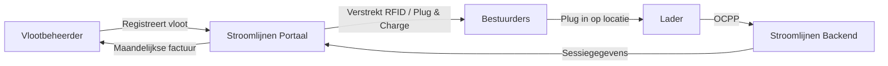

# Wat is Stroomlijnen?

Stroomlijnen B.V. is een Nederlandse **Charge Point Operator (CPO)** en **e-Mobility Service Provider (eMSP)** die laadinfrastructuur voor elektrische voertuigen bouwt en exploiteert bij **theaters** en **logistieke locaties** door heel Nederland.

## Wat We Doen

We installeren, exploiteren en onderhouden hoogvermogen laadstations die specifiek zijn ontworpen voor **elektrische vrachtwagens en bedrijfsvoertuigen**. Onze laders staan op locaties met grote bestaande netaansluitingen — voornamelijk theaters, evenementenlocaties en logistieke hubs.

### Waarom Theaters?

Theaters beschikken over iets wat de meeste locaties niet hebben: **enorme elektriciteitsaansluitingen** (vaak 400–2000 kVA) die overdag onbenut zijn. Voorstellingen zijn 's avonds. Vrachtwagens laden overdag. De infrastructuur is er al — wij zetten hem aan het werk.

### Onze eMSP-identiteit

We opereren onder de **NL\*STM** eMSP-identiteit in het Nederlandse en Europese laadnetwerk. Dat betekent:

- Uw bestuurders kunnen onze RFID-passen of Plug & Charge gebruiken bij **elke** openbare lader in Nederland en Europa (via roaming)
- Klanten van andere eMSP's kunnen laden op onze locaties
- Volledige interoperabiliteit via het OCPI-protocol

## Hoe Vlootladen Werkt

1. **Registreer** uw vloot op het Stroomlijnen-portaal
2. **Configureer** uw voertuigen — RFID-passen, Plug & Charge, of beide
3. **Bestuurders laden** op elke Stroomlijnen-locatie (of bij roamingpartner)
4. **U ontvangt** gedetailleerde sessiegegevens, energierapportages en één maandelijkse factuur

## Belangrijkste Functies

| Functie | Omschrijving |
|---------|-------------|
| **Plug & Charge** | ISO 15118 automatische authenticatie — geen pas nodig |
| **RFID-passen** | Traditioneel kaartgebaseerd laden met NL*STM-identiteit |
| **Vlootportaal** | Realtime sessiegegevens, voertuigbeheer, facturering |
| **Slim laden** | Taakverdeling voor optimale energiekosten en netimpact |
| **OCPP 2.0.1** | Nieuwste protocolstandaard voor laderbeheer |
| **Roaming** | Laden op 300.000+ punten door heel Europa via OCPI |

## Wat Staat Er in Deze Kennisbank?

Deze site bevat alles wat u moet weten:

- **[Aan de slag](/docs/getting-started/first-session)** — Uw eerste laadsessie
- **[Plug & Charge](/docs/plug-and-charge/what-is-pnc)** — De toekomst van moeiteloos laden
- **[Vlootbeheer](/docs/fleet-management/overview)** — Uw laadvloot beheren
- **[Technisch](/docs/technical/ocpp-overview)** — Diepgaand inzicht in de technologie
- **[FAQ](/docs/faq)** — Veelgestelde vragen beantwoord

:::tip The Show Must Go On
Onze slogan is niet zomaar marketing. Het weerspiegelt onze toewijding: als uw vloot moet laden, **moet** de infrastructuur er klaar voor zijn. Betrouwbaarheid op theaterniveau betekent voorbereid zijn op elk scenario.
:::
