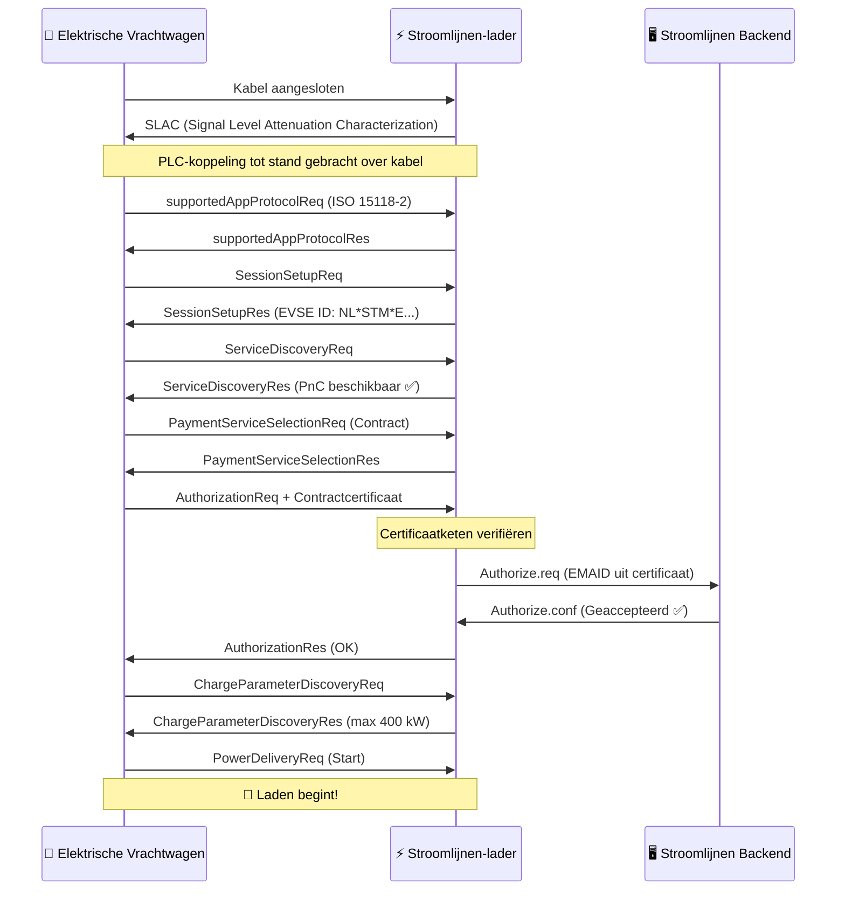

# Hoe Plug & Charge Werkt

Plug & Charge (PnC) vervangt fysieke tokens (RFID-passen, apps) door **cryptografische certificaten** die in het voertuig zijn ingebouwd. Wanneer een PnC-compatibele vrachtwagen aansluit op een PnC-compatibele lader, voeren ze een digitale handshake uit — waarbij ze identiteit verifiëren, de sessie autoriseren en energiestroom starten — alles binnen enkele seconden.

## Het Protocol: ISO 15118

ISO 15118 is de internationale standaard die definieert hoe elektrische voertuigen communiceren met laadstations via de laadkabel. Het gaat veel verder dan eenvoudige energielevering:

- **ISO 15118-2** — De breed inzetbare versie voor AC- en DC-laden met PnC-ondersteuning
- **ISO 15118-20** — De volgende generatie, met bidirectionele energieoverdracht (V2G) en verbeterde certificaatverwerking
- **ISO 15118-3** — Fysieke laag en datalinklaag (PLC-communicatie over de kabel)

Stroomlijnen-laders ondersteunen nu ISO 15118-2, met ISO 15118-20-gereedheid ingebouwd in onze hardware.

## De Certificaatketen

PnC-beveiliging steunt op een **Public Key Infrastructure (PKI)** — dezelfde technologie die internetbankieren en HTTPS-websites beveiligt. Dit is de hiërarchie:

```
V2G Root CA (bijv. Hubject)
├── CPO Sub-CA (Stroomlijnen)
│   └── EVSE-bladcertificaat (individuele lader)
└── eMSP Sub-CA (Stroomlijnen / roamingpartner)
    └── Contractcertificaat (geïnstalleerd in uw vrachtwagen)
```

Elk certificaat is ondertekend door het bovenliggende, waardoor een **vertrouwensketen** ontstaat die zowel het voertuig als de lader onafhankelijk kunnen verifiëren.

## De Handshake — Stap voor Stap



### Wat Er in Gewone Taal Gebeurt

1. **Fysieke verbinding** — De bestuurder steekt de CCS-kabel in
2. **Communicatiekoppeling** — De vrachtwagen en lader leggen een datakoppeling via de kabel via Power Line Communication (PLC)
3. **Protocolonderhandeling** — Ze spreken af ISO 15118-2 te gebruiken
4. **Identiteitsuitwisseling** — De vrachtwagen presenteert zijn **contractcertificaat**, dat de EMAID (e-Mobility Account Identifier) bevat die hem koppelt aan een factureringsaccount
5. **Certificaatverificatie** — De lader valideert de certificaatketen tot aan de vertrouwde root CA
6. **Backendautorisatie** — De lader controleert bij de Stroomlijnen-backend of deze EMAID geldig is en een actief contract heeft
7. **Laadparameters** — Ze onderhandelen over vermogensniveaus (spanning, stroom, maximaal vermogen)
8. **Energie stroomt** — Laden start automatisch

Het hele proces duurt **3–8 seconden** vanaf het insteken tot de stroomlevering.

## Kernconcepten

### Contractcertificaat

Een digitaal certificaat geïnstalleerd in de boordcomputer van het voertuig. Het bevat:

- **EMAID** — Uw unieke e-Mobility Account Identifier (bijv. `NL-STM-C00001234-5`)
- **Publieke sleutel** — Gebruikt voor TLS-authenticatie
- **Geldigheidsperiode** — Doorgaans 1–2 jaar
- **Uitgever** — De eMSP (Stroomlijnen of roamingpartner)

De vrachtwagen slaat dit certificaat veilig op en presenteert het automatisch bij elke PnC-compatibele lader.

### EVSE-certificaat

Het eigen certificaat van de lader, waarmee bewezen wordt dat het een legitiem Stroomlijnen-laadpunt is. Dit voorkomt dat malafide laders inloggegevens onderscheppen.

### Certificate Provisioning Service (CPS)

Het systeem dat contractcertificaten in voertuigen installeert en bijwerkt. Wanneer u een vrachtwagen registreert in het Stroomlijnen-portaal, zal de CPS:

1. Een contractcertificaat genereren voor dat voertuig
2. Het via de backend van de OEM naar het voertuig pushen (Volvo Connect, DAF Connect, enz.)
3. Het voertuig slaat het op in zijn beveiligde element

### Hubject

Het **vertrouwensanker** voor PnC in Europa. Hubject beheert de V2G Root CA en de certificatenpool die cross-operatorcompatibiliteit mogelijk maakt. Wanneer een Stroomlijnen-lader een vrachtwagen tegenkomt met een certificaat van een andere eMSP, valideert de infrastructuur van Hubject de keten.

## Beveiliging

PnC is **veiliger** dan RFID-passen:

| Aspect | RFID | Plug & Charge |
|--------|------|---------------|
| Authenticatie | Statisch token (kan worden gekloond) | TLS wederzijdse authenticatie |
| Versleuteling | Geen | AES-256 via PLC |
| Identiteitskoppeling | Pas ↔ account (los) | Certificaat ↔ voertuig-VIN (sterk) |
| Intrekking | Moet pas fysiek innemen | Certificaat op afstand intrekken |
| Frauderisico | Pasdiefstal/-kloning | Uiterst moeilijk (hardwarebeveiligingsmodule) |

## Vereisten

Voor Plug & Charge zijn drie zaken noodzakelijk:

1. **Voertuigondersteuning** — De vrachtwagen moet ISO 15118-PnC-mogelijkheid hebben en een geldig contractcertificaat geïnstalleerd hebben
2. **Laderondersteuning** — De EVSE moet ISO 15118-2 met PnC ondersteunen (alle Stroomlijnen DC-laders doen dit)
3. **Backendintegratie** — De eMSP en CPO moeten verbonden zijn via het certificaatecosysteem (Hubject)

## Wat Volgt: Vehicle-to-Grid (V2G)

ISO 15118-20 breidt PnC uit met bidirectionele energieoverdracht. Een vloot elektrische vrachtwagens die 's nachts bij een theater parkeert zou kunnen:

- Laden wanneer elektriciteit het goedkoopst is (daluren / hoog zonne-aanbod)
- Energie terug aan het net leveren tijdens piekvraag
- Inkomsten genereren voor de vlootbeheerder

De hardware van Stroomlijnen is V2G-klaar. Zodra vrachtwagen-OEM's ISO 15118-20 inschakelen, activeren wij bidirectioneel laden op onze locaties.

---

**Volgende:** [Compatibele Voertuigen →](./compatible-vehicles)
