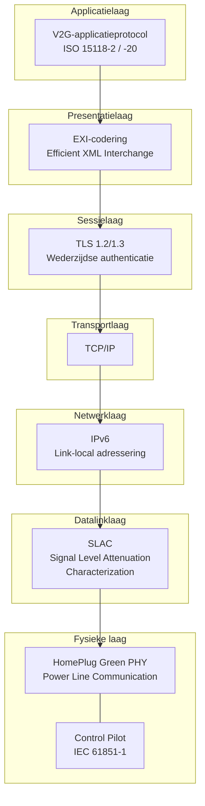
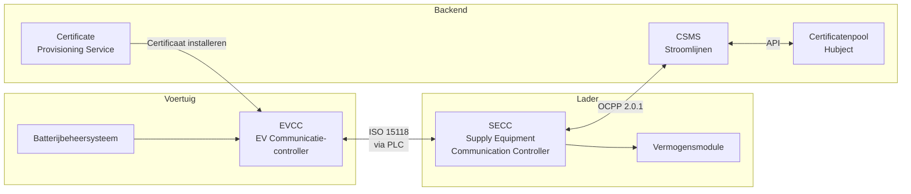
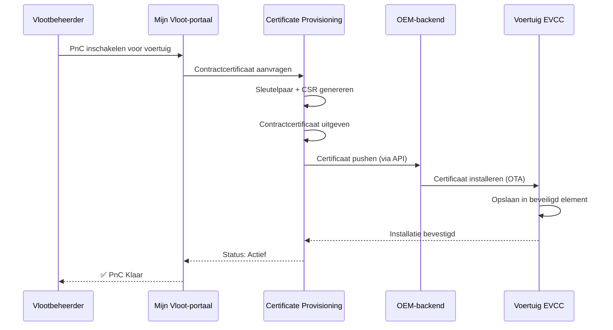

# ISO 15118 Verdieping

ISO 15118 is de internationale standaard voor "Vehicle-to-Grid Communication Interface." Het definieert hoe elektrische voertuigen en laadstations via de laadkabel communiceren, wat Plug & Charge, slim laden en uiteindelijk bidirectionele energieoverdracht mogelijk maakt.

## Standaardstructuur

| Deel | Titel | Relevantie |
|------|-------|-----------|
| ISO 15118-1 | Algemene informatie en gebruiksscenario-definitie | Kader en concepten |
| ISO 15118-2 | Netwerk- en applicatieprotocol (AC/DC) | **Momenteel ingezet** — PnC, slim laden |
| ISO 15118-3 | Fysieke en datalinklaag (PLC) | Powerline-communicatie via kabel |
| ISO 15118-4 | Netwerk- en applicatieprotocol conformiteitstest | Testprocedures |
| ISO 15118-5 | Fysieke en datalinklaag conformiteitstest | Testprocedures |
| ISO 15118-20 | 2e generatie netwerk- en applicatieprotocol | **Volgende generatie** — V2G, verbeterde PnC, ACDP |
| ISO 15118-8 | Fysieke en datalinklaag (draadloos) | Draadloze laadcommunicatie |

## Communicatiestack

### Laagindeling

**Fysieke laag — Power Line Communication (PLC)**
Communicatie vindt direct via de laadkabel plaats via HomePlug Green PHY (HPGP), een powerline-communicatiestandaard die werkt op frequenties tussen 2–30 MHz. Er is geen aparte datakabel nodig.

Het Control Pilot (CP)-signaal van IEC 61851-1 biedt basissignalering (kabel aangesloten, stroomcapaciteit) en triggert de hogere ISO 15118-communicatie.

**Datalinklaag — SLAC**
Signal Level Attenuation Characterization bepaalt welk voertuig is verbonden met welke lader. Op een parkeerplaats met meerdere laders zorgt SLAC ervoor dat uw vrachtwagen communiceert met de juiste lader, niet de lader in de naastgelegen opstelling.

**Netwerk — IPv6**
Zodra de PLC-koppeling tot stand is gebracht, wordt een IPv6 link-local netwerk aangemaakt tussen voertuig en lader. De lader voert een lichte DHCP/SDP (Service Discovery Protocol) uit waarmee het voertuig het eindpunt van de laaddienst kan vinden.

**Transport/Sessie — TLS**
Alle ISO 15118-2 PnC-communicatie is versleuteld met TLS. Zowel voertuig als lader presenteren certificaten voor wederzijdse authenticatie. Dit is de kernbeveiligingslaag.

**Presentatie — EXI**
Berichten worden gecodeerd in EXI (Efficient XML Interchange) — een compact binair formaat dat veel kleiner is dan XML-tekst. Dit is belangrijk omdat de PLC-bandbreedte beperkt is (~10 Mbps theoretisch, lager in de praktijk).

**Applicatie — V2G-protocol**
De werkelijke laadberichten: sessieconfiguratie, authenticatie, ontdekking laadparameters, vermogenslevering, meting en sessieafsluiting.

## Kernentiteiten

- **EVCC (EV Communication Controller)** — Het ISO 15118-brein van het voertuig. Verwerkt TLS, presenteert certificaten, vraagt energie aan.
- **SECC (Supply Equipment Communication Controller)** — Het ISO 15118-brein van de lader. Valideert certificaten, communiceert met de backend, beheert vermogenslevering.
- **Certificate Provisioning Service** — Installeert contractcertificaten in voertuigen (via OEM-backends).
- **Certificatenpool (Hubject)** — Cross-operator certificaatvertrouwen. Wanneer een voertuig van een andere eMSP laadt bij Stroomlijnen, overbrugt Hubject het vertrouwen.

## Certificaatbeheer

### Certificaattypen

| Certificaat | Doel | Geïnstalleerd in | Uitgegeven door |
|-------------|-----|-------------|-----------|
| V2G Root CA | Vertrouwensanker | Lader + Voertuig | Hubject / V2G PKI-beheerder |
| CPO Sub-CA | CPO-identiteit | CSMS | V2G Root CA |
| EVSE-certificaat | Laderidentiteit | Lader (SECC) | CPO Sub-CA |
| MO Root CA | eMSP-vertrouwensanker | Lader | Hubject |
| Contractcertificaat | Voertuig-/accountidentiteit | Voertuig (EVCC) | eMSP Sub-CA |

### Certificaatlevenscyclus

### Certificaatrotatie
Certificaten hebben een beperkte geldigheid (doorgaans 2 jaar). Ons systeem:
1. Bewaakt vervaldatums van alle vlootcertificaten
2. Stuurt meldingen 60, 30 en 7 dagen voor het verlopen
3. Genereert automatisch vernieuwingscertificaten
4. Pusht ze via hetzelfde OEM-kanaal
5. Het oude certificaat blijft geldig totdat het nieuwe is geïnstalleerd

## ISO 15118-20: Wat Is Nieuw

ISO 15118-20 is de volgende generatie, met toevoegingen:

### Bidirectionele Energieoverdracht (V2G/V2H)
- Voertuigen kunnen energie terug leveren aan het net of gebouw
- Vereist aanvullende veiligheids- en besturingsberichten
- Inkomstenpotentieel voor vlootbeheerders

### Automated Connection Device Protocol (ACDP)
- Ondersteunt geautomatiseerd/robotisch laden (geen menselijk insteken nodig)
- Relevant voor autonome vrachtwagens en depotladen

### Verbeterd Certificaatbeheer
- Efficiëntere installatie- en updateprocedures voor certificaten
- Ondersteuning voor meerdere contractcertificaten (eenvoudigere multi-provider roaming)

### DC Bidirectioneel (DC BPT)
- Bidirectioneel DC-laadprotocol
- Hogervermogen V2G dan AC bidirectioneel

### Gemultiplexte Communicatie
- Meerdere voertuigen kunnen een enkel communicatiekanaal delen (relevant voor pantograaf-/railladensystemen)

## Stroomlijnen & ISO 15118

Onze implementatie:

- **Huidig:** ISO 15118-2 op alle DC-laders — volledige Plug & Charge-ondersteuning
- **Hardware-klaar:** Onze laders hebben ISO 15118-20 geschikte communicatiemodules
- **V2G-voorbereid:** Vermogenselektronica ondersteunt bidirectionele stroom (firmware-activering in afwachting van OEM-gereedheid)
- **Hubject-verbonden:** Volledige integratie met de Europese V2G PKI

## Voor Ontwikkelaars

Als u integreert met de infrastructuur van Stroomlijnen op ISO 15118-niveau (laderfabrikanten, CSMS-ontwikkelaars), neem contact op via [technical@stroomlijnen.nl](mailto:technical@stroomlijnen.nl) voor:

- SECC-integratiespecificaties
- OCPP 2.0.1 ↔ ISO 15118-mappingdocumentatie
- Certificate provisioning API-documentatie
- Toegang tot de interoperabiliteitstestomgeving
