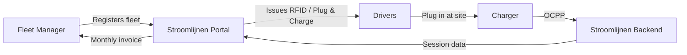

# What is Stroomlijnen?

Stroomlijnen B.V. is a Dutch **Charge Point Operator (CPO)** and **e-Mobility Service Provider (eMSP)** that builds and operates electric vehicle charging infrastructure at **theaters** and **logistics sites** across the Netherlands.

## What We Do

We install, operate, and maintain high-power charging stations specifically designed for **electric trucks and commercial vehicles**. Our chargers are located at sites with large existing grid connections — primarily theaters, event venues, and logistics hubs.

### Why Theaters?

Theaters have something most locations don't: **massive electrical grid connections** (often 400–2000 kVA) that sit idle during the day. Shows run in the evening. Trucks charge during the day. The infrastructure is already there — we put it to work.

### Our eMSP Identity

We operate under the **NL\*STM** eMSP identity in the Dutch and European charging network. This means:

- Your drivers can use our RFID cards or Plug & Charge at **any** public charger in the Netherlands and Europe (via roaming)
- Other eMSP customers can charge at our locations
- Full interoperability through the OCPI protocol

## How Fleet Charging Works

1. **Register** your fleet on the Stroomlijnen portal
2. **Configure** your vehicles — RFID cards, Plug & Charge, or both
3. **Drivers charge** at any Stroomlijnen location (or roaming partner)
4. **You get** detailed session data, energy reports, and a single monthly invoice

## Key Features

| Feature | Description |
|---------|-------------|
| **Plug & Charge** | ISO 15118 automatic authentication — no card needed |
| **RFID Cards** | Traditional card-based charging with NL*STM identity |
| **Fleet Portal** | Real-time session data, vehicle management, invoicing |
| **Smart Charging** | Load balancing to optimize energy costs and grid impact |
| **OCPP 2.0.1** | Latest protocol standard for charger management |
| **Roaming** | Charge at 300,000+ points across Europe via OCPI |

## What's in This Knowledge Base

This site covers everything you need to know:

- **[Getting Started](/docs/getting-started/first-session)** — Your first charging session
- **[Plug & Charge](/docs/plug-and-charge/what-is-pnc)** — The future of effortless charging
- **[Fleet Management](/docs/fleet-management/overview)** — Managing your charging fleet
- **[Technical](/docs/technical/ocpp-overview)** — Deep dives into the technology
- **[FAQ](/docs/faq)** — Common questions answered

:::tip The Show Must Go On
Our tagline isn't just marketing. It reflects our commitment: when your fleet needs to charge, the infrastructure **must** be ready. Theater-grade reliability means planning for every scenario.
:::
