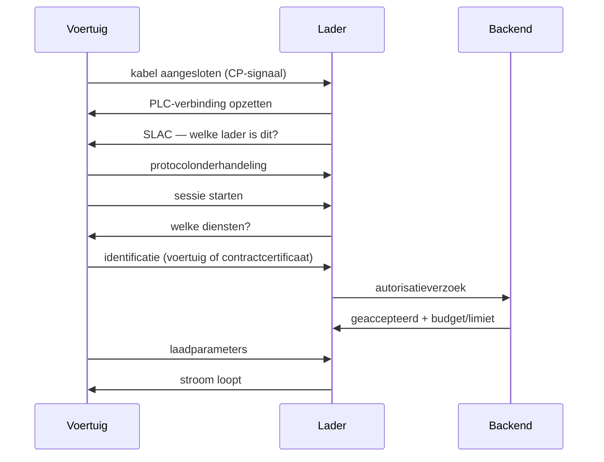

# Hoe Plug & Charge technisch werkt

Deze pagina legt uit wat er gebeurt tussen inpluggen en stroom. Voor de diepere protocoluitleg: zie [ISO 15118 verdieping](/docs/technical/iso-15118).

## Eerst: de kabel doet meer dan stroom

Een CCS-stekker heeft naast de stroompennen twee hulpcontacten. Via de **Control Pilot** (CP) meldt het voertuig dat het is aangesloten en hoeveel stroom het aankan. Bij DC-laden komt daar **Power Line Communication (PLC)** bij: data over dezelfde aders als de stroom.

Die datalaag is wat Plug & Charge mogelijk maakt. Zonder PLC geen gesprek, en dus geen automatische identificatie.

## De volgorde

In gewone taal:

1. **Aansluiten** — chauffeur plugt in.
2. **Koppelen** — via PLC ontstaat een dataverbinding; SLAC bepaalt met welke lader wordt gepraat.
3. **Onderhandelen** — voertuig en lader spreken af welke protocolversie ze gebruiken.
4. **Identificeren** — het voertuig maakt zich bekend. Bij ons met een voertuigidentiteit; bij de certificaatvariant met een contractcertificaat.
5. **Autoriseren** — de lader vraagt de backend: mag dit, en binnen welk budget?
6. **Parameters** — er wordt afgesproken hoeveel vermogen er mag vloeien. Hier komt ook de EMS-limiet binnen.
7. **Laden** — stroom gaat lopen; meterwaarden worden doorgegeven.

## Waar het meestal misgaat

Uit de praktijk, in volgorde van frequentie:

| Fout | Oorzaak | Wat te doen |
|---|---|---|
| Geen identificatie | Voertuig niet bekend bij de laadpartner | Voertuig registreren |
| Terugval op pas/QR | PLC-verbinding of protocolonderhandeling mislukt | Kabel opnieuw aansluiten, contacten controleren |
| Autorisatie geweigerd | Voertuig geblokkeerd, budget op, of verkeerde koppeling | Account controleren |
| Sessie stopt direct | Accu te warm/koud, of BMS weigert | Zie [Probleemoplossing](/docs/plug-and-charge/troubleshooting) |
| Herstart na sessie-einde | Kabel bleef zitten na einde sessie | Kabel eruit en opnieuw in |

## De rol van de backend

De lader beslist niet zelf of u mag laden. Hij vraagt het. Dat betekent dat de **backend** bepaalt:

- of dit voertuig of contract mag laden
- welk tarief en welk budget gelden
- welke limiet er nu geldt (van het EMS)
- of een sessie moet stoppen

En dat de lader moet blijven werken als die backend even niet bereikbaar is. Bij ons staat de aansturing op locatie, in het bastion bij de lader, niet in een datacenter. Valt de cloud weg, dan blijven lopende sessies doorlopen en worden gegevens later verwerkt.

## Waarom "gewoon inpluggen" zo lastig is

Wie dit leest denkt al snel: dit is toch simpel? Het lastige zit niet in het protocol maar in de **afspraken**:

- Wie geeft een voertuig het recht om te laden? Dat is een contract, met een factuuradres.
- Wie mag dat contract intrekken? De partij die het heeft uitgegeven.
- Hoe weet lader A dat een certificaat van partij B te vertrouwen is? Via een keten van vertrouwen die veel partijen samen moeten onderhouden.
- Wie betaalt de roamingkosten als iemand van netwerk B bij netwerk A laadt?

Dat is de reden dat Plug & Charge in theorie overal zou moeten werken en in de praktijk per combinatie van netwerk, fabrikant en land verschilt.

## Verder lezen

- [Wat is Plug & Charge?](/docs/plug-and-charge/what-is-pnc)
- [ISO 15118 verdieping](/docs/technical/iso-15118)
- [Compatibiliteit](/docs/plug-and-charge/compatible-vehicles)
