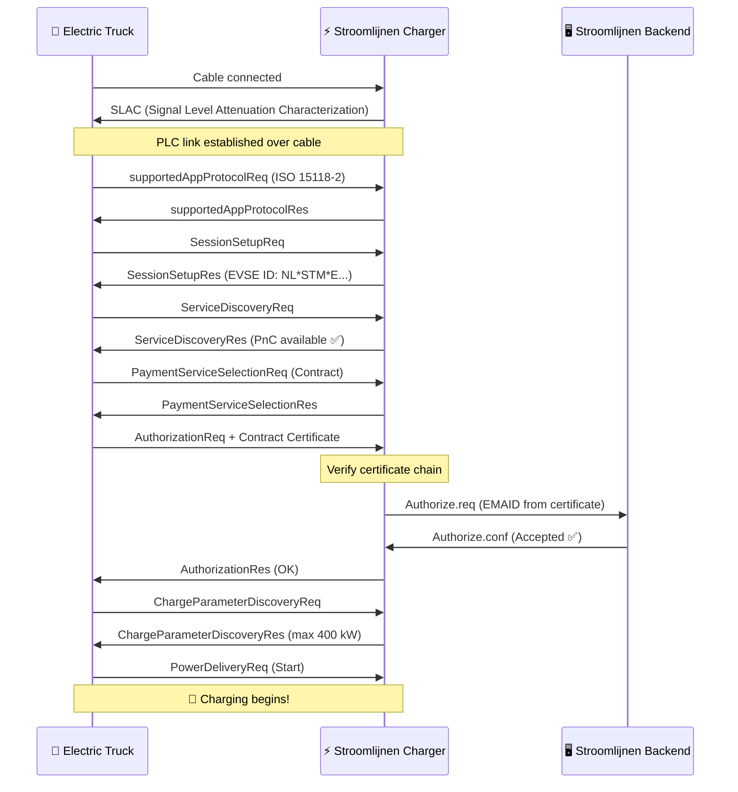

# How Plug & Charge Works

Plug & Charge (PnC) replaces physical tokens (RFID cards, apps) with **cryptographic certificates** embedded in the vehicle. When a PnC-enabled truck plugs into a PnC-enabled charger, they perform a digital handshake — verifying identity, authorizing the session, and starting energy flow — all within seconds.

## The Protocol: ISO 15118

ISO 15118 is the international standard that defines how electric vehicles communicate with charging stations over the charging cable. It goes far beyond simple power delivery:

- **ISO 15118-2** — The widely deployed version covering AC and DC charging with PnC support
- **ISO 15118-20** — The next generation, adding bidirectional power transfer (V2G) and improved certificate handling
- **ISO 15118-3** — Physical and data link layer (PLC communication over the cable)

Stroomlijnen chargers support ISO 15118-2 today, with ISO 15118-20 readiness built into our hardware.

## The Certificate Chain

PnC security relies on a **Public Key Infrastructure (PKI)** — the same technology that secures online banking and HTTPS websites. Here's the hierarchy:

```
V2G Root CA (e.g., Hubject)
├── CPO Sub-CA (Stroomlijnen)
│   └── EVSE Leaf Certificate (individual charger)
└── eMSP Sub-CA (Stroomlijnen / roaming partner)
    └── Contract Certificate (installed in your truck)
```

Each certificate is signed by the one above it, creating a **chain of trust** that both the vehicle and the charger can verify independently.

## The Handshake — Step by Step



### What Happens in Plain English

1. **Physical connection** — The driver plugs in the CCS cable
2. **Communication link** — The truck and charger establish a data link over the cable using Power Line Communication (PLC)
3. **Protocol negotiation** — They agree to use ISO 15118-2
4. **Identity exchange** — The truck presents its **contract certificate**, which contains the EMAID (e-Mobility Account Identifier) linking it to a billing account
5. **Certificate verification** — The charger validates the certificate chain up to the trusted root CA
6. **Backend authorization** — The charger checks with the Stroomlijnen backend that this EMAID is valid and has an active contract
7. **Charging parameters** — They negotiate power levels (voltage, current, max power)
8. **Energy flows** — Charging starts automatically

The entire process takes **3–8 seconds** from plug-in to power flow.

## Key Concepts

### Contract Certificate

A digital certificate installed in the vehicle's onboard computer. It contains:

- **EMAID** — Your unique e-Mobility Account Identifier (e.g., `NL-STM-C00001234-5`)
- **Public key** — Used for TLS authentication
- **Validity period** — Typically 1–2 years
- **Issuer** — The eMSP (Stroomlijnen or roaming partner)

The truck stores this certificate securely and presents it automatically at every PnC-enabled charger.

### EVSE Certificate

The charger's own certificate, proving it's a legitimate Stroomlijnen charge point. This prevents rogue chargers from intercepting credentials.

### Certificate Provisioning Service (CPS)

The system that installs and updates contract certificates in vehicles. When you register a truck in the Stroomlijnen portal, the CPS:

1. Generates a contract certificate for that vehicle
2. Pushes it to the vehicle via the OEM's backend (Volvo Connect, DAF Connect, etc.)
3. The vehicle stores it in its secure element

### Hubject

The **trust anchor** for PnC in Europe. Hubject operates the V2G Root CA and the certificate pool that enables cross-operator compatibility. When a Stroomlijnen charger encounters a truck with a certificate from another eMSP, Hubject's infrastructure validates the chain.

## Security

PnC is **more secure** than RFID cards:

| Aspect | RFID | Plug & Charge |
|--------|------|---------------|
| Authentication | Static token (can be cloned) | TLS mutual authentication |
| Encryption | None | AES-256 over PLC |
| Identity binding | Card ↔ account (loose) | Certificate ↔ vehicle VIN (strong) |
| Revocation | Must physically collect card | Remote certificate revocation |
| Fraud risk | Card theft/cloning | Extremely difficult (hardware security module) |

## Requirements

For Plug & Charge to work, three things must align:

1. **Vehicle support** — The truck must have ISO 15118 PnC capability and a valid contract certificate installed
2. **Charger support** — The EVSE must support ISO 15118-2 with PnC (all Stroomlijnen DC chargers do)
3. **Backend integration** — The eMSP and CPO must be connected through the certificate ecosystem (Hubject)

## What's Next: Vehicle-to-Grid (V2G)

ISO 15118-20 extends PnC with bidirectional power transfer. A fleet of electric trucks parked overnight at a theater could:

- Charge when electricity is cheapest (off-peak / high solar)
- Discharge back to the grid during peak demand
- Earn revenue for the fleet operator

Stroomlijnen's hardware is V2G-ready. As truck OEMs enable ISO 15118-20, we'll activate bidirectional charging at our sites.

---

**Next:** [Compatible Vehicles →](./compatible-vehicles)
