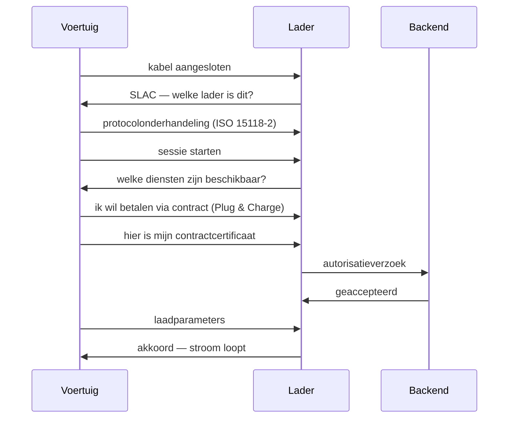

# ISO 15118 verdieping

**ISO 15118** is de internationale standaard voor communicatie tussen een elektrisch voertuig en een laadstation via de laadkabel. Het is wat Plug & Charge mogelijk maakt: het voertuig kan zich identificeren zonder pas of app.

## De delen van de standaard

| Deel | Onderwerp | Relevantie |
|---|---|---|
| **ISO 15118-1** | Terminologie en gebruiksscenario's | Begrippenkader |
| **ISO 15118-2** | Netwerk- en applicatieprotocol (AC/DC) | **Hier zit Plug & Charge** |
| **ISO 15118-3** | Fysieke en datalinklaag | Powerline-communicatie over de kabel |
| **ISO 15118-4/5** | Conformiteitstests | Hoe je vaststelt of iets echt werkt |
| **ISO 15118-8** | Draadloze variant | Voor inductief laden |
| **ISO 15118-20** | Tweede generatie | Bidirectioneel laden, verbeterd certificaatbeheer |

## De communicatiestack

```
Applicatie    │ ISO 15118-2 / -20 berichten (SessionSetup, Authorize, …)
Presentatie   │ EXI (compacte binaire XML-codering)
Sessie        │ TLS (afhankelijk van protocol en authenticatiemethode)
Transport     │ TCP/IP
Netwerk       │ IPv6 link-local
Datalink      │ SLAC (welk voertuig hoort bij welke lader)
Fysiek        │ HomePlug Green PHY (PLC) + Control Pilot (IEC 61851-1)
```

Een paar lagen verdienen uitleg:

**PLC (Power Line Communication)** — HomePlug Green PHY draagt de communicatie via het Control Pilot-pad van de laadkabel, niet via de DC-vermogensaders. Er is geen aparte externe datakabel nodig. De bandbreedte is beperkt (enkele Mbps in de praktijk), daarom wordt er compact gecodeerd.

**SLAC (Signal Level Attenuation Characterization)** — bepaalt welk voertuig met welke lader praat. Op een parkeerplaats met tien laders is dat niet triviaal: zonder SLAC kan een auto met de verkeerde lader gaan onderhandelen.

**EXI** — een binaire vorm van XML, nodig omdat de PLC-verbinding smal is.

**TLS** — beschermt de communicatie. De controle van het contractcertificaat is onderdeel van de Plug & Charge-authenticatie; dit is niet hetzelfde als MAC-gebaseerde herkenning.

## Certificaten: wie vertrouwt wie

Bij de **certificaatvariant** van Plug & Charge draait alles om een keten van vertrouwen:

```
V2G Root CA (vertrouwensanker)
├── CPO Sub-CA            → certificaat van de lader (EVSE)
└── eMSP Sub-CA           → contractcertificaat in het voertuig
```

- Het **contractcertificaat** in het voertuig bevat een identificatie (in OCPI-termen een **EMAID**) die het voertuig aan een factureringsaccount koppelt.
- Het **EVSE-certificaat** bewijst dat de lader echt bij die operator hoort — zodat een voertuig niet met een nagemaakte lader praat.
- De **root** is het ankerpunt. In Europa wordt dat in de praktijk beheerd door één of enkele partijen; daarom is "cross-operator" Plug & Charge afhankelijk van afspraken tussen veel partijen.

Het lastige deel is niet de handshake, maar de **provisioning**: hoe komt dat certificaat in het voertuig? Dat loopt via de fabrikant, en iedere fabrikant heeft daar zijn eigen proces en tempo voor. Dat is de reden dat Plug & Charge in de praktijk vaak "per merk" werkt in plaats van overal.

## Wat er gebeurt bij het inpluggen



Dit schema toont vereenvoudigd een geslaagde certificaatgebaseerde sessie, niet de Stroomlijnen-aanmeldprocedure. Beschikbare alternatieven en de duur hangen af van de implementatie en de autorisatie.

## Wat wij vandaag doen — en wat nog niet

**Vandaag:** de huidige herkenning op ondersteunde DC-laders gebruikt **EVCCID: het MAC-adres van de voertuigcommunicatiecontroller**. Dit is niet het VIN en geen authenticatie met een ISO 15118-contractcertificaat. Een MAC-adres is een identifier, geen cryptografisch bewijs van een contract of voertuigidentiteit.

De chauffeur meldt het voertuig aan op het laadscherm met een accountgebonden pas. De kaartlezer moet eerst met de knop worden geactiveerd. Huurgegevens en kentekencontrole kunnen afhankelijk van de configuratie volgen. Pas bij de aansluitinstructie wordt het voertuig aangesloten; na uitlezen legt de lader de EVCCID automatisch vast. Een VIN in het portaal invoeren vervangt dit niet. Zie [Instellen](/docs/plug-and-charge/setup-guide).

**Aanmelden is geen goedkeuring:** na vastleggen is afzonderlijke toestemming van de accounthouder nodig. De totale aanmeldtijd is 5 minuten vanaf Begin; het uitlezen duurt maximaal 3 minuten binnen de resterende totale tijd. Die tijdslimieten zijn geen garantie voor een laadstart.

**De certificaatvariant:** de uitleg en het schema hierboven beschrijven contractcertificaten, niet de huidige MAC-gebaseerde herkenning. Zij bewijzen niet dat certificaatauthenticatie op uw lader beschikbaar is. Ook met certificaten werkt automatisch laden alleen waar voertuig, lader, vertrouwensketen en contractautorisatie bij elkaar passen — niet vanzelf bij iedere operator.

## ISO 15118-20: wat er komt

- **Bidirectioneel laden** (V2G/V2H) — het voertuig kan terugleveren aan gebouw of net
- **ACDP** — geautomatiseerd aansluiten (robotisch/inductief), relevant voor depots
- **Beter certificaatbeheer** — meerdere contractcertificaten naast elkaar
- **DC bidirectioneel** — hogere vermogens dan via AC

Bidirectioneel laden is veelbelovend, maar het vereist dat zowel het voertuig als de lader het ondersteunen én dat de netbeheerder en de veiligheidsregels het toestaan. Wij positioneren het als **toekomstige** functionaliteit, niet als iets wat vandaag kan.

## Verder lezen

- [Plug & Charge](/docs/plug-and-charge/what-is-pnc)
- [Hoe Plug & Charge werkt](/docs/plug-and-charge/how-it-works)
- [OCPP-overzicht](/docs/technical/ocpp-overview)
