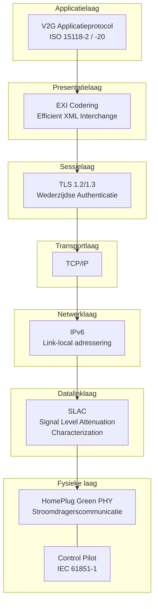
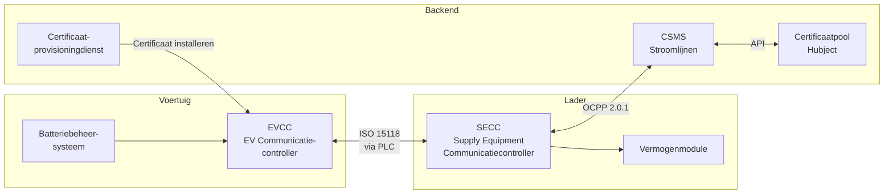
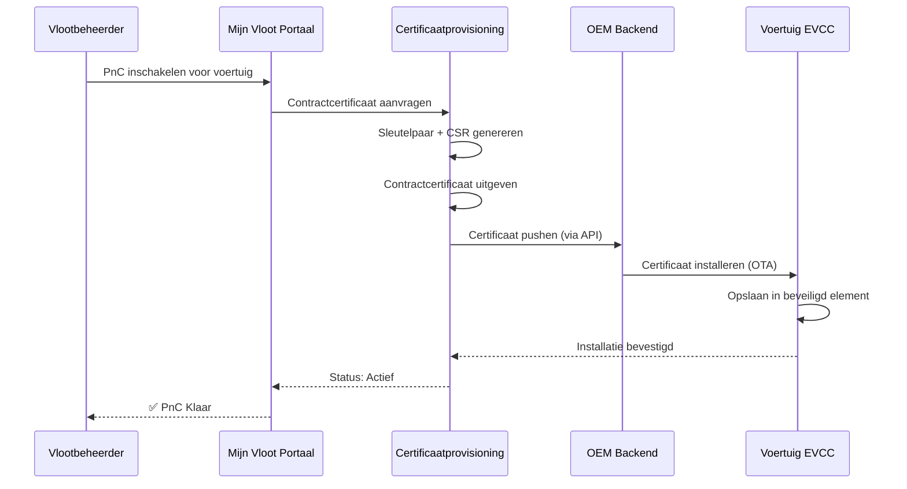

# ISO 15118 Verdieping

ISO 15118 is de internationale standaard voor "Vehicle-to-Grid Communication Interface." Het definieert hoe elektrische voertuigen en laadstations communiceren via de laadkabel, wat Plug & Charge, slim laden en uiteindelijk bidirectionele energieoverdracht mogelijk maakt.

## Structuur van de Standaard

| Deel | Titel | Relevantie |
|------|-------|-----------|
| ISO 15118-1 | Algemene informatie en gebruiksscenario's | Kader en concepten |
| ISO 15118-2 | Netwerk- en applicatieprotocol (AC/DC) | **Momenteel ingezet** — PnC, slim laden |
| ISO 15118-3 | Fysieke en datalinklaag (PLC) | Stroomdragerscommunicatie via kabel |
| ISO 15118-4 | Conformiteitstest netwerk- en applicatieprotocol | Testprocedures |
| ISO 15118-5 | Conformiteitstest fysieke en datalinklaag | Testprocedures |
| ISO 15118-20 | 2e gen. netwerk- en applicatieprotocol | **Volgende generatie** — V2G, verbeterde PnC, ACDP |
| ISO 15118-8 | Fysieke en datalinklaag (draadloos) | Draadloze laadcommunicatie |

## Communicatiestack

### Laagbeschrijving

**Fysieke laag — Stroomdragerscommunicatie (PLC)**
Communicatie verloopt rechtstreeks via de laadkabel met HomePlug Green PHY (HPGP), een stroomdragerscommunicatiestandaard die werkt op frequenties tussen 2–30 MHz. Er is geen aparte datakabel nodig.

Het Control Pilot (CP)-signaal van IEC 61851-1 verzorgt basissignalering (kabel aangesloten, stroomcapaciteit) en activeert de hogere ISO 15118-communicatie.

**Datalinklaag — SLAC**
Signal Level Attenuation Characterization bepaalt welk voertuig verbonden is met welke lader. Op een parkeerterrein met meerdere laders zorgt SLAC ervoor dat uw vrachtwagen communiceert met de juiste lader, en niet met die in de naastgelegen ruimte.

**Netwerklaag — IPv6**
Zodra de PLC-verbinding tot stand is gebracht, wordt een IPv6-link-local-netwerk gecreëerd tussen voertuig en lader. De lader gebruikt een lichtgewicht DHCP/SDP (Service Discovery Protocol) om het voertuig het laadservice-eindpunt te laten vinden.

**Transport/Sessielaag — TLS**
Alle ISO 15118-2 PnC-communicatie is versleuteld met TLS. Zowel het voertuig als de lader presenteren certificaten voor wederzijdse authenticatie. Dit is de kern beveiligingslaag.

**Presentatielaag — EXI**
Berichten worden gecodeerd in EXI (Efficient XML Interchange) — een compact binair formaat dat veel kleiner is dan XML-tekst. Dit is belangrijk omdat de PLC-bandbreedte beperkt is (~10 Mbps theoretisch, lager in de praktijk).

**Applicatielaag — V2G-protocol**
De daadwerkelijke laadberichten: sessiestart, authenticatie, onderhandeling over laadparameters, vermogenslevering, meting en sessieafsluiting.

## Kernentiteiten

- **EVCC (EV Communication Controller)** — Het ISO 15118-brein van het voertuig. Verwerkt TLS, presenteert certificaten, vraagt energie aan.
- **SECC (Supply Equipment Communication Controller)** — Het ISO 15118-brein van de lader. Valideert certificaten, communiceert met de backend, beheert vermogenslevering.
- **Certificaatprovisioningdienst** — Installeert contractcertificaten in voertuigen (via OEM-backends).
- **Certificaatpool (Hubject)** — Cross-operator certificaatvertrouwen. Wanneer een voertuig van een andere eMSP bij Stroomlijnen laadt, verbindt de infrastructuur van Hubject het vertrouwen.

## Certificaatbeheer

### Certificaattypen

| Certificaat | Doel | Geïnstalleerd In | Uitgegeven Door |
|-------------|------|-----------------|----------------|
| V2G Root CA | Vertrouwensanker | Lader + Voertuig | Hubject / V2G PKI-operator |
| CPO Sub-CA | CPO-identiteit | CSMS | V2G Root CA |
| EVSE-certificaat | Laderidentiteit | Lader (SECC) | CPO Sub-CA |
| MO Root CA | eMSP-vertrouwensanker | Lader | Hubject |
| Contractcertificaat | Voertuig-/accountidentiteit | Voertuig (EVCC) | eMSP Sub-CA |

### Levenscyclus Certificaten

### Certificaatvernieuwing
Certificaten hebben een beperkte geldigheid (doorgaans 2 jaar). Ons systeem:
1. Bewaakt vervaldatums van alle vlootcertificaten
2. Stuurt meldingen op 60, 30 en 7 dagen voor vervaldatum
3. Genereert automatisch vernieuwingscertificaten
4. Pusht deze via hetzelfde OEM-kanaal
5. Het oude certificaat blijft geldig totdat het nieuwe is geïnstalleerd

## ISO 15118-20: Wat Is Nieuw

ISO 15118-20 is de volgende generatie, met de volgende toevoegingen:

### Bidirectionele Energieoverdracht (V2G/V2H)
- Voertuigen kunnen energie terugleveren aan het net of gebouw
- Vereist aanvullende beveiligings- en besturingsberichten
- Inkomstenpotentieel voor vlootbeheerders

### Automated Connection Device Protocol (ACDP)
- Ondersteunt geautomatiseerd/robotisch laden (geen handmatig insteken)
- Relevant voor autonome vrachtwagens en depotsnel laden

### Verbeterd Certificaatbeheer
- Efficiëntere certificaatinstallatie- en updateprocedures
- Ondersteuning voor meerdere contractcertificaten (eenvoudiger multi-provider roaming)

### DC Bidirectioneel (DC BPT)
- Bidirectioneel DC-laadprotocol
- Hogervermogen V2G dan bidirectioneel AC

### Gemultiplexte Communicatie
- Meerdere voertuigen kunnen een enkel communicatiekanaal delen (relevant voor pantograaf-/railsladen)

## Stroomlijnen & ISO 15118

Onze implementatie:

- **Huidig:** ISO 15118-2 op alle DC-laders — volledige Plug & Charge-ondersteuning
- **Hardwareklaar:** Onze laders beschikken over ISO 15118-20-capabele communicatiemodules
- **V2G voorbereid:** Vermogelektronica ondersteunt bidirectionele stroom (firmware-activering wacht op OEM-gereedheid)
- **Hubject aangesloten:** Volledige integratie met de Europese V2G PKI

## Voor Ontwikkelaars

Als u integreert met de infrastructuur van Stroomlijnen op ISO 15118-niveau (laderfabrikanten, CSMS-ontwikkelaars), neem contact op via [technical@stroomlijnen.nl](mailto:technical@stroomlijnen.nl) voor:

- SECC-integratiespecificaties
- OCPP 2.0.1 ↔ ISO 15118-koppelingsdocumentatie
- Documentatie voor certificaatprovisioning-API
- Toegang tot de interoperabiliteitstestomgeving
