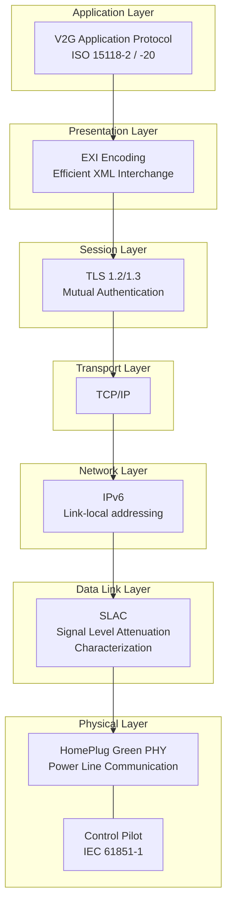
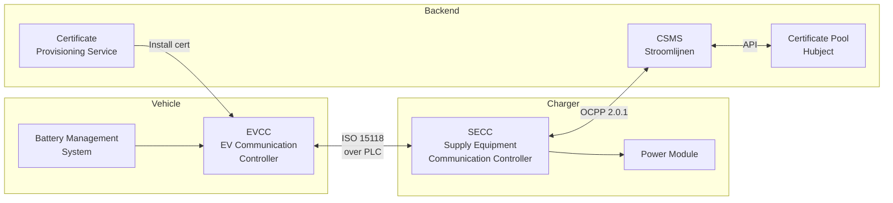
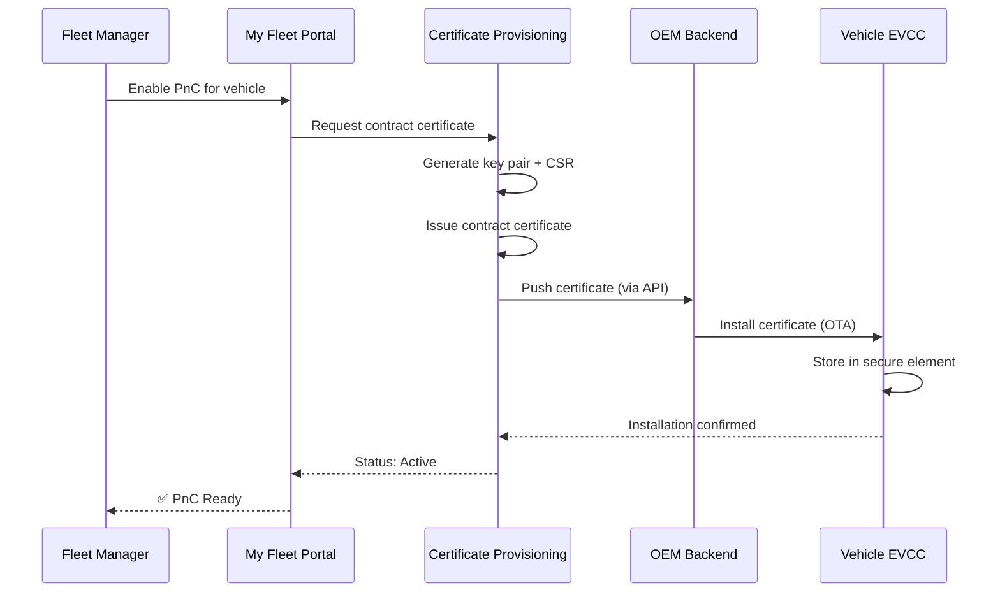

# ISO 15118 Deep Dive

ISO 15118 is the international standard for "Vehicle-to-Grid Communication Interface." It defines how electric vehicles and charging stations communicate over the charging cable, enabling Plug & Charge, smart charging, and eventually bidirectional energy transfer.

## Standard Structure

| Part | Title | Relevance |
|------|-------|-----------|
| ISO 15118-1 | General information and use case definition | Framework and concepts |
| ISO 15118-2 | Network and application protocol (AC/DC) | **Currently deployed** — PnC, smart charging |
| ISO 15118-3 | Physical and data link layer (PLC) | Powerline communication over cable |
| ISO 15118-4 | Network and application protocol conformance test | Testing procedures |
| ISO 15118-5 | Physical and data link layer conformance test | Testing procedures |
| ISO 15118-20 | 2nd gen network and application protocol | **Next gen** — V2G, improved PnC, ACDP |
| ISO 15118-8 | Physical and data link layer (wireless) | Wireless charging communication |

## Communication Stack

### Layer Breakdown

**Physical Layer — Power Line Communication (PLC)**
Communication happens directly over the charging cable using HomePlug Green PHY (HPGP), a powerline communication standard operating at frequencies between 2–30 MHz. No separate data cable is needed.

The Control Pilot (CP) signal from IEC 61851-1 provides basic signaling (cable connected, current capacity) and triggers the higher-layer ISO 15118 communication.

**Data Link — SLAC**
Signal Level Attenuation Characterization establishes which vehicle is connected to which charger. In a parking lot with multiple chargers, SLAC ensures your truck talks to the correct charger, not the one in the next bay.

**Network — IPv6**
Once the PLC link is established, an IPv6 link-local network is created between vehicle and charger. The charger runs a lightweight DHCP/SDP (Service Discovery Protocol) to let the vehicle find the charging service endpoint.

**Transport/Session — TLS**
All ISO 15118-2 PnC communication is encrypted with TLS. Both vehicle and charger present certificates for mutual authentication. This is the core security layer.

**Presentation — EXI**
Messages are encoded in EXI (Efficient XML Interchange) — a compact binary format that's much smaller than XML text. This is important because PLC bandwidth is limited (~10 Mbps theoretical, lower in practice).

**Application — V2G Protocol**
The actual charging messages: session setup, authentication, charge parameter discovery, power delivery control, metering, and session teardown.

## Key Entities

- **EVCC (EV Communication Controller)** — The vehicle's ISO 15118 brain. Handles TLS, presents certificates, requests energy.
- **SECC (Supply Equipment Communication Controller)** — The charger's ISO 15118 brain. Validates certificates, communicates with backend, controls power delivery.
- **Certificate Provisioning Service** — Installs contract certificates in vehicles (via OEM backends).
- **Certificate Pool (Hubject)** — Cross-operator certificate trust. When a vehicle from another eMSP charges at Stroomlijnen, Hubject bridges the trust.

## Certificate Management

### Certificate Types

| Certificate | Purpose | Installed In | Issued By |
|-------------|---------|-------------|-----------|
| V2G Root CA | Trust anchor | Charger + Vehicle | Hubject / V2G PKI operator |
| CPO Sub-CA | CPO identity | CSMS | V2G Root CA |
| EVSE Certificate | Charger identity | Charger (SECC) | CPO Sub-CA |
| MO Root CA | eMSP trust anchor | Charger | Hubject |
| Contract Certificate | Vehicle/account identity | Vehicle (EVCC) | eMSP Sub-CA |

### Certificate Lifecycle

### Certificate Rotation
Certificates have a limited validity (typically 2 years). Our system:
1. Monitors expiry dates for all fleet certificates
2. Sends notifications at 60, 30, and 7 days before expiry
3. Automatically generates renewal certificates
4. Pushes them through the same OEM channel
5. The old certificate remains valid until the new one is installed

## ISO 15118-20: What's New

ISO 15118-20 is the next generation, adding:

### Bidirectional Power Transfer (V2G/V2H)
- Vehicles can feed energy back to the grid or building
- Requires additional safety and control messages
- Revenue potential for fleet operators

### Automated Connection Device Protocol (ACDP)
- Supports automated/robotic charging (no human plugging in)
- Relevant for autonomous trucks and depot charging

### Improved Certificate Handling
- More efficient certificate installation and update procedures
- Support for multiple contract certificates (easier multi-provider roaming)

### DC Bidirectional (DC BPT)
- Bidirectional DC charging protocol
- Higher power V2G than AC bidirectional

### Multiplexed Communication
- Multiple vehicles can share a single communication channel (relevant for pantograph/rail charging)

## Stroomlijnen & ISO 15118

Our implementation:

- **Current:** ISO 15118-2 on all DC chargers — full Plug & Charge support
- **Hardware ready:** Our chargers have ISO 15118-20 capable communication modules
- **V2G prepared:** Power electronics support bidirectional flow (firmware activation pending OEM readiness)
- **Hubject connected:** Full integration with the European V2G PKI

## For Developers

If you're integrating with Stroomlijnen's infrastructure at the ISO 15118 level (charger manufacturers, CSMS developers), contact [technical@stroomlijnen.nu](mailto:technical@stroomlijnen.nu) for:

- SECC integration specifications
- OCPP 2.0.1 ↔ ISO 15118 mapping documentation
- Certificate provisioning API documentation
- Interoperability testing environment access
