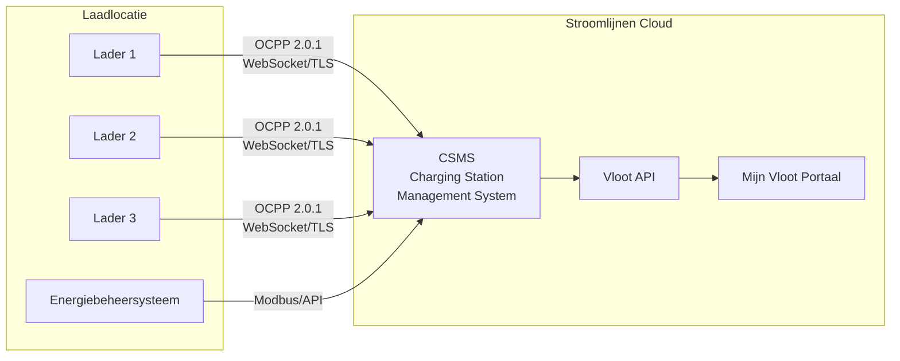

# OCPP Overzicht

**OCPP (Open Charge Point Protocol)** is het industriestandaard communicatieprotocol tussen laadstations en een centraal beheersysteem. Stroomlijnen gebruikt OCPP om al onze laders op afstand te beheren, monitoren en aansturen.

## Wat is OCPP?

OCPP bepaalt hoe een laadstation (Charge Point) communiceert met een Charging Station Management System (CSMS — dat zijn wij). Het omvat:

- **Autorisatie** — Controleren of een gebruiker/voertuig mag laden
- **Sessiebeheer** — Laadsessies starten, bewaken en stoppen
- **Meting** — Energieverbruik in realtime rapporteren
- **Bediening op afstand** — Sessies op afstand starten/stoppen, vermogen aanpassen, laders herstarten
- **Diagnostiek** — Firmware-updates, logopvraging, statusmonitoring
- **Slim laden** — Dynamisch vermogensbeheer over meerdere laders

## OCPP-versies

| Versie | Status bij Stroomlijnen | Kernfuncties |
|--------|------------------------|--------------|
| OCPP 1.6-J | ✅ Ondersteund | JSON/WebSocket, slimme laadprofielen, breed ingezet |
| OCPP 2.0.1 | ✅ Voorkeur | ISO 15118-integratie, apparaatmodel, verbeterde beveiliging, transactieverwerking |

### Waarom OCPP 2.0.1 Belangrijk Is

OCPP 2.0.1 is een significante upgrade ten opzichte van 1.6, met name voor vlootladen:

- **ISO 15118-integratie** — Native ondersteuning voor Plug & Charge-certificaatbeheer via OCPP
- **Verbeterde beveiliging** — Veilige firmware-updates, ondertekende meterwaarden, TLS verplicht
- **Apparaatmodel** — Gestandaardiseerde manier om laderkenmerken en -configuratie op te vragen
- **Transactieverwerking** — Betere afhandeling van complexe transacties (voorautorisatie, parkeren, energie)
- **Slim laden** — Nauwkeurigere controle over laadprofielen en vermogensverdeling
- **Displayberichten** — Eigen berichten sturen naar het scherm van de lader

Alle nieuwe Stroomlijnen-laders worden ingezet met OCPP 2.0.1. Bestaande 1.6-J-laders blijven werken en worden geüpgraded wanneer de hardware dit ondersteunt.

## Architectuur

### Communicatiestroom

1. **Lader → CSMS:** De lader maakt verbinding met ons CSMS via een beveiligde WebSocket-verbinding (wss://)
2. **Heartbeats:** Laders sturen periodieke heartbeats om te bevestigen dat ze online zijn
3. **Autorisatie:** Wanneer een gebruiker een RFID-pas tikt of een PnC-certificaat presenteert, stuurt de lader een autorisatieverzoek naar ons CSMS
4. **Meting:** Tijdens het laden worden meterwaarden (energie, vermogen, SoC) met regelmatige tussenpozen verstuurd
5. **Opdrachten op afstand:** Ons CSMS kan opdrachten sturen naar laders (start, stop, reset, firmware-update)

## Slim Laden

De slimme laadmogelijkheden van OCPP zijn essentieel voor locaties met beperkte netcapaciteit:

### Laadprofielen
We stellen laadprofielen in die elke lader vertellen hoeveel vermogen hij op een bepaald moment mag gebruiken:

- **TxDefaultProfile** — Standaard vermogenslimiet voor elke transactie
- **TxProfile** — Vermogensaanpassing per transactie
- **ChargingStationMaxProfile** — Totale vermogenslimiet voor de locatie

### Taakverdeling
Wanneer meerdere vrachtwagens gelijktijdig laden en de locatie beperkte netcapaciteit heeft:

1. Ons energiebeheersysteem monitort de totale locatiebelasting (via Modbus/API)
2. CSMS berekent beschikbaar vermogen per lader
3. Laadprofielen worden dynamisch bijgewerkt via OCPP
4. Vermogen wordt eerlijk verdeeld of op basis van prioriteit (conform vlootinstellingen)

Voorbeeld: Een locatie met 600 kW netcapaciteit en 3 laders van elk 350 kW:
- 1 vrachtwagen laadt → krijgt tot 350 kW
- 2 vrachtwagens laden → 300 kW elk
- 3 vrachtwagens laden → 200 kW elk
- Tijdens piekuren op het net → verder verlaagd om binnen de gecontracteerde capaciteit te blijven

### Gepland Laden
Vlootbeheerders kunnen vertrektijden en gewenste SoC instellen. Ons systeem optimaliseert wanneer geladen wordt:
- Stelt de start uit totdat elektriciteit het goedkoopst is
- Zorgt dat de gewenste SoC bereikt is voor de vertrektijd
- Verdeelt de belasting over alle voertuigen op de locatie

## Beveiliging

OCPP 2.0.1-beveiligingsfuncties die wij implementeren:

- **TLS 1.3** — Alle OCPP-verbindingen zijn versleuteld
- **Clientcertificaten** — Laders authenticeren naar ons CSMS met certificaten
- **Ondertekende meterwaarden** — Manipulatiebestendige energiemetingen
- **Veilige firmware-updates** — Cryptografisch ondertekende firmware-images
- **Toegangscontrole** — Fysieke en netwerktoegangsrestricties op elke locatie

## Voor Hardwarepartners

Als u een laderfabrikant of installateur bent die met Stroomlijnen samenwerkt:

- Wij vereisen **OCPP 2.0.1**-conformiteit (1.6-J geaccepteerd voor bestaande voorraad)
- Laders moeten **ISO 15118-2** PnC ondersteunen
- TLS 1.2+ is verplicht
- Wij verstrekken CSMS-eindpunten en inloggegevens tijdens het onboardingproces
- Interoperabiliteitstesten zijn vereist voor inzet

Neem contact op via [technical@stroomlijnen.nl](mailto:technical@stroomlijnen.nl) voor integratiedocumentatie.
