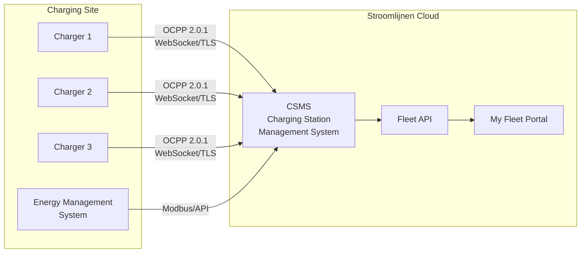

# OCPP Overview

**OCPP (Open Charge Point Protocol)** is the industry-standard communication protocol between charging stations and a central management system. Stroomlijnen uses OCPP to remotely manage, monitor, and control all our chargers.

## What is OCPP?

OCPP defines how a charging station (Charge Point) talks to a Charging Station Management System (CSMS — that's us). It covers:

- **Authorization** — Checking if a user/vehicle is allowed to charge
- **Session management** — Starting, monitoring, and stopping charging sessions
- **Metering** — Reporting energy consumption in real time
- **Remote control** — Remotely starting/stopping sessions, adjusting power, rebooting chargers
- **Diagnostics** — Firmware updates, log retrieval, health monitoring
- **Smart charging** — Dynamic power management across multiple chargers

## OCPP Versions

| Version | Status at Stroomlijnen | Key Features |
|---------|----------------------|--------------|
| OCPP 1.6-J | ✅ Supported | JSON/WebSocket, smart charging profiles, widely deployed |
| OCPP 2.0.1 | ✅ Preferred | ISO 15118 integration, device model, improved security, transaction handling |

### Why OCPP 2.0.1 Matters

OCPP 2.0.1 is a significant upgrade from 1.6, especially for fleet charging:

- **ISO 15118 integration** — Native support for Plug & Charge certificate management through OCPP
- **Improved security** — Secure firmware updates, signed meter values, TLS mandatory
- **Device model** — Standardized way to query charger capabilities and configuration
- **Transaction handling** — Better handling of complex transactions (pre-authorization, parking, energy)
- **Smart charging** — More granular control over charging profiles and power allocation
- **Display messages** — Send custom messages to the charger's screen

All new Stroomlijnen chargers are deployed with OCPP 2.0.1. Existing 1.6-J chargers continue to work and are upgraded when hardware supports it.

## Architecture

### Communication Flow

1. **Charger → CSMS:** The charger connects to our CSMS via a secure WebSocket (wss://) connection
2. **Heartbeats:** Chargers send periodic heartbeats to confirm they're online
3. **Authorization:** When a user presents an RFID card or PnC certificate, the charger sends an authorization request to our CSMS
4. **Metering:** During charging, meter values (energy, power, SoC) are sent at regular intervals
5. **Remote commands:** Our CSMS can send commands to chargers (start, stop, reset, update firmware)

## Smart Charging

OCPP's smart charging capabilities are essential for sites with limited grid capacity:

### Charging Profiles
We set charging profiles that tell each charger how much power it can draw at any given time:

- **TxDefaultProfile** — Default power limit for any transaction
- **TxProfile** — Per-transaction power adjustment
- **ChargingStationMaxProfile** — Overall site power limit

### Load Balancing
When multiple trucks charge simultaneously and the site has limited grid capacity:

1. Our EMS monitors total site load (via Modbus/API)
2. CSMS calculates available capacity per charger
3. Charging profiles are dynamically updated via OCPP
4. Power is distributed fairly or by priority (based on fleet settings)

Example: A site with 600 kW grid capacity and 3 chargers rated at 350 kW each:
- 1 truck charging → gets up to 350 kW
- 2 trucks charging → 300 kW each
- 3 trucks charging → 200 kW each
- During peak grid hours → further reduced to stay within contracted capacity

### Scheduled Charging
Fleet managers can set departure times and target SoC. Our system optimizes when to charge:
- Delays start until electricity is cheapest
- Ensures target SoC is reached by departure time
- Balances across all vehicles at the site

## Security

OCPP 2.0.1 security features we implement:

- **TLS 1.3** — All OCPP connections are encrypted
- **Client certificates** — Chargers authenticate to our CSMS with certificates
- **Signed meter values** — Tamper-evident energy measurements
- **Secure firmware updates** — Cryptographically signed firmware images
- **Access control** — Physical and network access restrictions at each site

## For Hardware Partners

If you're a charger manufacturer or installer working with Stroomlijnen:

- We require **OCPP 2.0.1** compliance (1.6-J accepted for existing inventory)
- Chargers must support **ISO 15118-2** PnC
- TLS 1.2+ is mandatory
- We provide CSMS endpoints and credentials during the onboarding process
- Interoperability testing is required before deployment

Contact [technical@stroomlijnen.nu](mailto:technical@stroomlijnen.nu) for integration documentation.
