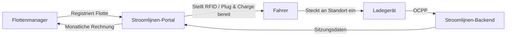

# Was ist Stroomlijnen?

Stroomlijnen B.V. ist ein niederländischer **Charge Point Operator (CPO)** und **e-Mobility Service Provider (eMSP)**, der Ladeinfrastrukturen für Elektrofahrzeuge an **Theatern** und **Logistikstandorten** in ganz Nederland baut und betreibt.

## Was Wir Tun

Wir installieren, betreiben und warten Hochleistungs-Ladestationen, die speziell für **elektrische Lkw und Nutzfahrzeuge** konzipiert sind. Unsere Ladegeräte stehen an Standorten mit großen bestehenden Netzanschlüssen — hauptsächlich Theatern, Veranstaltungsorten und Logistikzentren.

### Warum Theaters?

Theater verfügen über etwas, das die meisten Standorte nicht haben: **enorme Stromanschlüsse** (oft 400-2000 kVA), die tagsüber ungenutzt sind. Vorstellungen finden abends statt. Lkw laden tagsüber. Die Infrastruktur ist bereits vorhanden — wir setzen sie ein.

### Unsere eMSP-Identität

Wir operieren unter der **NL\*STM**-eMSP-Identität im niederländischen und europäischen Ladennetzwerk. Das bedeutet:

- Ihre Fahrer können unsere RFID-Pässe oder Plug & Charge an **jedem** öffentlichen Ladegerät in den Niederlanden und Europa (über Roaming) verwenden
- Kunden anderer eMSPs können an unseren Standorten laden
- Volle Interoperabilität über das OCPI-Protokoll

## Wie Flottennachladung Funktioniert

1. **Registrieren** Sie Ihre Flotte im Stroomlijnen-Portal
2. **Konfigurieren** Sie Ihre Fahrzeuge — RFID-Pässe, Plug & Charge oder beides
3. **Fahrer laden** an jedem Stroomlijnen-Standort (oder bei Roaming-Partnern)
4. **Sie erhalten** detaillierte Sitzungsdaten, Energieberichte und eine monatliche Rechnung

## Hauptfunktionen

| Funktion | Beschreibung |
|---------|-------------|
| **Plug & Charge** | ISO 15118-Automatische Authentifizierung — kein Pass erforderlich |
| **RFID-Pässe** | Traditionelle kartengestützte Ladung mit NL\*STM-Identität |
| **Flottenportal** | Echtzeit-Sitzungsdaten, Fahrzeugverwaltung, Rechnungsstellung |
| **Intelligentes Laden** | Aufgabenverteilung für optimale Energiekosten und Netzauswirkungen |
| **OCPP 2.0.1** | Neuester Protokollstandard für Ladegeräteverwaltung |
| **Roaming** | Laden an 300.000+ Punkten in ganz Europa über OCPI |

## Was Enthält Diese Wissensdatenbank?

Diese Website enthält alles, was Sie wissen müssen:

- **[Erste Schritte](/docs/getting-started/first-session)** — Ihre erste Ladesitzung
- **[Plug & Charge](/docs/plug-and-charge/what-is-pnc)** — Die Zukunft des mühelosen Ladens
- **[Flottenverwaltung](/docs/fleet-management/overview)** — Verwalten Sie Ihre Lade-Flotte
- **[Technisch](/docs/technical/ocpp-overview)** — Tiefere Einblicke in die Technologie
- **[FAQ](/docs/faq)** — Häufig gestellte Fragen beantwortet

:::tip Die Show Muss Weitergehen
Unser Slogan ist nicht nur Marketing. Er spiegelt unsere Hingabe wider: Wenn Ihre Flotte laden muss, **muss** die Infrastruktur bereit sein. Zuverlässigkeit auf Theaterebene bedeutet, auf jedes Szenario vorbereitet zu sein.
:::