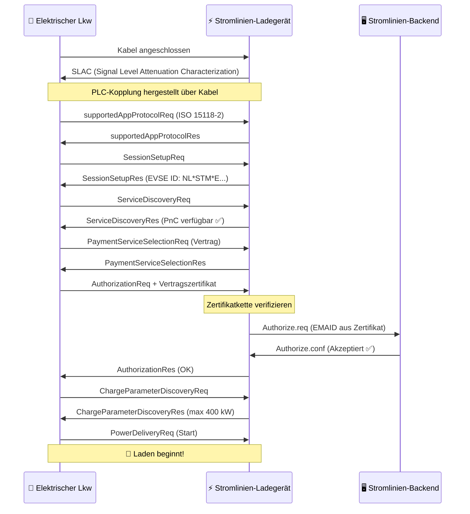

# Wie Plug & Charge Funktioniert

Plug & Charge (PnC) ersetzt physische Token (RFID-Pässe, Apps) durch **kryptografische Zertifikate**, die im Fahrzeug integriert sind. Wenn ein PnC-kompatibler Lkw an einen PnC-kompatiblen Ladegerät angeschlossen wird, führen sie eine digitale Handshake aus — bei der sie Identität verifizieren, die Sitzung autorisieren und Energiefluss starten — alles innerhalb von wenigen Sekunden.

## Das Protokoll: ISO 15118

ISO 15118 ist der internationale Standard, der definiert, wie elektrische Fahrzeuge mit Ladestationen über das Ladekabel kommunizieren. Es geht weit über die einfache Energieversorgung hinaus:

- **ISO 15118-2** — Die breit einsetzbare Version für AC- und DC-Laden mit PnC-Unterstützung
- **ISO 15118-20** — Die nächste Generation, mit bidirektionalem Energieaustausch (V2G) und verbesserter Zertifikatverarbeitung
- **ISO 15118-3** — Physische Schicht und Datenlink-Schicht (PLC-Kommunikation über das Kabel)

Stromlinien-Ladegeräte unterstützen nun ISO 15118-2, mit ISO 15118-20-Fähigkeit in unsere Hardware integriert.

## Die Zertifikatkette

PnC-Sicherheit basiert auf einer **Public Key Infrastructure (PKI)** — derselben Technologie, die Internetbanking und HTTPS-Websites sichert. Dies ist die Hierarchie:

```
V2G Root CA (z.B. Hubject)
├── CPO Sub-CA (Stromlinien)
│   └── EVSE-Blattzertifikat (individuelles Ladegerät)
└── eMSP Sub-CA (Stromlinien / Roamingpartner)
    └── Vertragszertifikat (installiert in Ihrem Lkw)
```

Jedes Zertifikat ist von dem übergeordneten unterzeichnet, wodurch eine **Vertrauenskette** entsteht, die sowohl das Fahrzeug als auch das Ladegerät unabhängig verifizieren können.

## Die Handshake — Schritt für Schritt



### Was in normaler Sprache passiert

1. **Physische Verbindung** — Der Fahrer steckt das CCS-Kabel ein
2. **Kommunikationskopplung** — Das Fahrzeug und das Ladegerät legen eine Datenkopplung über das Kabel via Power Line Communication (PLC) her
3. **Protokollverhandlung** — Sie sprechen sich auf ISO 15118-2 ein
4. **Identitätsaustausch** — Das Fahrzeug präsentiert sein **Vertragszertifikat**, das die EMAID (e-Mobility Account Identifier) enthält, die es mit einem Abrechnungskonto verknüpft
5. **Zertifikatsverifizierung** — Das Ladegerät validiert die Zertifikatkette bis zur vertrauenswürdigen Root CA
6. **Backend-Autorisierung** — Das Ladegerät überprüft bei der Stromlinien-Backend, ob diese EMAID gültig ist und ein aktiver Vertrag vorliegt
7. **Ladeparameter** — Sie verhandeln über Leistungsstufen (Spannung, Strom, maximale Leistung)
8. **Energiefluss** — Laden beginnt automatisch

Der gesamte Prozess dauert **3–8 Sekunden** von der Einsteckung bis zur Energieversorgung.

## Kernkonzepte

### Vertragszertifikat

Ein digitales Zertifikat, das in der Fahrzeug-Computer installiert ist. Es enthält:

- **EMAID** — Ihre eindeutige e-Mobility Account Identifier (z.B. `NL-STM-C00001234-5`)
- **Öffentlicher Schlüssel** — Verwendet für TLS-Authentifizierung
- **Gültigkeitsperiode** — In der Regel 1–2 Jahre
- **Aussteller** — Der eMSP (Stromlinien oder Roamingpartner)

Das Fahrzeug speichert dieses Zertifikat sicher und präsentiert es automatisch bei jedem PnC-kompatiblen Ladegerät.

### EVSE-Zertifikat

Das eigene Zertifikat des Ladegeräts, mit dem bewiesen wird, dass es ein legitimes Stromlinien-Ladepunkt ist. Dies verhindert, dass bösartige Ladegeräte Anmeldeinformationen abfangen.

### Certificate Provisioning Service (CPS)

Das System, das Vertragszertifikate in Fahrzeugen installiert und aktualisiert. Wenn Sie ein Fahrzeug im Stromlinien-Portal registrieren, generiert der CPS:

1. Ein Vertragszertifikat für dieses Fahrzeug
2. Es über die Backend des OEM an das Fahrzeug pushen (Volvo Connect, DAF Connect usw.)
3. Das Fahrzeug speichert es in seinem sicheren Element

### Hubject

Das **Vertrauensanker** für PnC in Europa. Hubject verwaltet die V2G Root CA und den Zertifikatpool, der Cross-Operator-Kompatibilität ermöglicht. Wenn ein Stromlinien-Ladegerät ein Fahrzeug mit einem Zertifikat eines anderen eMSP trifft, validiert die Infrastruktur von Hubject die Kette.

## Sicherheit

PnC ist **sicherer** als RFID-Pässe:

| Aspekt | RFID | Plug & Charge |
|--------|------|---------------|
| Authentifizierung | Statisches Token (kann geklont werden) | TLS-wechselseitige Authentifizierung |
| Verschlüsselung | Keine | AES-256 über PLC |
| Identitätsverknüpfung | Pas ↔ Konto (los) | Zertifikat ↔ Fahrzeug-VIN (stark) |
| Widerruf | Muss Pass physisch einziehen | Zertifikat auf Entfernung widerrufen |
| Betrugsrisiko | Passdiebstahl/-Kloning | Äußerst schwierig (Hardware-Sicherheitsmodul) |

## Anforderungen

Für Plug & Charge sind drei Dinge notwendig:

1. **Fahrzeugunterstützung** — Das Fahrzeug muss ISO 15118-PnC-Fähigkeit haben und ein gültiges Vertragszertifikat installiert haben
2. **Ladegeräteunterstützung** — Das EVSE muss ISO 15118-2 mit PnC unterstützen (alle Stromlinien-DC-Ladegeräte tun dies)
3. **Backend-Integration** — Der eMSP und CPO müssen über das Zertifikatecosystem (Hubject) verbunden sein

## Was kommt als Nächstes: Vehicle-to-Grid (V2G)

ISO 15118-20 erweitert PnC um bidirektionalen Energieaustausch. Eine Flotte elektrischer Lkws, die nachts bei einem Theater parkt, könnte:

- Laden, wenn Strom am billigsten ist (Talzeiten / hohes Sonnenangebot)
- Energie zurück ins Netz liefern, wenn Nachfrage hoch ist
- Einnahmen für den Flottenmanager generieren

Die Hardware von Stromlinien ist V2G-fähig. Sobald Lkw-Hersteller ISO 15118-20 aktivieren, aktivieren wir bidirektionales Laden an unseren Standorten.

---

**Weiter:** [Kompatible Fahrzeuge →](./compatible-vehicles)