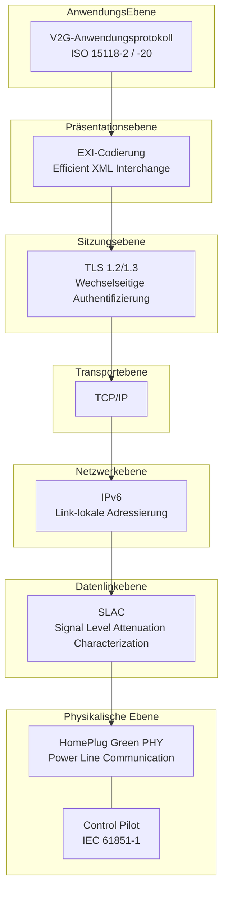
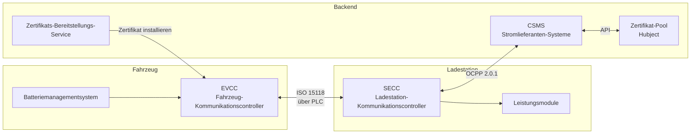
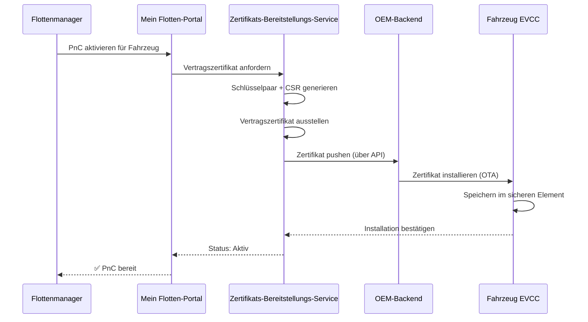

# ISO 15118 Vertiefung

ISO 15118 ist der internationale Standard für "Vehicle-to-Grid Communication Interface". Es definiert, wie elektrische Fahrzeuge und Ladestationen über das Ladekabel kommunizieren, was Plug & Charge, intelligentes Laden und letztendlich bidirektionale Energieübertragung ermöglicht.

## Standardstruktur

| Teil | Titel | Relevanz |
|------|-------|-----------|
| ISO 15118-1 | Allgemeine Informationen und Anwendungsszenarien | Rahmen und Konzepte |
| ISO 15118-2 | Netzwerk- und Anwendungsprotokoll (AC/DC) | **Aktuell eingesetzt** — PnC, intelligentes Laden |
| ISO 15118-3 | Physikalische und Datenlink-Ebene (PLC) | Powerline-Kommunikation über Kabel |
| ISO 15118-4 | Netzwerk- und Anwendungsprotokoll-Konformitätstest | Testverfahren |
| ISO 15118-5 | Physikalische und Datenlink-Ebene-Konformitätstest | Testverfahren |
| ISO 15118-20 | 2. Generation Netzwerk- und Anwendungsprotokoll | **Nächste Generation** — V2G, verbessertes PnC, ACDP |
| ISO 15118-8 | Physikalische und Datenlink-Ebene (drahtlos) | Drahtlose Ladekommunikation |

## Kommunikationsstack

### Schichtenübersicht

**Physikalische Ebene — Power Line Communication (PLC)**
Die Kommunikation findet direkt über das Ladekabel statt, indem HomePlug Green PHY (HPGP), ein Powerline-Kommunikationsstandard, der auf Frequenzen zwischen 2–30 MHz arbeitet, verwendet wird. Es ist keine separate Datenkabel erforderlich.

Das Control Pilot (CP)-Signal von IEC 61851-1 bietet Basis-Signalisierung (Kabel angeschlossen, Stromkapazität) und löst die höhere ISO 15118-Kommunikation aus.

**Datenlinkebene — SLAC**
Die Signal Level Attenuation Characterization bestimmt, welches Fahrzeug mit welcher Ladestation verbunden ist. Auf einem Parkplatz mit mehreren Ladestationen stellt SLAC sicher, dass Ihr LKW mit der richtigen Ladestation kommuniziert und nicht mit der in der Nachbarposition.

**Netzwerk — IPv6**
Sobald die PLC-Verbindung hergestellt ist, wird ein IPv6-Link-Local-Netzwerk zwischen Fahrzeug und Ladestation erstellt. Die Ladestation führt eine leichte DHCP/SDP (Service Discovery Protocol) aus, mit der das Fahrzeug den Endpunkt des Ladedienstes finden kann.

**Transport/Sitzung — TLS**
Alle ISO 15118-2-PnC-Kommunikationen sind verschlüsselt mit TLS. Sowohl das Fahrzeug als auch die Ladestation präsentieren Zertifikate für wechselseitige Authentifizierung. Dies ist die Kernsicherheitsebene.

**Präsentation — EXI**
Meldungen werden in EXI (Efficient XML Interchange) kodiert — ein kompaktes Binärformat, das viel kleiner als XML-Text ist. Dies ist wichtig, da die PLC-Bandbreite begrenzt ist (~10 Mbps theoretisch, niedriger in der Praxis).

**Anwendung — V2G-Protokoll**
Die eigentlichen Lademeldungen: Sitzungs-Konfiguration, Authentifizierung, Entdeckung von Lade-Parametern, Leistungs-Lieferung, Messung und Sitzungs-Schließung.

## Kernentitäten

- **EVCC (Fahrzeug-Kommunikationscontroller)** — Das ISO 15118-Gehirn des Fahrzeugs. Verarbeitet TLS, präsentiert Zertifikate, fordert Energie an.
- **SECC (Ladestation-Kommunikationscontroller)** — Das ISO 15118-Gehirn der Ladestation. Validiert Zertifikate, kommuniziert mit dem Backend, verwaltet Leistungs-Lieferung.
- **Zertifikats-Bereitstellungs-Service** — Installiert Vertragszertifikate in Fahrzeugen (über OEM-Backends).
- **Zertifikat-Pool (Hubject)** — Cross-Operator-Zertifikatsvertrauen. Wenn ein Fahrzeug von einem anderen eMSP bei Stromlieferanten lädt, überbrückt Hubject das Vertrauen.

## Zertifikatsmanagement

### Zertifikattypen

| Zertifikat | Zweck | Installiert in | Ausgestellt von |
|-------------|-----|-------------|-----------|
| V2G Root CA | Vertrauensanker | Ladestation + Fahrzeug | Hubject / V2G PKI-Verwalter |
| CPO Sub-CA | CPO-Identität | CSMS | V2G Root CA |
| EVSE-Zertifikat | Ladestation-Identität | Ladestation (SECC) | CPO Sub-CA |
| MO Root CA | eMSP-Vertrauensanker | Ladestation | Hubject |
| Vertragszertifikat | Fahrzeug-/Konto-Identität | Fahrzeug (EVCC) | eMSP Sub-CA |

### Zertifikats-Lebenszyklus

### Zertifikats-Rotation
Zertifikate haben eine begrenzte Gültigkeit (in der Regel 2 Jahre). Unser System:
1. Überwacht Ablaufdaten aller Flottenzertifikate
2. Sendet Benachrichtigungen 60, 30 und 7 Tage vor dem Ablauf
3. Generiert automatisch Verlängerungszertifikate
4. Pushed sie über das gleiche OEM-Kanal
5. Das alte Zertifikat bleibt gültig, bis das neue installiert ist

## ISO 15118-20: Was ist neu

ISO 15118-20 ist die nächste Generation, mit Ergänzungen:

### Bidirektionale Energieübertragung (V2G/V2H)
- Fahrzeuge können Energie an das Netz oder Gebäude zurückliefern
- Erfordert zusätzliche Sicherheits- und Steuerungs-Meldungen
- Ertragspotenzial für Flottenmanager

### Automatisiertes Verbindungsgatter-Protokoll (ACDP)
- Unterstützt automatisierte/robotische Ladung (kein menschliches Einstecken erforderlich)
- Relevant für autonome LKWs und Depot-Ladungen

### Verbessertes Zertifikatsmanagement
- Effizientere Installations- und Update-Verfahren für Zertifikate
- Unterstützung für mehrere Vertragszertifikate (einfachere Multi-Provider-Roaming)

### DC-Bidirektionale (DC BPT)
- Bidirektionales DC-Ladeprotokoll
- Höhere Leistung V2G als AC-bidirektional

### Gemultiplexte Kommunikation
- Mehrere Fahrzeuge können ein einzelnes Kommunikations-Kanal teilen (relevant für Pantographen-/Schienensysteme)

## Stromlieferanten & ISO 15118

Unsere Implementierung:

- **Aktuell:** ISO 15118-2 auf allen DC-Ladestationen — vollständige Plug & Charge-Unterstützung
- **Hardware-bereit:** Unsere Ladestationen haben ISO 15118-20 geeignete Kommunikationsmodule
- **V2G-vorbereitet:** Leistungselektronik unterstützt bidirektionale Ströme (Firmware-Aktivierung in Erwartung von OEM-Bereitschaft)
- **Hubject-verbunden:** Vollständige Integration mit der europäischen V2G PKI

## Für Entwickler

Wenn Sie die Infrastruktur von Stromlieferanten auf ISO 15118-Ebene integrieren (Ladestationshersteller, CSMS-Entwickler), kontaktieren Sie uns bitte über [technical@stromlieferanten.nl](mailto:technical@stromlieferanten.nl) für:

- SECC-Integrations-Spezifikationen
- OCPP 2.0.1 ↔ ISO 15118-Mapping-Dokumentation
- Zertifikats-Bereitstellungs-API-Dokumentation
- Zugriff auf die Interoperabilitätstest-Umgebung