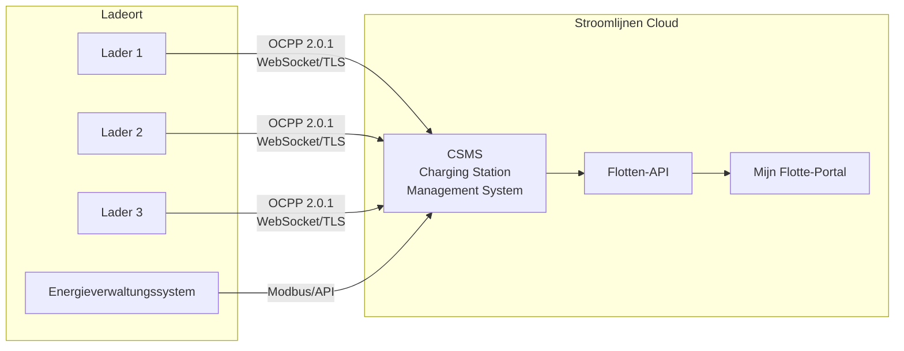

# OCPP Überblick

**OCPP (Open Charge Point Protocol)** ist das branchenübliche Kommunikationsprotokoll zwischen Ladestationen und einem zentralen Verwaltungssystem. Stroomlijnen verwendet OCPP, um alle unsere Lader ferngesteuert zu verwalten, zu überwachen und zu steuern.

## Was ist OCPP?

OCPP definiert, wie eine Ladestation (Charge Point) mit einem Charging Station Management System (CSMS — das sind wir) kommuniziert. Es umfasst:

- **Autorisierung** — Überprüfung, ob ein Benutzer/Fahrzeug laden darf
- **Sitzungsverwaltung** — Ladesitzungen starten, überwachen und stoppen
- **Messung** — Energieverbrauch in Echtzeit melden
- **Fernsteuerung** — Sitzungen ferngesteuert starten/stoppen, Leistung anpassen, Lader neu starten
- **Diagnose** — Firmware-Updates, Log-Anfragen, Gesundheitsüberwachung
- **Intelligentes Laden** — Dynamisches Leistungsmanagement über mehrere Lader

## OCPP-Versionen

| Version | Status bei Stroomlijnen | Kernfunktionen |
|---------|----------------------|--------------|
| OCPP 1.6-J | ✅ Unterstützt | JSON/WebSocket, intelligente Ladeprofile, breite Verwendung |
| OCPP 2.0.1 | ✅ Vorzug | ISO 15118-Integration, Gerätemodell, verbesserte Sicherheit, Transaktionsverarbeitung |

### Warum OCPP 2.0.1 wichtig ist

OCPP 2.0.1 ist eine wesentliche Aktualisierung von 1.6, insbesondere für Flottenladungen:

- **ISO 15118-Integration** — Integrierte Unterstützung für Plug & Charge-Zertifikatsverwaltung über OCPP
- **Verbesserte Sicherheit** — Sichere Firmware-Updates, signierte Zählerwerte, TLS erforderlich
- **Gerätemodell** — Standardisierte Methode zum Abrufen von Laderfunktionen und -konfiguration
- **Transaktionsverarbeitung** — Bessere Verarbeitung komplexer Transaktionen (Vorautorisierung, Parken, Energie)
- **Intelligentes Laden** — Detailliertere Kontrolle über Ladeprofile und Leistungsverteilung
- **Anzeigemeldungen** — Anpassbare Meldungen an das Display des Laders senden

Alle neuen Stroomlijnen-Lader werden mit OCPP 2.0.1 eingesetzt. Bestehende 1.6-J-Lader bleiben funktionsfähig und werden aktualisiert, wenn die Hardware dies unterstützt.

## Architektur

### Kommunikationsfluss

1. **Lader → CSMS:** Der Lader verbindet sich mit unserem CSMS über eine gesicherte WebSocket (wss://) Verbindung
2. **Heartbeats:** Lader senden periodische Heartbeats, um zu bestätigen, dass sie online sind
3. **Autorisierung:** Wenn ein Benutzer einen RFID-Ausweis oder PnC-Zertifikat vorlegt, sendet der Lader eine Autorisierungsanfrage an unser CSMS
4. **Messung:** Während des Ladens werden Zählerwerte (Energie, Leistung, SoC) in regelmäßigen Abständen gesendet
5. **Externe Befehle:** Unser CSMS kann Befehle an Lader senden (Starten, Stoppen, Zurücksetzen, Firmware aktualisieren)

## Intelligentes Laden

Die intelligenten Lademöglichkeiten von OCPP sind für Orte mit begrenzter Netzkapazität unerlässlich:

### Ladeprofile
Wir stellen Ladeprofile ein, die jedem Lader mitteilen, wie viel Leistung er zu jedem Zeitpunkt verwenden darf:

- **TxDefaultProfile** — Standard-Leistungsbeschränkung für jede Transaktion
- **TxProfile** — Leistungsanpassung pro Transaktion
- **ChargingStationMaxProfile** — Gesamte Ortsleistungsbeschränkung

### Aufteilung
Wenn mehrere Fahrzeuge gleichzeitig laden und der Ort eine begrenzte Netzkapazität hat:

1. Unser EMS überwacht die gesamte Ortsbelastung (über Modbus/API)
2. CSMS berechnet die verfügbare Kapazität pro Lader
3. Ladeprofile werden dynamisch über OCPP aktualisiert
4. Leistung wird fair verteilt oder basierend auf Priorität (basierend auf Flotteneinstellungen)

Beispiel: Ein Ort mit 600 kW Netzkapazität und 3 Ladern à 350 kW:
- 1 Fahrzeug lädt → erhält bis zu 350 kW
- 2 Fahrzeuge laden → jeweils 300 kW
- 3 Fahrzeuge laden → jeweils 200 kW
- Während Spitzenstunden im Netz → weiter reduziert, um innerhalb des vertraglich vereinbarten Rahmens zu bleiben

### Geplantes Laden
Flottenverwalter können Abfahrtzeiten und Ziel-SoC einstellen. Unser System optimiert, wann zu laden ist:
- Verzögert den Start, bis der Strom am günstigsten ist
- Stellt sicher, dass das Ziel-SoC vor der Abfahrt erreicht ist
- Balanciert über alle Fahrzeuge auf dem Ort

## Sicherheit

OCPP 2.0.1-Sicherheitsfunktionen, die wir implementieren:

- **TLS 1.3** — Alle OCPP-Verbindungen sind verschlüsselt
- **Clientzertifikate** — Lader authentifizieren sich bei unserem CSMS mit Zertifikaten
- **Signierte Zählerwerte** — Manipulationssichere Energiemessungen
- **Sichere Firmware-Updates** — Kryptografisch signierte Firmware-Bilder
- **Zugriffsbeschränkung** — Physische und netzwerkbezogene Zugriffsbeschränkungen auf jedem Ort

## Für Hardwarepartner

Wenn Sie ein Laderhersteller oder -installateur sind, der mit Stroomlijnen zusammenarbeitet:

- Wir erfordern **OCPP 2.0.1**-Konformität (1.6-J akzeptiert für bestehende Lagerbestände)
- Lader müssen **ISO 15118-2** PnC unterstützen
- TLS 1.2+ ist erforderlich
- Wir stellen CSMS-Endpunkte und -Daten während des Onboarding-Prozesses zur Verfügung
- Interoperabilitätstests sind für die Inbetriebnahme erforderlich

Kontaktieren Sie uns über [technical@stroomlijnen.nl](mailto:technical@stroomlijnen.nl) für Integrationsdokumentation.