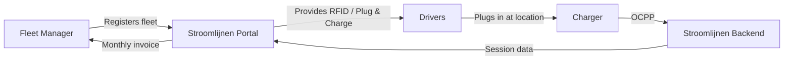

---
---
sidebar_position: 1
title: What is Stroomlijnen?
description: Introduction to Stroomlijnen — a Dutch CPO and eMSP specializing in electric truck charging at theaters and logistics locations.
keywords: [Stroomlijnen, CPO, eMSP, electric truck charging, Netherlands, fleet charging]
---

# What is Stroomlijnen?

Stroomlijnen B.V. is a Dutch **Charge Point Operator (CPO)** and **e-Mobility Service Provider (eMSP)** that builds and operates electric vehicle charging infrastructure at **theaters** and **logistics locations** throughout the Netherlands.

## What We Do

We install, operate, and maintain high-power charging stations specifically designed for **electric trucks and commercial vehicles**. Our chargers are located at sites with large existing grid connections — mainly theaters, event venues, and logistics hubs.

### Why Theaters?

Theaters have something that most locations don't: **enormous electrical connections** (often 400-2000 kVA) that are unused during the day. Performances are in the evenings. Trucks charge during the day. The infrastructure is already there — we put it to work.

### Our eMSP Identity

We operate under the **NL\*STM** eMSP identity in the Dutch and European charging network. This means:

- Your drivers can use our RFID passes or Plug & Charge at **any** public charger in the Netherlands and Europe (via roaming)
- Customers of other eMSPs can charge at our locations
- Full interoperability via the OCPI protocol

## How Fleet Charging Works

1. **Register** your fleet on the Stroomlijnen portal
2. **Configure** your vehicles — RFID passes, Plug & Charge, or both
3. **Drivers charge** at any Stroomlijnen location (or at a roaming partner)
4. **You receive** detailed session data, energy reports, and one monthly invoice

## Key Features

| Feature | Description |
|---------|-------------|
| **Plug & Charge** | ISO 15118 automatic authentication — no pass required |
| **RFID passes** | Traditional card-based charging with NL*STM identity |
| **Fleet portal** | Real-time session data, vehicle management, invoicing |
| **Smart charging** | Load balancing for optimal energy costs and grid impact |
| **OCPP 2.0.1** | Latest protocol standard for charger management |
| **Roaming** | Charging at 300,000+ points across Europe via OCPI |

## What's in This Knowledge Base?

This site contains everything you need to know:

- **[Getting Started](/docs/getting-started/first-session)** — Your first charging session
- **[Plug & Charge](/docs/plug-and-charge/what-is-pnc)** — The future of effortless charging
- **[Fleet Management](/docs/fleet-management/overview)** — Managing your charging fleet
- **[Technical](/docs/technical/ocpp-overview)** — In-depth insights into the technology
- **[FAQ](/docs/faq)** — Frequently asked questions answered

:::tip The Show Must Go On
Our slogan is not just marketing. It reflects our commitment: if your fleet needs to charge, **must** have infrastructure ready. Reliability at theater level means being prepared for every scenario.
:::