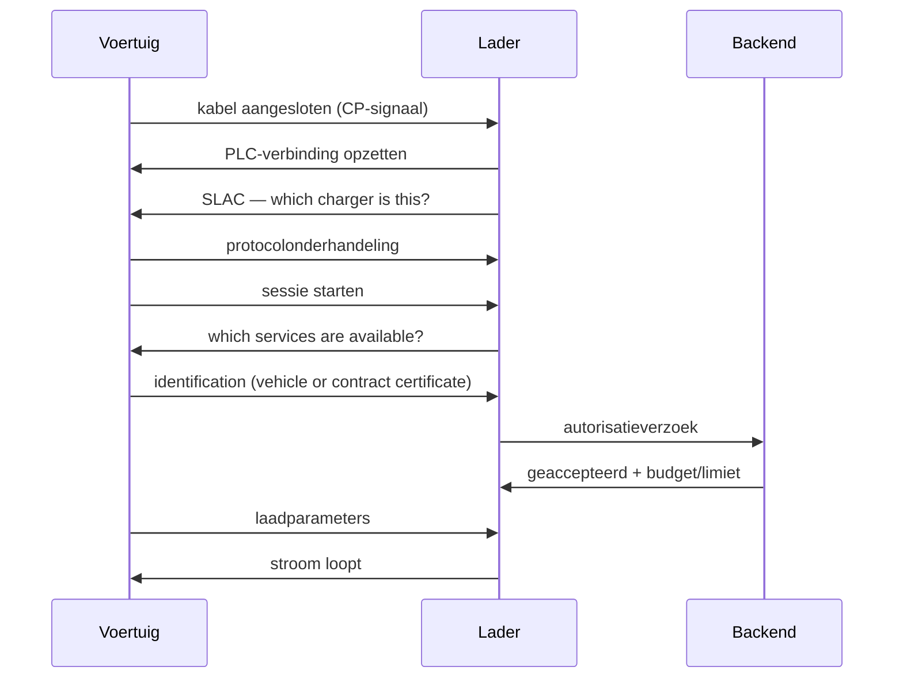

# How Plug & Charge works technically

This page explains what happens between plugging in and power. For the deeper protocol explanation: see [ISO 15118 in depth](/en/docs/technical/iso-15118).

## First: the cable does more than carry power

A CCS plug has two auxiliary contacts in addition to the power pins. Via the **Control Pilot** (CP), the vehicle reports that it is connected and how much current it can handle. For DC charging, **Power Line Communication (PLC)** is added: data over the same conductors as the power.

That data layer is what makes Plug & Charge possible. Without PLC there is no conversation, and therefore no automatic identification.

## The sequence

In plain language:

1. **Connecting** — the driver plugs in.
2. **Linking** — a data connection is established via PLC; SLAC determines which charger is being talked to.
3. **Negotiating** — vehicle and charger agree which protocol version they use.
4. **Identifying** — the vehicle identifies itself. At our sites with a vehicle identity; with the certificate variant with a contract certificate.
5. **Authorising** — the charger asks the backend: is this allowed, and within which budget?
6. **Parameters** — it is agreed how much power may flow. This is also where the EMS limit comes in.
7. **Charging** — power starts flowing; meter values are passed on.

## Where it usually goes wrong

From practice, in order of frequency:

| Fault | Cause | What to do |
|---|---|---|
| No identification | Vehicle not known to the charging partner | Register the vehicle |
| Fallback to card/QR | PLC connection or protocol negotiation failed | Reconnect the cable, check the contacts |
| Authorisation refused | Vehicle blocked, budget exhausted, or wrong link | Check the account |
| Session stops immediately | Battery too hot/cold, or BMS refuses | See [Troubleshooting](/en/docs/plug-and-charge/troubleshooting) |
| Restart after session end | Cable remained inserted after the session ended | Unplug the cable and plug it in again |

## The role of the backend

The charger does not decide for itself whether you may charge. It asks. That means the **backend** determines:

- whether this vehicle or contract may charge
- which tariff and which budget apply
- which limit currently applies (from the EMS)
- whether a session must stop

And that the charger must keep working if that backend is temporarily unreachable. At our sites the control system is on location, in the bastion at the charger, not in a data centre. If the cloud goes down, ongoing sessions continue and data is processed later.

## Why "just plug in" is so difficult

Anyone reading this quickly thinks: surely this is simple? The difficulty does not lie in the protocol but in the **agreements**:

- Who gives a vehicle the right to charge? That is a contract, with an invoicing address.
- Who may revoke that contract? The party that issued it.
- How does charger A know that a certificate from party B can be trusted? Via a chain of trust that many parties have to maintain together.
- Who pays the roaming costs if someone from network B charges at network A?

That is why Plug & Charge should in theory work everywhere and in practice differs per combination of network, manufacturer and country.

## Further reading

- [What is Plug & Charge?](/en/docs/plug-and-charge/what-is-pnc)
- [ISO 15118 in depth](/en/docs/technical/iso-15118)
- [Compatibility](/en/docs/plug-and-charge/compatible-vehicles)
