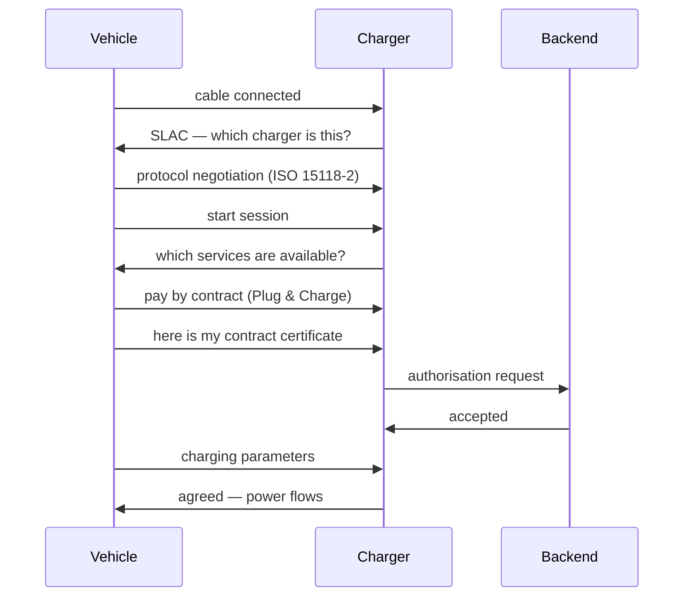

# ISO 15118 in depth

**ISO 15118** is the international standard for communication between an electric vehicle and a charging station via the charging cable. It is what makes Plug & Charge possible: the vehicle can identify itself without a card or app.

## The parts of the standard

| Part | Subject | Relevance |
|---|---|---|
| **ISO 15118-1** | Terminology and use cases | Conceptual framework |
| **ISO 15118-2** | Network and application protocol (AC/DC) | **This is where Plug & Charge lives** |
| **ISO 15118-3** | Physical and data link layer | Power line communication over the cable |
| **ISO 15118-4/5** | Conformity tests | How you establish whether something really works |
| **ISO 15118-8** | Wireless variant | For inductive charging |
| **ISO 15118-20** | Second generation | Bidirectional charging, improved certificate management |

## The communication stack

```
Application   │ ISO 15118-2 / -20 messages (SessionSetup, Authorize, …)
Presentation  │ EXI (compact binary XML encoding)
Session       │ TLS (depending on protocol and authentication method)
Transport     │ TCP/IP
Network       │ IPv6 link-local
Data link     │ SLAC (which vehicle belongs to which charger)
Physical      │ HomePlug Green PHY (PLC) + Control Pilot (IEC 61851-1)
```

A few layers deserve explanation:

**PLC (Power Line Communication)** — HomePlug Green PHY carries communication through the charging cable’s Control Pilot path, not the DC power conductors. No separate external data cable is needed. The bandwidth is limited (a few Mbps in practice), which is why encoding is compact.

**SLAC (Signal Level Attenuation Characterization)** — determines which vehicle talks to which charger. In a car park with ten chargers that is not trivial: without SLAC, a car could start negotiating with the wrong charger.

**EXI** — a binary form of XML, needed because the PLC connection is narrow.

**TLS** — protects communication. Checking the contract certificate is part of Plug & Charge authentication; this is not the same as MAC-based recognition.

## Certificates: who trusts whom

In the **certificate variant** of Plug & Charge, everything revolves around a chain of trust:

```
V2G Root CA (trust anchor)
├── CPO sub-CA            → certificate of the charger (EVSE)
└── eMSP sub-CA           → contract certificate in the vehicle
```

- The **contract certificate** in the vehicle contains an identifier (an **EMAID** in OCPI terms) that links the vehicle to a billing account.
- The **EVSE certificate** proves that the charger really belongs to that operator — so that a vehicle does not talk to an imitation charger.
- The **root** is the anchor point. In Europe it is in practice managed by one or a few parties; that is why "cross-operator" Plug & Charge depends on agreements between many parties.

The difficult part is not the handshake but the **provisioning**: how does that certificate get into the vehicle? That runs via the manufacturer, and every manufacturer has its own process and pace for it. That is why Plug & Charge in practice often works "per brand" instead of everywhere.

## What happens when you plug in



This diagram simplifies a successful certificate-based session, not the Stroomlijnen enrolment procedure. Available alternatives and timing depend on the implementation and authorisation.

## What we do today — and what we do not yet

**Today:** current recognition at supported DC chargers uses **EVCCID: the MAC address of the vehicle communication controller**. This is not the VIN and is not authentication with an ISO 15118 contract certificate. A MAC address is an identifier, not cryptographic proof of a contract or vehicle identity.

The driver enrols the vehicle on the charger screen with an account-linked card. The card reader must first be activated with the button. Rental details and a registration-number check may follow depending on the configuration. The vehicle is connected only at the connection prompt; after capture, the charger automatically records the EVCCID. Entering a VIN in the portal does not replace this. See [Setup](/en/docs/plug-and-charge/setup-guide).

**Enrolment is not approval:** separate account-owner permission is needed after recording. Total enrolment time is 5 minutes from Begin; capture takes up to 3 minutes within the remaining overall time. Those time limits do not guarantee a charging start.

**The certificate variant:** the explanation and diagram above describe contract certificates, not current MAC-based recognition. They do not prove certificate authentication is available on your charger. Even with certificates, automatic charging works only where the vehicle, charger, trust chain and contract authorisation match — not automatically at every operator.

## ISO 15118-20: what is coming

- **Bidirectional charging** (V2G/V2H) — the vehicle can feed back to the building or the grid
- **ACDP** — automated connection (robotic/inductive), relevant for depots
- **Better certificate management** — several contract certificates side by side
- **DC bidirectional** — higher power levels than via AC

Bidirectional charging is promising, but it requires that both the vehicle and the charger support it and that the grid operator and safety rules permit it. We position it as **future** functionality, not as something that is possible today.

## Further reading

- [Plug & Charge](/en/docs/plug-and-charge/what-is-pnc)
- [How Plug & Charge works](/en/docs/plug-and-charge/how-it-works)
- [OCPP overview](/en/docs/technical/ocpp-overview)
