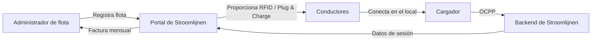

# ¿Qué es Stroomlijnen?

Stroomlijnen B.V. es un **operador de puntos de carga (CPO)** y **proveedor de servicios de movilidad eléctrica (eMSP)** neerlandés que construye y opera infraestructura de carga para vehículos eléctricos en **teatros** y **locales logísticos** en todo el país.

## ¿Qué hacemos?

Instalamos, operamos y mantenemos estaciones de carga de alta potencia diseñadas específicamente para **camiones eléctricos y vehículos comerciales**. Nuestros cargadores se encuentran en locales con grandes conexiones de red existentes — principalmente teatros, locales de eventos y centros logísticos.

### ¿Por qué teatros?

Los teatros disponen de algo que la mayoría de los locales no tienen: **conexiones eléctricas enormes** (a menudo 400-2000 kVA) que no se utilizan durante el día. Las funciones son por la noche. Los camiones se cargan durante el día. La infraestructura ya existe — nosotros la ponemos en funcionamiento.

### Nuestra identidad eMSP

Operamos bajo la identidad **NL\*STM** de eMSP en la red de carga neerlandesa y europea. Eso significa:

- Sus conductores pueden utilizar nuestros pases RFID o Plug & Charge en **cualquier** cargador público en los Países Bajos y Europa (a través de roaming)
- Los clientes de otros eMSP pueden cargar en nuestras ubicaciones
- Interoperabilidad completa a través del protocolo OCPI

## ¿Cómo funciona la carga de flotas?

1. **Registre** su flota en el portal de Stroomlijnen
2. **Configure** sus vehículos — pases RFID, Plug & Charge o ambos
3. **Los conductores cargan** en cualquier local de Stroomlijnen (o en un partner de roaming)
4. **Recibirá** datos de sesión detallados, informes de energía y una factura mensual

## Funciones principales

| Función | Descripción |
|---------|-------------|
| **Plug & Charge** | Autenticación automática ISO 15118 — sin tarjeta necesaria |
| **Pases RFID** | Carga tradicional basada en tarjetas con identidad NL*STM |
| **Portal de flota** | Datos de sesión en tiempo real, administración de vehículos, facturación |
| **Carga inteligente** | Distribución de tareas para costos de energía y impacto en la red óptimos |
| **OCPP 2.0.1** | Último estándar de protocolo para la gestión de cargadores |
| **Roaming** | Carga en más de 300.000 puntos en toda Europa a través de OCPI |

## ¿Qué hay en esta base de conocimientos?

Este sitio contiene todo lo que necesita saber:

- **[Empezar](/docs/getting-started/first-session)** — Su primera sesión de carga
- **[Plug & Charge](/docs/plug-and-charge/what-is-pnc)** — El futuro de la carga sin esfuerzo
- **[Administración de flotas](/docs/fleet-management/overview)** — Administrar su flota de carga
- **[Técnico](/docs/technical/ocpp-overview)** — Información detallada sobre la tecnología
- **[Preguntas frecuentes](/docs/faq)** — Preguntas frecuentes respondidas

:::tip El espectáculo debe continuar
Nuestro lema no es solo marketing. Refleja nuestro compromiso: si su flota necesita cargar, **debe** estar lista la infraestructura. La confiabilidad a nivel de teatro significa estar preparado para cualquier escenario.
:::