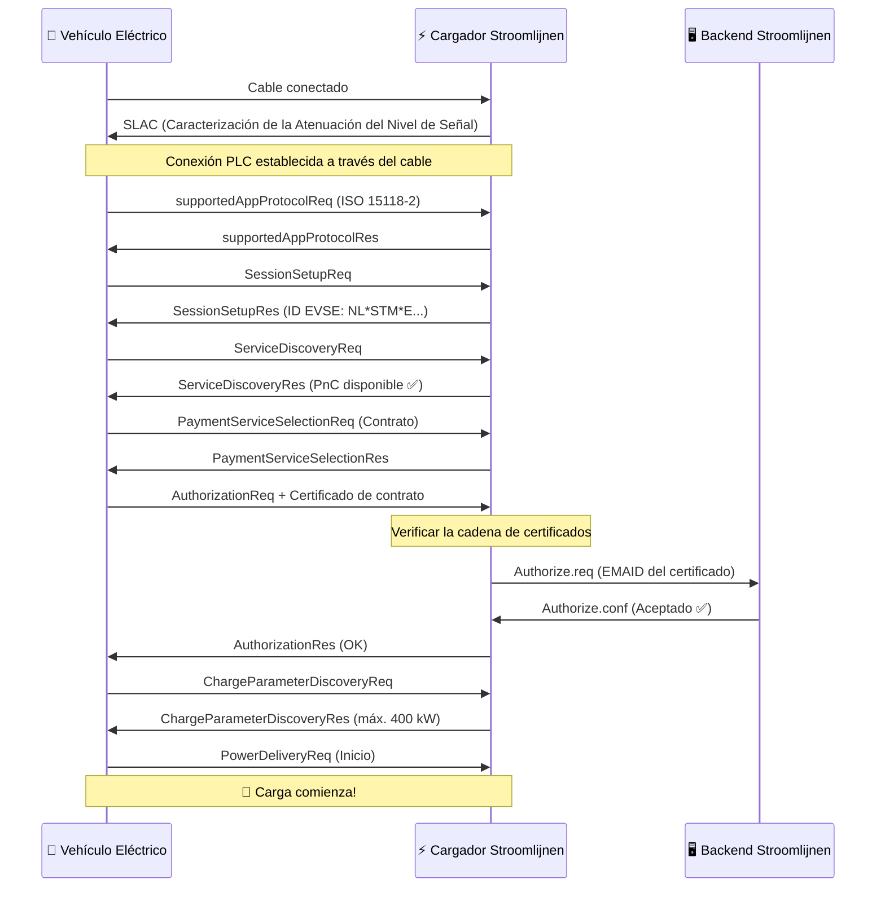

# Cómo Funciona Plug & Charge

Plug & Charge (PnC) reemplaza los tokens físicos (tarjetas RFID, aplicaciones) por **certificados criptográficos** integrados en el vehículo. Cuando un camión compatible con PnC se conecta a un cargador compatible con PnC, realizan un apretón de manos digital — donde verifican la identidad, autorizan la sesión y comienzan el flujo de energía — todo en cuestión de segundos.

## El Protocolo: ISO 15118

ISO 15118 es el estándar internacional que define cómo los vehículos eléctricos se comunican con las estaciones de carga a través del cable de carga. Va mucho más allá de la simple entrega de energía:

- **ISO 15118-2** — La versión ampliamente adoptada para la carga AC y DC con soporte PnC
- **ISO 15118-20** — La próxima generación, con transferencia de energía bidireccional (V2G) y procesamiento de certificados mejorado
- **ISO 15118-3** — Capa física y capa de enlace de datos (comunicación PLC a través del cable)

Los cargadores Stroomlijnen ahora admiten ISO 15118-2, con la preparación para ISO 15118-20 integrada en nuestro hardware.

## La Cadena de Certificados

La seguridad PnC se basa en una **Infraestructura de Clave Pública (PKI)** — la misma tecnología que protege el banca en línea y los sitios web HTTPS. Esta es la jerarquía:

```
V2G Root CA (por ejemplo, Hubject)
├── CPO Sub-CA (Stroomlijnen)
│   └── Certificado de hoja EVSE (cargador individual)
└── eMSP Sub-CA (Stroomlijnen / socio de roaming)
    └── Certificado de contrato (instalado en su camión)
```

Cada certificado está firmado por el certificado principal, lo que crea una **cadena de confianza** que tanto el vehículo como el cargador pueden verificar de forma independiente.

## El Apretón de Manos — Paso a Paso



### Qué Sucede en Lenguaje Común

1. **Conexión física** — El conductor conecta el cable CCS
2. **Conexión de comunicación** — El camión y el cargador establecen una conexión de datos a través del cable mediante Power Line Communication (PLC)
3. **Negociación de protocolo** — Acuerdan utilizar ISO 15118-2
4. **Intercambio de identidad** — El camión presenta su **certificado de contrato**, que contiene el EMAID (Identificador de cuenta de movilidad eléctrica) que lo vincula a una cuenta de facturación
5. **Verificación de certificado** — El cargador valida la cadena de certificados hasta llegar al CA raíz de confianza
6. **Autorización de backend** — El cargador verifica con el backend de Stroomlijnen si este EMAID es válido y tiene un contrato activo
7. **Parámetros de carga** — Negocian los niveles de potencia (voltaje, corriente, potencia máxima)
8. **Flujo de energía** — La carga comienza automáticamente

Todo el proceso dura **3–8 segundos** desde la conexión hasta la entrega de energía.

## Conceptos Clave

### Certificado de Contrato

Un certificado digital instalado en la computadora de a bordo del vehículo. Contiene:

- **EMAID** — Su identificador único de cuenta de movilidad eléctrica (por ejemplo, `NL-STM-C00001234-5`)
- **Clave pública** — Utilizada para la autenticación TLS
- **Período de validez** — Normalmente 1–2 años
- **Emisor** — El eMSP (Stroomlijnen o socio de roaming)

El camión almacena este certificado de forma segura y lo presenta automáticamente en cada cargador compatible con PnC.

### Certificado EVSE

El certificado propio del cargador, que demuestra que es un punto de carga legítimo de Stroomlijnen. Esto evita que los cargadores maliciosos intercepten las credenciales de inicio de sesión.

### Servicio de Provisionamiento de Certificados (CPS)

El sistema que instala y actualiza certificados de contrato en los vehículos. Cuando registra un camión en el portal de Stroomlijnen, el CPS:

1. Genera un certificado de contrato para ese vehículo
2. Lo envía a través del backend del OEM al vehículo (Volvo Connect, DAF Connect, etc.)
3. El vehículo lo almacena en su elemento seguro

### Hubject

El **ancla de confianza** para PnC en Europa. Hubject administra la V2G Root CA y el grupo de certificados que permite la compatibilidad entre operadores. Cuando un cargador Stroomlijnen encuentra un camión con un certificado de otro eMSP, la infraestructura de Hubject verifica la cadena.

## Seguridad

PnC es **más seguro** que las tarjetas RFID:

| Aspecto | RFID | Plug & Charge |
|--------|------|---------------|
| Autenticación | Token estático (puede ser clonado) | Autenticación mutua TLS |
| Cifrado | Ninguno | AES-256 a través de PLC |
| Vinculación de identidad | Tarjeta ↔ cuenta (separada) | Certificado ↔ VIN del vehículo (fuerte) |
| Revocación | Debe recuperar la tarjeta físicamente | Puede revocar el certificado de forma remota |
| Riesgo de fraude | Robo o clonación de tarjetas | Muy difícil (módulo de seguridad de hardware) |

## Requisitos

Para Plug & Charge, se necesitan tres cosas:

1. **Soporte del vehículo** — El camión debe tener la capacidad PnC de ISO 15118 y un certificado de contrato válido instalado
2. **Soporte del cargador** — La EVSE debe admitir ISO 15118-2 con PnC (todos los cargadores DC de Stroomlijnen lo hacen)
3. **Integración de backend** — El eMSP y el CPO deben estar conectados a través del ecosistema de certificados (Hubject)

## Qué Viene a Continuación: Vehicle-to-Grid (V2G)

ISO 15118-20 amplía PnC con transferencia de energía bidireccional. Una flota de camiones eléctricos que se estaciona en un teatro por la noche podría:

- Cargar cuando la electricidad es más barata (horas valle / alta oferta solar)
- Devolver energía a la red durante las horas pico
- Generar ingresos para el administrador de la flota

El hardware de Stroomlijnen está listo para V2G. Tan pronto como los fabricantes de vehículos habiliten ISO 15118-20, activaremos la carga bidireccional en nuestros puntos de carga.

---

**Siguiente:** [Vehículos Compatibles →](./compatible-vehicles)