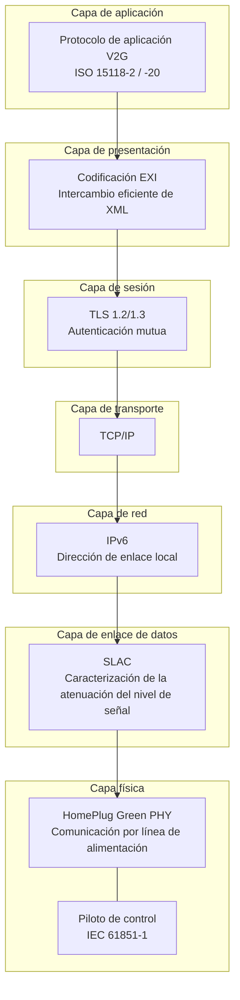
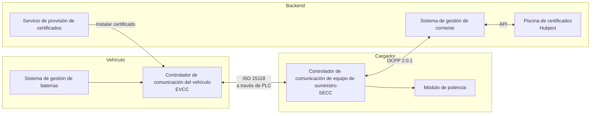
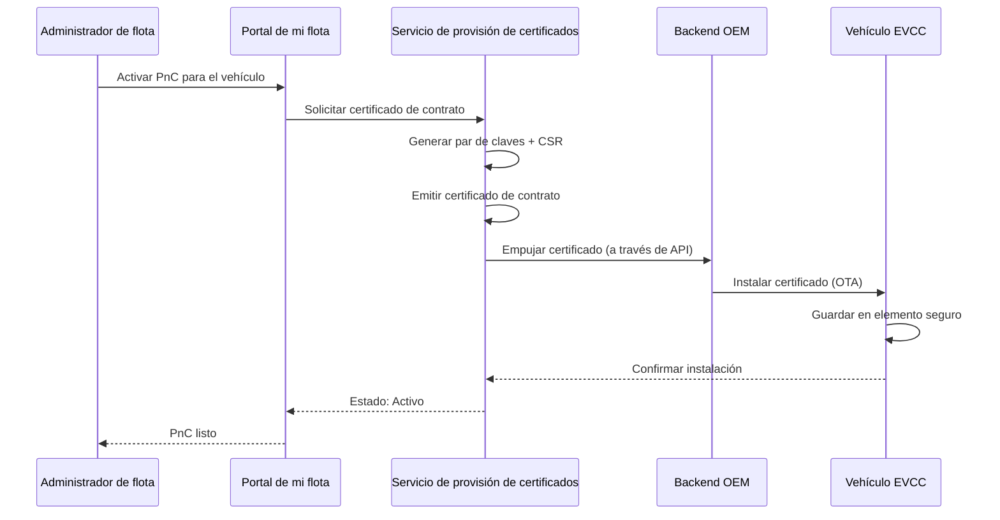

# Profundización en ISO 15118

ISO 15118 es el estándar internacional para la "Interfaz de comunicación Vehicle-to-Grid". Define cómo los vehículos eléctricos y las estaciones de carga se comunican a través del cable de carga, lo que permite Plug & Charge, carga inteligente y, en última instancia, transferencia bidireccional de energía.

## Estructura estándar

| Parte | Título | Relevancia |
|------|-------|-----------|
| ISO 15118-1 | Información general y definición de escenarios de uso | Marco y conceptos |
| ISO 15118-2 | Protocolo de red y aplicación (AC/DC) | **Actualmente implementado** — PnC, carga inteligente |
| ISO 15118-3 | Capa física y de enlace de datos (PLC) | Comunicación por línea de alimentación a través del cable |
| ISO 15118-4 | Prueba de conformidad del protocolo de red y aplicación | Procedimientos de prueba |
| ISO 15118-5 | Prueba de conformidad de la capa física y de enlace de datos | Procedimientos de prueba |
| ISO 15118-20 | Protocolo de red y aplicación de segunda generación | **Próxima generación** — V2G, PnC mejorada, ACDP |
| ISO 15118-8 | Capa física y de enlace de datos (inalámbrico) | Comunicación de carga inalámbrica |

## Pila de comunicación

### Organización de capas

**Capa física — Comunicación por línea de alimentación (PLC)**
La comunicación se realiza directamente a través del cable de carga mediante HomePlug Green PHY (HPGP), un estándar de comunicación por línea de alimentación que funciona en frecuencias entre 2–30 MHz. No se requiere un cable de datos separado.

La señal de piloto de control (CP) de IEC 61851-1 proporciona señalización básica (cable conectado, capacidad de corriente) y desencadena la comunicación ISO 15118 de nivel superior.

**Capa de enlace de datos — SLAC**
La caracterización de la atenuación del nivel de señal determina qué vehículo está conectado a qué cargador. En un aparcamiento con varios cargadores, SLAC garantiza que su camión se comunique con el cargador correcto, no con el cargador en la configuración adyacente.

**Red — IPv6**
Una vez establecida la conexión PLC, se crea una red IPv6 de enlace local entre el vehículo y el cargador. El cargador realiza un ligero DHCP/SDP (Protocolo de descubrimiento de servicios) para que el vehículo pueda encontrar el punto final del servicio de carga.

**Transporte/Sesión — TLS**
Toda la comunicación PnC ISO 15118-2 está cifrada con TLS. Tanto el vehículo como el cargador presentan certificados para la autenticación mutua. Esta es la capa de seguridad fundamental.

**Presentación — EXI**
Los mensajes se codifican en EXI (Intercambio eficiente de XML) — un formato binario compacto que es mucho más pequeño que el texto XML. Esto es importante porque la banda PLC es limitada (~10 Mbps teóricos, menor en la práctica).

**Aplicación — Protocolo V2G**
Los mensajes de carga reales: configuración de sesión, autenticación, descubrimiento de parámetros de carga, suministro de energía, medición y cierre de sesión.

## Entidades clave

- **EVCC (Controlador de comunicación del vehículo)** — El cerebro ISO 15118 del vehículo. Procesa TLS, presenta certificados, solicita energía.
- **SECC (Controlador de comunicación de equipo de suministro)** — El cerebro ISO 15118 del cargador. Valida certificados, se comunica con el backend, gestiona la entrega de energía.
- **Servicio de provisión de certificados** — Instala certificados de contrato en vehículos (a través de backends OEM).
- **Piscina de certificados (Hubject)** — Confianza entre operadores. Cuando un vehículo de otro eMSP carga en Stroomlijnen, Hubject conecta la confianza.

## Gestión de certificados

### Tipos de certificados

| Certificado | Propósito | Instalado en | Emitido por |
|-------------|-----|-------------|-----------|
| V2G Root CA | Ancla de confianza | Cargador + Vehículo | Hubject / Administrador de PKI V2G |
| CPO Sub-CA | Identidad de CPO | CSMS | V2G Root CA |
| Certificado EVSE | Identidad del cargador | Cargador (SECC) | CPO Sub-CA |
| MO Root CA | Ancla de confianza de eMSP | Cargador | Hubject |
| Certificado de contrato | Identidad del vehículo/cuenta | Vehículo (EVCC) | eMSP Sub-CA |

### Ciclo de vida del certificado

### Rotación de certificados
Los certificados tienen una validez limitada (generalmente 2 años). Nuestro sistema:
1. Supervisa las fechas de vencimiento de todos los certificados de la flota
2. Envía notificaciones 60, 30 y 7 días antes del vencimiento
3. Genera automáticamente certificados de renovación
4. Los envía a través del mismo canal OEM
5. El certificado antiguo permanece válido hasta que se instala el nuevo

## ISO 15118-20: Qué es nuevo

ISO 15118-20 es la próxima generación, con adiciones:

### Transferencia bidireccional de energía (V2G/V2H)
- Los vehículos pueden devolver energía a la red o al edificio
- Requiere mensajes y controles de seguridad adicionales
- Potencial de ingresos para los administradores de flotas

### Protocolo de dispositivo de conexión automatizado (ACDP)
- Soporta carga automatizada/robotizada (no requiere intervención humana)
- Relevante para camiones autónomos y carga en depósitos

### Gestión de certificados mejorada
- Procedimientos de instalación y actualización de certificados más eficientes
- Soporte para múltiples certificados de contrato (roaming entre proveedores más sencillo)

### Bidireccional DC (DC BPT)
- Protocolo de carga bidireccional DC
- Mayor potencia V2G que la bidireccional AC

### Comunicación multiplexada
- Múltiples vehículos pueden compartir un solo canal de comunicación (relevante para sistemas de carga por pantógrafo/carril)

## Stroomlijnen y ISO 15118

Nuestra implementación:

- **Actual:** ISO 15118-2 en todos los cargadores DC — soporte completo para Plug & Charge
- **Listo para hardware:** Nuestros cargadores tienen módulos de comunicación compatibles con ISO 15118-20
- **Preparado para V2G:** La electrónica de potencia admite flujo bidireccional (activación de firmware en espera de la preparación OEM)
- **Conectado a Hubject:** Integración completa con el PKI V2G europeo

## Para desarrolladores

Si está integrando con la infraestructura de Stroomlijnen a nivel ISO 15118 (fabricantes de cargadores, desarrolladores de CSMS), comuníquese con [technical@stroomlijnen.nl](mailto:technical@stroomlijnen.nl) para:

- Especificaciones de integración SECC
- Documentación de asignación OCPP 2.0.1 ↔ ISO 15118
- Documentación de la API de provisión de certificados
- Acceso al entorno de prueba de interoperabilidad