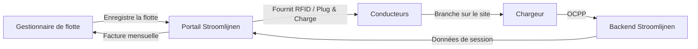

# Qu'est-ce que Stroomlijnen ?

Stroomlijnen B.V. est un **Charge Point Operator (CPO)** et **e-Mobility Service Provider (eMSP)** néerlandais qui construit et exploite des infrastructures de charge pour véhicules électriques dans les **théâtres** et les **sites logistiques** à travers les Pays-Bas.

## Ce que nous faisons

Nous installons, exploitons et maintenons des stations de charge haute puissance spécifiquement conçues pour les **camions électriques et les véhicules utilitaires**. Nos chargeurs sont situés dans des endroits avec de grandes connexions électriques existantes — principalement des théâtres, des lieux d'événements et des hubs logistiques.

### Pourquoi les théâtres ?

Les théâtres disposent de quelque chose que la plupart des sites n'ont pas : **de très grandes connexions électriques** (souvent 400-2000 kVA) qui ne sont pas utilisées pendant la journée. Les représentations ont lieu le soir. Les camions se chargent pendant la journée. L'infrastructure est déjà en place — nous l'exploitons.

### Notre identité eMSP

Nous opérons sous l'identité eMSP **NL\*STM** dans le réseau de charge néerlandais et européen. Cela signifie :

- Vos conducteurs peuvent utiliser nos passes RFID ou Plug & Charge sur **toute** chargeur publique aux Pays-Bas et en Europe (via le roaming)
- Les clients d'autres eMSP peuvent se charger sur nos sites
- Interopérabilité complète via le protocole OCPI

## Comment fonctionne la charge de flotte

1. **Enregistrez** votre flotte sur le portail Stroomlijnen
2. **Configurez** vos véhicules — passes RFID, Plug & Charge, ou les deux
3. **Les conducteurs se chargent** sur n'importe quel site Stroomlijnen (ou chez un partenaire de roaming)
4. **Vous recevez** des données de session détaillées, des rapports d'énergie et une facture mensuelle

## Fonctions principales

| Fonction | Description |
|---------|-------------|
| **Plug & Charge** | Authentification automatique ISO 15118 — pas de carte nécessaire |
| **Passes RFID** | Chargement basé sur les cartes traditionnelles avec l'identité NL*STM |
| **Portail de flotte** | Données de session en temps réel, gestion de véhicules, facturation |
| **Chargement intelligent** | Répartition des tâches pour des coûts d'énergie et un impact sur le réseau optimaux |
| **OCPP 2.0.1** | Dernière norme de protocole pour la gestion des chargeurs |
| **Roaming** | Chargement sur plus de 300 000 points à travers l'Europe via OCPI |

## Qu'y a-t-il dans cette base de connaissances ?

Ce site contient tout ce que vous devez savoir :

- **[Premier démarrage](/docs/getting-started/first-session)** — Votre première session de charge
- **[Plug & Charge](/docs/plug-and-charge/what-is-pnc)** — L'avenir du chargement sans effort
- **[Gestion de flotte](/docs/fleet-management/overview)** — Gérez votre flotte de charge
- **[Technique](/docs/technical/ocpp-overview)** — Un aperçu approfondi de la technologie
- **[FAQ](/docs/faq)** — Questions fréquentes répondues

:::tip Le spectacle doit continuer
Notre slogan n'est pas juste du marketing. Il reflète notre engagement : si votre flotte doit se charger, **la** infrastructure doit être prête. La fiabilité au niveau des théâtres signifie être préparé à tout scénario.
:::