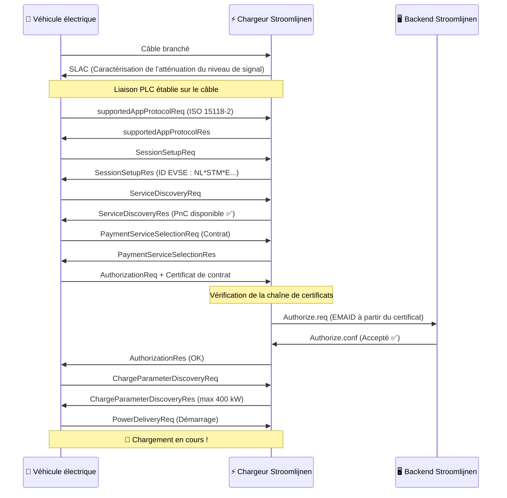

# Comment fonctionne Plug & Charge

Plug & Charge (PnC) remplace les jetons physiques (passeports RFID, applications) par des **certificats cryptographiques** intégrés dans le véhicule. Lorsqu'un camion compatible PnC se branche sur une chargeuse compatible PnC, ils effectuent une poignée de main numérique — vérifiant l'identité, autorisant la session et amorçant le flux d'énergie — le tout en quelques secondes.

## Le Protocole : ISO 15118

ISO 15118 est la norme internationale qui définit la façon dont les véhicules électriques communiquent avec les stations de charge via le câble de charge. Il va bien au-delà de la simple fourniture d'énergie :

- **ISO 15118-2** — La version largement utilisée pour la charge AC et DC avec prise en charge de PnC
- **ISO 15118-20** — La prochaine génération, avec transfert d'énergie bidirectionnel (V2G) et traitement amélioré des certificats
- **ISO 15118-3** — Couche physique et couche de liaison de données (communication PLC sur le câble)

Les chargeurs Stroomlijnen prennent en charge ISO 15118-2, avec la préparation ISO 15118-20 intégrée dans notre matériel.

## La Chaîne de Certificats

La sécurité PnC repose sur une **Infrastructure à clés publiques (PKI)** — la même technologie qui sécurise les banques en ligne et les sites Web HTTPS. Voici la hiérarchie :

```
V2G Root CA (par exemple Hubject)
├── CPO Sub-CA (Stroomlijnen)
│   └── Certificat de feuille EVSE (chargeur individuel)
└── eMSP Sub-CA (Stroomlijnen / partenaire de roaming)
    └── Certificat de contrat (installé dans votre camion)
```

Chaque certificat est signé par le certificat parent, créant une **chaîne de confiance** que le véhicule et la chargeuse peuvent vérifier de manière indépendante.

## La Poignée de Main — Étape par Étape



### Ce qui se passe en langage clair

1. **Connexion physique** — Le conducteur branche le câble CCS
2. **Liaison de communication** — Le camion et la chargeuse établissent une liaison de données via le câble par communication PLC
3. **Négociation du protocole** — Ils conviennent d'utiliser ISO 15118-2
4. **Échange d'identité** — Le camion présente son **certificat de contrat**, qui contient l'EMAID (identifiant de compte de mobilité électrique) liant le véhicule à un compte de facturation
5. **Vérification du certificat** — La chargeuse valide la chaîne de certificats jusqu'à la racine CA de confiance
6. **Autorisation backend** — La chargeuse vérifie auprès du backend Stroomlijnen si cette EMAID est valide et a un contrat actif
7. **Paramètres de charge** — Ils négocient les niveaux de puissance (tension, courant, puissance maximale)
8. **Énergie en cours** — Le chargement démarre automatiquement

L'ensemble du processus dure **3–8 secondes** depuis la connexion jusqu'à la fourniture d'énergie.

## Concepts clés

### Certificat de contrat

Un certificat numérique installé dans l'ordinateur de bord du véhicule. Il contient :

- **EMAID** — Votre identifiant de compte de mobilité électrique unique (par exemple `NL-STM-C00001234-5`)
- **Clé publique** — Utilisée pour l'authentification TLS
- **Période de validité** — Généralement 1–2 ans
- **Émetteur** — L'eMSP (Stroomlijnen ou partenaire de roaming)

Le camion stocke ce certificat en toute sécurité et le présente automatiquement à chaque chargeuse compatible PnC.

### Certificat EVSE

Le certificat propre de la chargeuse, prouvant qu'il s'agit d'un point de charge Stroomlijnen légitime. Cela empêche les chargeuses malveillantes d'intercepter les informations de connexion.

### Service de provisionnement de certificats (CPS)

Le système qui installe et met à jour les certificats de contrat dans les véhicules. Lorsque vous enregistrez un camion sur le portail Stroomlijnen, le CPS :

1. Génère un certificat de contrat pour ce véhicule
2. Le pousse via le backend du fabricant vers le véhicule (Volvo Connect, DAF Connect, etc.)
3. Le véhicule stocke le certificat dans son élément sécurisé

### Hubject

L'**ancre de confiance** pour PnC en Europe. Hubject gère la V2G Root CA et la piscine de certificats qui permet la compatibilité entre opérateurs. Lorsqu'une chargeuse Stroomlijnen rencontre un camion avec un certificat d'un autre eMSP, l'infrastructure de Hubject valide la chaîne.

## Sécurité

PnC est **plus sécurisé** que les passeports RFID :

| Aspect | RFID | Plug & Charge |
|--------|------|---------------|
| Authentification | Jeton statique (peut être cloné) | Authentification mutuelle TLS |
| Chiffrement | Aucun | AES-256 via PLC |
| Liaison d'identité | Passeport ↔ compte (détaché) | Certificat ↔ VIN du véhicule (fort) |
| Révocation | Doit retirer physiquement le passeport | Révoquer le certificat à distance |
| Risque de fraude | Vol ou clonage du passeport | Extrêmement difficile (module de sécurité matériel) |

## Exigences

Pour Plug & Charge, trois éléments sont nécessaires :

1. **Prise en charge du véhicule** — Le camion doit avoir la fonctionnalité ISO 15118-PnC et un certificat de contrat valide installé
2. **Prise en charge de la chargeuse** — La chargeuse EVSE doit prendre en charge ISO 15118-2 avec PnC (toutes les chargeuses DC Stroomlijnen le font)
3. **Intégration backend** — L'eMSP et le CPO doivent être connectés via l'écosystème de certificats (Hubject)

## Ce qui suit : Vehicle-to-Grid (V2G)

ISO 15118-20 étend PnC à la transmission d'énergie bidirectionnelle. Une flotte de camions électriques stationnés près d'un théâtre pourrait :

- Se charger lorsque l'électricité est la moins chère (heures creuses / offre solaire élevée)
- Fournir de l'énergie au réseau pendant les heures de pointe
- Générer des revenus pour le gestionnaire de flotte

Le matériel Stroomlijnen est prêt pour V2G. Dès que les fabricants de camions activent ISO 15118-20, nous activerons le chargement bidirectionnel sur nos sites.

---

**Suivant:** [Véhicules compatibles →](./compatible-vehicles)