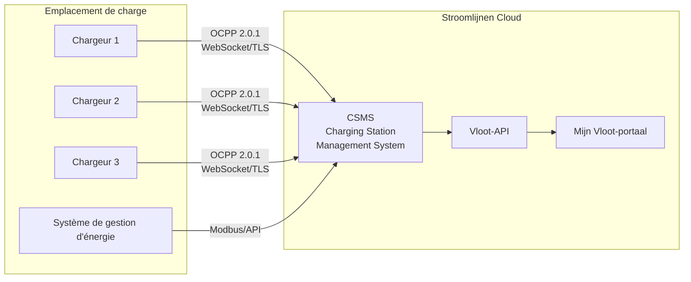

# Présentation d'OCPP

**OCPP (Open Charge Point Protocol)** est le protocole de communication standard entre les stations de charge et un système de gestion centralisé. Stroomlijnen utilise OCPP pour gérer, surveiller et contrôler à distance tous nos chargeurs.

## Qu'est-ce qu'OCPP ?

OCPP définit la façon dont une station de charge (Charge Point) communique avec un Charging Station Management System (CSMS — c'est-à-dire nous). Il comprend :

- **Autorisation** — Vérifier si un utilisateur/véhicule est autorisé à charger
- **Gestion de session** — Démarrer, surveiller et arrêter les sessions de charge
- **Mesure** — Rapporter la consommation d'énergie en temps réel
- **Contrôle à distance** — Démarrer/arrêter des sessions à distance, ajuster la puissance, redémarrer les chargeurs
- **Diagnostic** — Mises à jour de firmware, requêtes de journal, surveillance de l'état
- **Charge intelligente** — Gestion dynamique de la puissance sur plusieurs chargeurs

## Versions d'OCPP

| Version | Statut chez Stroomlijnen | Fonctionnalités clés |
|---------|----------------------|--------------|
| OCPP 1.6-J | ✅ Supporté | JSON/WebSocket, profils de charge intelligents, largement utilisé |
| OCPP 2.0.1 | ✅ Préféré | Intégration ISO 15118, modèle d'appareil, sécurité améliorée, traitement de transaction |

### Pourquoi OCPP 2.0.1 est important

OCPP 2.0.1 est une mise à niveau significative par rapport à la version 1.6, en particulier pour le chargement de flotte :

- **Intégration ISO 15118** — Support intégré pour la gestion des certificats Plug & Charge via OCPP
- **Sécurité améliorée** — Mises à jour de firmware sécurisées, valeurs de mesure signées, TLS obligatoire
- **Modèle d'appareil** — Méthode standardisée pour interroger les capacités et la configuration des chargeurs
- **Traitement de transaction** — Meilleur traitement des transactions complexes (pré-autorisation, stationnement, énergie)
- **Charge intelligente** — Contrôle plus détaillé des profils de charge et de la répartition de puissance
- **Messages d'affichage** — Envoyer des messages personnalisés à l'écran du chargeur

Tous les nouveaux chargeurs Stroomlijnen sont déployés avec OCPP 2.0.1. Les chargeurs existants 1.6-J continuent à fonctionner et seront mis à jour lorsque le matériel le permet.

## Architecture

### Flux de communication

1. **Chargeur → CSMS:** Le chargeur se connecte à notre CSMS via une connexion WebSocket sécurisée (wss://)
2. **Battlements:** Les chargeurs envoient des battlements périodiques pour confirmer qu'ils sont en ligne
3. **Autorisation:** Lorsqu'un utilisateur présente un passe RFID ou un certificat PnC, le chargeur envoie une demande d'autorisation à notre CSMS
4. **Mesure:** Pendant la charge, les valeurs de mesure (énergie, puissance, SoC) sont envoyées à intervalles réguliers
5. **Commandes externes:** Notre CSMS peut envoyer des commandes aux chargeurs (démarrer, arrêter, réinitialiser, mettre à jour le firmware)

## Charge intelligente

Les capacités de charge intelligentes d'OCPP sont essentielles pour les emplacements avec une capacité réseau limitée :

### Profils de charge
Nous configurons des profils de charge qui indiquent à chaque chargeur la quantité de puissance qu'il peut utiliser à tout moment :

- **TxDefaultProfile** — Limite de puissance par défaut pour chaque transaction
- **TxProfile** — Ajustement de puissance par transaction
- **ChargingStationMaxProfile** — Limite de puissance globale pour l'emplacement

### Répartition de tâches
Lorsque plusieurs véhicules chargent en même temps et que l'emplacement a une capacité réseau limitée :

1. Notre EMS surveille la charge totale de l'emplacement (via Modbus/API)
2. Le CSMS calcule la capacité disponible pour chaque chargeur
3. Les profils de charge sont mis à jour dynamiquement via OCPP
4. La puissance est répartie équitablement ou en fonction de la priorité (en fonction des paramètres de flotte)

Exemple : Un emplacement avec une capacité réseau de 600 kW et 3 chargeurs de 350 kW chacun :
- 1 véhicule en charge → reçoit jusqu'à 350 kW
- 2 véhicules en charge → chacun 300 kW
- 3 véhicules en charge → chacun 200 kW
- Pendant les heures de pointe sur le réseau → réduit encore pour rester dans la capacité contractuelle

### Charge planifiée
Les gestionnaires de flotte peuvent configurer les heures de départ et les niveaux de charge cibles. Notre système optimise le moment de charger :
- Retarde le démarrage jusqu'à ce que l'électricité soit la moins chère
- Garantit que le niveau de charge cible est atteint avant l'heure de départ
- Équilibre sur tous les véhicules de l'emplacement

## Sécurité

Les fonctionnalités de sécurité d'OCPP 2.0.1 que nous mettons en œuvre :

- **TLS 1.3** — Toutes les connexions OCPP sont chiffrées
- **Certificats client** — Les chargeurs s'authentifient auprès de notre CSMS avec des certificats
- **Valeurs de mesure signées** — Mesures d'énergie sécurisées contre la manipulation
- **Mises à jour de firmware sécurisées** — Images de firmware cryptographiquement signées
- **Contrôle d'accès** — Restrictions d'accès physique et réseau sur chaque emplacement

## Pour les partenaires de matériel

Si vous êtes un fabricant ou un installateur de chargeurs qui travaille avec Stroomlijnen :

- Nous exigeons la **conformité OCPP 2.0.1** (1.6-J accepté pour le stock existant)
- Les chargeurs doivent prendre en charge **ISO 15118-2** PnC
- TLS 1.2+ est obligatoire
- Nous fournissons les points de terminaison et les informations CSMS pendant le processus d'intégration
- Des tests d'interopérabilité sont requis pour le déploiement

Contactez-nous via [technical@stroomlijnen.nl](mailto:technical@stroomlijnen.nl) pour obtenir la documentation d'intégration.