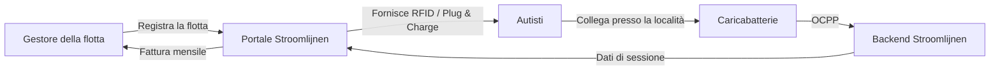

# Cos'è Stroomlijnen?

Stroomlijnen B.V. è un **Charge Point Operator (CPO)** e **e-Mobility Service Provider (eMSP)** olandese che costruisce e gestisce l'infrastruttura di ricarica per veicoli elettrici presso **teatri** e **località logistiche** in tutta l'Olanda.

## Cosa Facciamo

Installiamo, gestiamo e manteniamo stazioni di ricarica ad alta potenza progettate specificamente per **camion elettrici e veicoli aziendali**. I nostri caricabatterie sono posizionati in località con grandi connessioni di rete esistenti — principalmente teatri, località per eventi e hub logistici.

### Perché i Teatri?

I teatri dispongono di qualcosa che la maggior parte delle località non ha: **connessioni elettriche enormi** (spesso 400-2000 kVA) che non vengono utilizzate durante il giorno. Gli spettacoli si tengono la sera. I camion si ricaricano durante il giorno. L'infrastruttura c'è già — noi la mettiamo al lavoro.

### La Nostra Identità eMSP

Operiamo sotto l'identità **NL\*STM** eMSP nella rete di ricarica olandese ed europea. Ciò significa:

- I vostri autisti possono utilizzare i nostri pass RFID o Plug & Charge presso **qualsiasi** caricabatterie pubblico nei Paesi Bassi e in Europa (tramite roaming)
- I clienti di altri eMSP possono ricaricare presso le nostre località
- Interoperabilità completa tramite il protocollo OCPI

## Come Funziona la Ricarica della Flotta

1. **Registra** la tua flotta sul portale Stroomlijnen
2. **Configura** i tuoi veicoli — pass RFID, Plug & Charge o entrambi
3. **Gli autisti ricaricano** presso qualsiasi località Stroomlijnen (o presso un partner di roaming)
4. **Ricevi** dati di sessione dettagliati, report energetici e una fattura mensile

## Funzioni Principali

| Funzione | Descrizione |
|---------|-------------|
| **Plug & Charge** | Autenticazione automatica ISO 15118 — nessun pass necessario |
| **Pass RFID** | Ricarica basata su carta tradizionale con identità NL*STM |
| **Portale della flotta** | Dati di sessione in tempo reale, gestione dei veicoli, fatturazione |
| **Ricarica intelligente** | Gestione del carico per costi energetici e impatto sulla rete ottimali |
| **OCPP 2.0.1** | Ultimo standard di protocollo per la gestione dei caricabatterie |
| **Roaming** | Ricarica presso oltre 300.000 punti in tutta Europa tramite OCPI |

## Cosa Troverai in Questa Banca Dati?

Questo sito contiene tutto ciò che devi sapere:

- **[Iniziare](/docs/getting-started/first-session)** — La tua prima sessione di ricarica
- **[Plug & Charge](/docs/plug-and-charge/what-is-pnc)** — Il futuro della ricarica senza problemi
- **[Gestione della flotta](/docs/fleet-management/overview)** — Gestisci la tua flotta di ricarica
- **[Tecnico](/docs/technical/ocpp-overview)** — Approfondimenti sulla tecnologia
- **[FAQ](/docs/faq)** — Domande frequenti risposte

:::tip Lo Spettacolo Deve Andare Avanti
Il nostro slogan non è solo una strategia di marketing. Riflette il nostro impegno: se la tua flotta deve ricaricare, **deve** essere pronta l'infrastruttura. L'affidabilità a livello teatrale significa essere preparati per ogni scenario.
:::