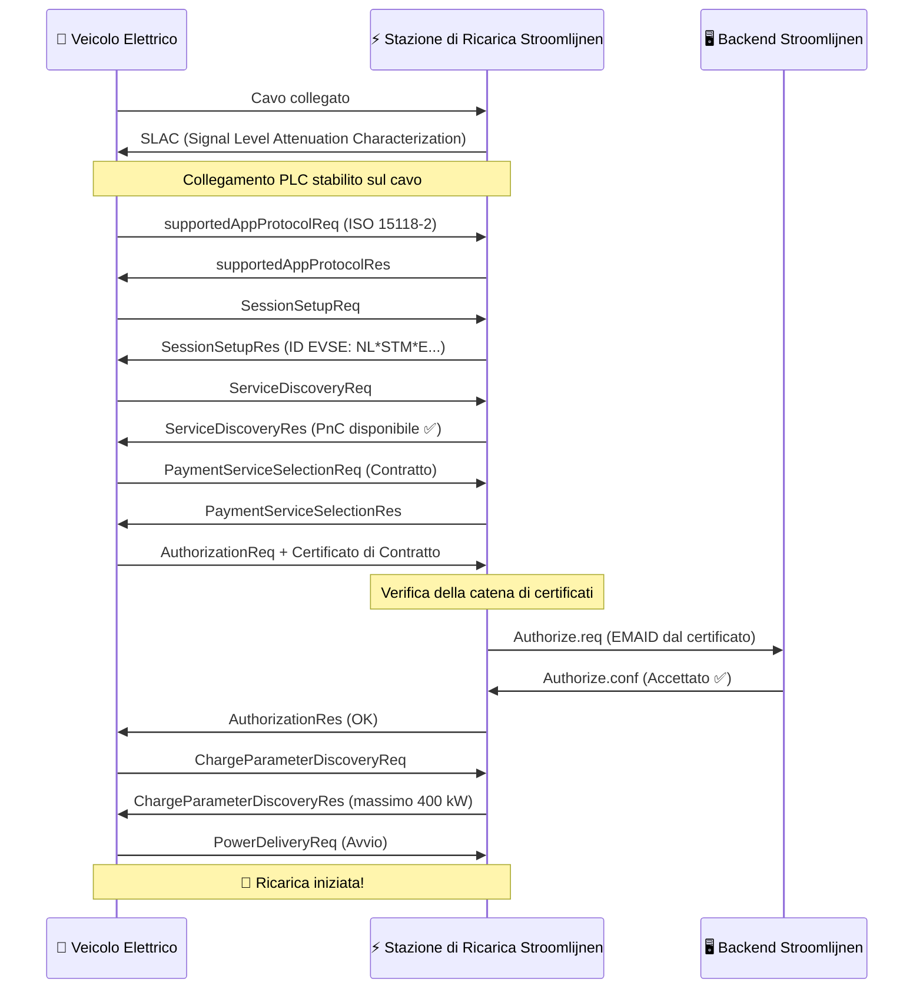

# Come Funziona Plug & Charge

Plug & Charge (PnC) sostituisce i token fisici (pass RFID, app) con **certificati crittografici** incorporati nel veicolo. Quando un veicolo compatibile PnC si collega a una stazione di ricarica compatibile PnC, eseguono una stretta di mano digitale — verificando l'identità, autorizzando la sessione e avviando il flusso di energia — tutto in pochi secondi.

## Il Protocollo: ISO 15118

ISO 15118 è lo standard internazionale che definisce come i veicoli elettrici comunicano con le stazioni di ricarica attraverso il cavo di ricarica. Va ben oltre la semplice fornitura di energia:

- **ISO 15118-2** — La versione ampiamente utilizzata per la ricarica AC e DC con supporto PnC
- **ISO 15118-20** — La prossima generazione, con trasferimento di energia bidirezionale (V2G) e migliorato il processo di certificazione
- **ISO 15118-3** — Strato fisico e strato di collegamento dati (comunicazione PLC sul cavo)

Le stazioni di ricarica Stroomlijnen supportano ora ISO 15118-2, con la prontezza per ISO 15118-20 integrata nel nostro hardware.

## La Catena di Certificati

La sicurezza PnC si basa su una **Public Key Infrastructure (PKI)** — la stessa tecnologia che protegge il banking online e i siti web HTTPS. Questa è la gerarchia:

```
V2G Root CA (ad esempio Hubject)
├── CPO Sub-CA (Stroomlijnen)
│   └── Certificato foglia EVSE (stazione di ricarica individuale)
└── eMSP Sub-CA (Stroomlijnen / partner di roaming)
    └── Certificato di contratto (installato nel tuo veicolo)
```

Ogni certificato è firmato da quello superiore, creando una **catena di fiducia** che sia il veicolo che la stazione di ricarica possono verificare in modo indipendente.

## La Stretta di Mano — Passo dopo Passo



### Cosa Succede in Termini Semplici

1. **Collegamento Fisico** — L'autista inserisce il cavo CCS
2. **Collegamento di Comunicazione** — Il veicolo e la stazione di ricarica stabiliscono un collegamento dati tramite Power Line Communication (PLC)
3. **Negoziazione del Protocollo** — Concordano sull'utilizzo di ISO 15118-2
4. **Scambio di Identità** — Il veicolo presenta il suo **certificato di contratto**, che contiene l'EMAID (e-Mobility Account Identifier) che lo collega a un account di fatturazione
5. **Verifica del Certificato** — La stazione di ricarica valida la catena di certificati fino alla root CA attendibile
6. **Autorizzazione Backend** — La stazione di ricarica controlla presso il backend Stroomlijnen se questo EMAID è valido e ha un contratto attivo
7. **Parametri di Ricarica** — Negoziano i livelli di potenza (tensione, corrente, potenza massima)
8. **Flusso di Energia** — La ricarica inizia automaticamente

L'intero processo dura **3–8 secondi** dall'inserimento del cavo all'avvio della fornitura di energia.

## Concetti Chiave

### Certificato di Contratto

Un certificato digitale installato nel computer di bordo del veicolo. Contiene:

- **EMAID** — Il tuo univoco e-Mobility Account Identifier (ad esempio `NL-STM-C00001234-5`)
- **Chiave Pubblica** — Utilizzata per l'autenticazione TLS
- **Periodo di Validità** — Di solito 1–2 anni
- **Emittente** — L'eMSP (Stroomlijnen o partner di roaming)

Il veicolo memorizza questo certificato in modo sicuro e lo presenta automaticamente a ogni stazione di ricarica compatibile PnC.

### Certificato EVSE

Il certificato proprio della stazione di ricarica, che dimostra di essere un punto di ricarica Stroomlijnen legittimo. Ciò impedisce che stazioni di ricarica malintenzionate intercettino le credenziali di accesso.

### Servizio di Provisioning dei Certificati (CPS)

Il sistema che installa e aggiorna i certificati di contratto nei veicoli. Quando si registra un veicolo nel portale Stroomlijnen, il CPS:

1. Genera un certificato di contratto per quel veicolo
2. Lo invia tramite il backend dell'OEM al veicolo (Volvo Connect, DAF Connect, ecc.)
3. Il veicolo lo memorizza nel suo elemento sicuro

### Hubject

L'**ancoraggio di fiducia** per PnC in Europa. Hubject gestisce la V2G Root CA e il pool di certificati che consente la compatibilità cross-operator. Quando una stazione di ricarica Stroomlijnen incontra un veicolo con un certificato di un'altra eMSP, l'infrastruttura di Hubject verifica la catena.

## Sicurezza

PnC è **più sicuro** dei pass RFID:

| Aspetto | RFID | Plug & Charge |
|--------|------|---------------|
| Autenticazione | Token statico (può essere clonato) | Autenticazione TLS reciproca |
| Crittografia | Nessuna | AES-256 via PLC |
| Collegamento di Identità | Pass ↔ account (sciolto) | Certificato ↔ VIN del veicolo (forte) |
| Revoca | Deve ritirare fisicamente il pass | Revoca del certificato a distanza |
| Rischio di Frode | Furto o clonazione del pass | Estremamente difficile (modulo di sicurezza hardware) |

## Requisiti

Per Plug & Charge sono necessari tre elementi:

1. **Supporto del Veicolo** — Il veicolo deve avere la funzionalità ISO 15118-PnC e un certificato di contratto valido installato
2. **Supporto della Stazione di Ricarica** — La stazione di ricarica EVSE deve supportare ISO 15118-2 con PnC (tutte le stazioni di ricarica DC Stroomlijnen lo fanno)
3. **Integrazione del Backend** — L'eMSP e il CPO devono essere connessi tramite l'ecosistema dei certificati (Hubject)

## Cosa Arriva Dopo: Vehicle-to-Grid (V2G)

ISO 15118-20 estende PnC con il trasferimento di energia bidirezionale. Una flotta di veicoli elettrici che parcheggia vicino a un teatro di notte potrebbe:

- Ricaricare quando l'elettricità è più economica (ore di basso carico / alto apporto solare)
- Fornire energia alla rete durante i picchi di domanda
- Generare entrate per il gestore della flotta

L'hardware Stroomlijnen è pronto per V2G. Non appena gli OEM dei veicoli attivano ISO 15118-20, attiveremo la ricarica bidirezionale nelle nostre sedi.

---

**Prossimo:** [Veicoli Compatibili →](./compatible-vehicles)