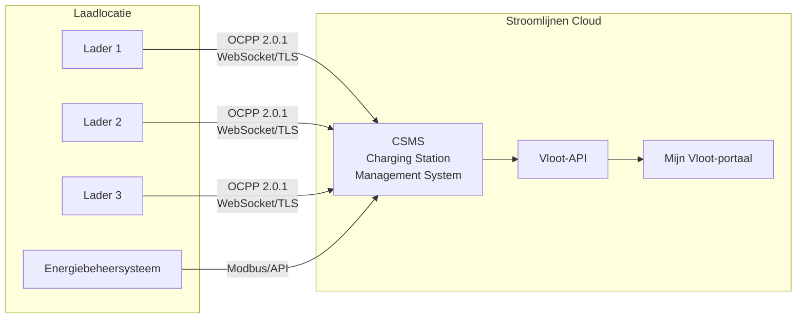

# Panoramica su OCPP

**OCPP (Open Charge Point Protocol)** è il protocollo di comunicazione standard dell'industria tra le stazioni di ricarica e un sistema di gestione centrale. Stroomlijnen utilizza OCPP per gestire, monitorare e controllare a distanza tutti i nostri caricabatterie.

## Cos'è OCPP?

OCPP definisce come una stazione di ricarica (Charge Point) comunichi con un Charging Station Management System (CSMS — che siamo noi). Comprende:

- **Autorizzazione** — Controllo se un utente/veicolo può caricare
- **Gestione sessione** — Avvio, monitoraggio e arresto delle sessioni di ricarica
- **Misurazione** — Rapporto in tempo reale del consumo di energia
- **Controllo remoto** — Avvio/arresto a distanza delle sessioni, regolazione della potenza, riavvio dei caricabatterie
- **Diagnostica** — Aggiornamenti del firmware, richiesta dei log, monitoraggio dello stato di salute
- **Ricarica intelligente** — Gestione dinamica della potenza su più caricabatterie

## Versioni OCPP

| Versione | Stato in Stroomlijnen | Funzionalità principali |
|---------|----------------------|--------------|
| OCPP 1.6-J | ✅ Supportato | JSON/WebSocket, profili di ricarica intelligenti, ampiamente adottato |
| OCPP 2.0.1 | ✅ Preferito | Integrazione ISO 15118, modello di dispositivo, sicurezza migliorata, elaborazione transazioni |

### Perché OCPP 2.0.1 è importante

OCPP 2.0.1 rappresenta un significativo aggiornamento rispetto alla versione 1.6, in particolare per la ricarica della flotta:

- **Integrazione ISO 15118** — Supporto integrato per la gestione dei certificati Plug & Charge tramite OCPP
- **Sicurezza migliorata** — Aggiornamenti del firmware sicuri, valori del contatore firmati, TLS obbligatorio
- **Modello di dispositivo** — Metodo standardizzato per richiedere le capacità e la configurazione dei caricabatterie
- **Elaborazione transazioni** — Migliore elaborazione delle transazioni complesse (pre-autorizzazione, parcheggio, energia)
- **Ricarica intelligente** — Controllo più dettagliato dei profili di ricarica e della distribuzione della potenza
- **Messaggi di visualizzazione** — Invio di messaggi personalizzati allo schermo del caricabatterie

Tutti i nuovi caricabatterie Stroomlijnen vengono implementati con OCPP 2.0.1. I caricabatterie esistenti della versione 1.6-J continueranno a funzionare e verranno aggiornati quando il hardware lo supporterà.

## Architettura

### Flusso di comunicazione

1. **Caricabatterie → CSMS:** Il caricabatterie si connette al nostro CSMS tramite una connessione WebSocket sicura (wss://)
2. **Battiti cardiaci:** I caricabatterie inviano battiti cardiaci periodici per confermare di essere online
3. **Autorizzazione:** Quando un utente presenta un pass RFID o un certificato PnC, il caricabatterie invia una richiesta di autorizzazione al nostro CSMS
4. **Misurazione:** Durante la ricarica, i valori del contatore (energia, potenza, SoC) vengono inviati a intervalli regolari
5. **Comandi esterni:** Il nostro CSMS può inviare comandi ai caricabatterie (avvio, arresto, reset, aggiornamento del firmware)

## Ricarica intelligente

Le funzionalità di ricarica intelligente di OCPP sono essenziali per le località con capacità di rete limitata:

### Profili di ricarica
Impostiamo profili di ricarica che indicano a ogni caricabatterie quanto potere può utilizzare in ogni momento:

- **TxDefaultProfile** — Limite di potenza predefinito per ogni transazione
- **TxProfile** — Regolazione della potenza per transazione
- **ChargingStationMaxProfile** — Limite di potenza generale per la località

### Distribuzione dei compiti
Quando più veicoli caricano contemporaneamente e la località ha una capacità di rete limitata:

1. Il nostro EMS monitora il carico totale della località (tramite Modbus/API)
2. Il CSMS calcola la capacità disponibile per ogni caricabatterie
3. I profili di ricarica vengono aggiornati dinamicamente tramite OCPP
4. La potenza viene distribuita in modo equo o in base alla priorità (in base alle impostazioni della flotta)

Esempio: Una località con una capacità di rete di 600 kW e 3 caricabatterie da 350 kW ciascuno:
- 1 veicolo in carica → riceve fino a 350 kW
- 2 veicoli in carica → ogni uno 300 kW
- 3 veicoli in carica → ogni uno 200 kW
- Durante le ore di punta sulla rete → ulteriormente ridotto per rimanere entro la capacità contrattata

### Ricarica pianificata
I gestori della flotta possono impostare gli orari di partenza e lo stato di carica desiderato. Il nostro sistema ottimizza quando caricare:
- Ritarda l'avvio fino a quando l'elettricità è più economica
- Garantisce che lo stato di carica desiderato sia raggiunto per l'orario di partenza
- Bilancia su tutti i veicoli nella località

## Sicurezza

Funzionalità di sicurezza OCPP 2.0.1 che implementiamo:

- **TLS 1.3** — Tutte le connessioni OCPP sono crittografate
- **Certificati client** — I caricabatterie si autenticano con il nostro CSMS tramite certificati
- **Valori del contatore firmati** — Misurazioni dell'energia resistenti alla manipolazione
- **Aggiornamenti del firmware sicuri** — Immagini del firmware crittograficamente firmate
- **Controllo di accesso** — Limitazioni fisiche e di rete per ogni località

## Per i partner hardware

Se sei un produttore o installatore di caricabatterie che lavora con Stroomlijnen:

- Richiediamo la conformità **OCPP 2.0.1** (1.6-J accettato per il magazzino esistente)
- I caricabatterie devono supportare **ISO 15118-2** PnC
- TLS 1.2+ è obbligatorio
- Forniamo endpoint e dati CSMS durante il processo di onboarding
- Sono richiesti test di interoperabilità per la distribuzione

Contattaci tramite [technical@stroomlijnen.nl](mailto:technical@stroomlijnen.nl) per la documentazione di integrazione.