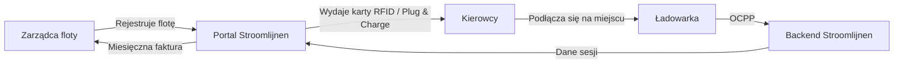

# Co to jest Stroomlijnen?

Stroomlijnen B.V. jest holenderskim **Operatorem Punktu Ładowania (CPO)** i **Dostawcą Usług Ruchomości Elektrycznej (eMSP)**, który buduje i eksploatuje infrastrukturę ładowania pojazdów elektrycznych w **teatrach** i **lokalizacjach logistycznych** na terenie całej Holandii.

## Co Robimy

Instalujemy, eksploatujemy i utrzymujemy stacje ładowania o wysokiej mocy, które są specjalnie zaprojektowane dla **elektrycznych ciężarówek i pojazdów użytkowych**. Nasze ładowarki znajdują się w lokalizacjach z dużymi istniejącymi połączeniami sieciowymi — głównie teatry, place targowe i centra logistyczne.

### Dlaczego Teatry?

Teatry posiadają coś, czego nie mają większość lokalizacji: **ogromne połączenia elektryczne** (często 400–2000 kVA), które są niewykorzystane w ciągu dnia. Spektakle odbywają się wieczorami. Ciężarówki ładowane są w ciągu dnia. Infrastruktura jest już dostępna — my ją wykorzystujemy.

### Nasza Tożsamość eMSP

Działamy pod **identyfikatorem eMSP NL\*STM** w holenderskiej i europejskiej sieci ładowania. Oznacza to:

- Twoi kierowcy mogą korzystać z naszych kart RFID lub Plug & Charge przy **każdej** publicznej ładowarce w Holandii i Europie (poprzez roaming)
- Klienci innych eMSP mogą ładować na naszych lokalizacjach
- Pełna interoperacyjność za pomocą protokołu OCPI

## Jak Działa Ładowanie Floty

1. **Zarejestruj** swoją flotę w portalu Stroomlijnen
2. **Skonfiguruj** swoje pojazdy — karty RFID, Plug & Charge lub oba
3. **Kierowcy ładują** na każdej lokalizacji Stroomlijnen (lub u partnera roamingowego)
4. **Otrzymujesz** szczegółowe dane sesji, raporty energetyczne i jedną miesięczną fakturę

## Główne Funkcje

| Funkcja | Opis |
|---------|-------------|
| **Plug & Charge** | Automatyczna autentykacja ISO 15118 — nie potrzebna karta |
| **Karty RFID** | Tradycyjne ładowanie oparte na karcie z identyfikatorem NL*STM |
| **Portal floty** | Dane sesji w czasie rzeczywistym, zarządzanie pojazdami, faktury |
| **Inteligentne ładowanie** | Rozdział zadań dla optymalnych kosztów energii i wpływu na sieć |
| **OCPP 2.0.1** | Najnowszy standard protokołu dla zarządzania ładowarkami |
| **Roaming** | Ładowanie na ponad 300 000 punktach w całej Europie za pomocą OCPI |

## Co Znajduje Się w Tym Repozytorium Wiedzy?

Ten serwis zawiera wszystko, co musisz wiedzieć:

- **[Rozpoczęcie](/docs/getting-started/first-session)** — Twoja pierwsza sesja ładowania
- **[Plug & Charge](/docs/plug-and-charge/what-is-pnc)** — Przyszłość bezproblemowego ładowania
- **[Zarządzanie flotą](/docs/fleet-management/overview)** — Zarządzanie Twoją flotą ładowania
- **[Techniczne](/docs/technical/ocpp-overview)** — Głębokie spojrzenie na technologię
- **[FAQ](/docs/faq)** — Odpowiedzi na najczęściej zadawane pytania

:::tip The Show Must Go On
Nasze motto nie jest po prostu marketingiem. Odzwierciedla nasze zaangażowanie: jeśli Twoja flota musi być naładowana, **musi** być gotowa infrastruktura. Niezawodność na poziomie teatru oznacza przygotowanie się na każdy scenariusz.
:::