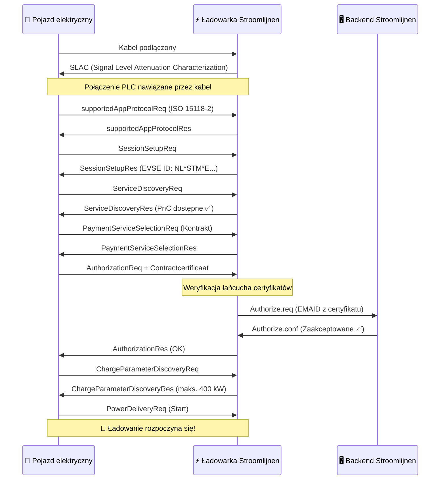

# Jak Działa Plug & Charge

Plug & Charge (PnC) zastępuje fizyczne tokeny (karty RFID, aplikacje) **kryptograficznymi certyfikatami** wbudowanymi w pojazd. Gdy PnC-kompatybilny samochód ciężarowy podłączy się do PnC-kompatybilnego ładowarki, wykonują one cyfrowy handshake — weryfikując tożsamość, autoryzując sesję i uruchamiając przepływ energii — wszystko w ciągu kilku sekund.

## Protokół: ISO 15118

ISO 15118 jest międzynarodowym standardem, który definiuje, jak pojazdy elektryczne komunikują się z stacjami ładowania za pomocą kabla ładowania. Idzie znacznie dalej niż prosta dostawa energii:

- **ISO 15118-2** — Powszechnie stosowana wersja dla ładowania AC i DC z obsługą PnC
- **ISO 15118-20** — Następna generacja, z transmisją energii w obu kierunkach (V2G) i ulepszoną obsługą certyfikatów
- **ISO 15118-3** — Warstwa fizyczna i warstwa łącza danych (komunikacja PLC przez kabel)

Ładowarki Stroomlijnen obsługują obecnie ISO 15118-2, z gotowością do ISO 15118-20 wbudowaną w nasze urządzenia.

## Łańcuch Certyfikatów

Bezpieczeństwo PnC opiera się na **Public Key Infrastructure (PKI)** — tej samej technologii, która zabezpiecza bankowość internetową i strony HTTPS. Oto hierarchia:

```
V2G Root CA (np. Hubject)
├── CPO Sub-CA (Stroomlijnen)
│   └── EVSE-bladcertificaat (indywidualna ładowarka)
└── eMSP Sub-CA (Stroomlijnen / partner roamingowy)
    └── Contractcertificaat (zainstalowany w Twoim pojeździe)
```

Każdy certyfikat jest podpisany przez wyższy, tworząc **łańcuch zaufania**, który zarówno pojazd, jak i ładowarka mogą niezależnie zweryfikować.

## Handshake — Krok po Kroku



### Co Się Dzieje w Zwykłym Języku

1. **Połączenie fizyczne** — Kierowca podłącza kabel CCS
2. **Połączenie komunikacyjne** — Pojazd i ładowarka nawiązują połączenie danych przez kabel za pomocą Power Line Communication (PLC)
3. **Negocjowanie protokołu** — Uzgadniają użycie ISO 15118-2
4. **Wymiana tożsamości** — Pojazd przedstawia swój **certyfikat kontraktowy**, który zawiera EMAID (e-Mobility Account Identifier) powiązany z kontem rozliczeniowym
5. **Weryfikacja certyfikatu** — Ładowarka sprawdza łańcuch certyfikatów aż do zaufanego root CA
6. **Autoryzacja backendu** — Ładowarka sprawdza w backendzie Stroomlijnen, czy EMAID jest ważne i czy ma aktywny kontrakt
7. **Parametry ładowania** — Uzgadniają poziomy mocy (napięcie, prąd, maksymalna moc)
8. **Przepływ energii** — Ładowanie rozpoczyna się automatycznie

Cały proces trwa **3–8 sekund** od podłączenia do rozpoczęcia przepływu energii.

## Kluczowe Pojęcia

### Certyfikat Kontraktowy

Cyfrowy certyfikat zainstalowany w komputerze pokładowym pojazdu. Zawiera:

- **EMAID** — Unikalny e-Mobility Account Identifier (np. `NL-STM-C00001234-5`)
- **Klucz publiczny** — Używany do uwierzytelniania TLS
- **Okres ważności** — Zwykle 1–2 lata
- **Wydawca** — eMSP (Stroomlijnen lub partner roamingowy)

Pojazd przechowuje ten certyfikat bezpiecznie i przedstawia go automatycznie przy każdej PnC-kompatybilnej ładowarce.

### Certyfikat EVSE

Własny certyfikat ładowarki, który potwierdza, że jest to prawdziwa ładowarka Stroomlijnen. Zapobiega to nieautoryzowanym ładowarkom przechwyceniu danych logowania.

### Certificate Provisioning Service (CPS)

System, który instaluje certyfikaty kontraktowe w pojazdach i je aktualizuje. Gdy zarejestrujesz swój pojazd w portalu Stroomlijnen, CPS:

1. Generuje certyfikat kontraktowy dla tego pojazdu
2. Wysyła go przez backend OEM do pojazdu (Volvo Connect, DAF Connect itp.)
3. Pojazd zapisuje go w swoim bezpiecznym elemencie

### Hubject

**Anker zaufania** dla PnC w Europie. Hubject zarządza V2G Root CA i pulą certyfikatów, umożliwiając kompatybilność między operatorami. Gdy ładowarka Stroomlijnen spotka pojazd z certyfikatem innego eMSP, infrastruktura Hubject weryfikuje łańcuch.

## Bezpieczeństwo

PnC jest **bezpieczniejsze** niż karty RFID:

| Aspekt | RFID | Plug & Charge |
|--------|------|---------------|
| Uwierzytelnianie | Statyczny token (może być sklonowany) | Wspólne uwierzytelnianie TLS |
| Szyfrowanie | Brak | AES-256 przez PLC |
| Powiązanie tożsamości | Karta ↔ konto (luźne) | Certyfikat ↔ VIN pojazdu (silne) |
| Odwołanie | Należy fizycznie odebrać kartę | Można odwołać certyfikat na odległość |
| Ryzyko oszustwa | Kradzież/klonowanie karty | Bardzo trudne (moduł zabezpieczeń sprzętowych) |

## Wymagania

Aby korzystać z Plug & Charge, są potrzebne trzy rzeczy:

1. **Wspieranie przez pojazd** — Pojazd musi mieć możliwość obsługi ISO 15118-PnC i ważny certyfikat kontraktowy
2. **Wspieranie przez ładowarkę** — Ładowarka EVSE musi obsługiwać ISO 15118-2 z PnC (wszystkie ładowarki DC Stroomlijnen to robią)
3. **Integracja backendu** — eMSP i CPO muszą być połączone za pomocą systemu certyfikatów (Hubject)

## Co Dalej: Vehicle-to-Grid (V2G)

ISO 15118-20 rozszerza PnC o transmisję energii w obu kierunkach. Flota elektrycznych samochodów ciężarowych, która parkuje np. przy teatrze nocą, mogłaby:

- Ładować się, gdy energia jest najtańsza (godziny szczytu / wysoka dostępność energii słonecznej)
- Dostarczać energię z powrotem do sieci podczas szczytowego zapotrzebowania
- Generować dochody dla zarządcy floty

Urządzenia Stroomlijnen są gotowe do V2G. Gdy producenci samochodów włączą ISO 15118-20, aktywujemy bidirectionally ładowanie na naszych lokalizacjach.

---

**Następnie:** [Kompatybilne Pojazdy →](./compatible-vehicles)