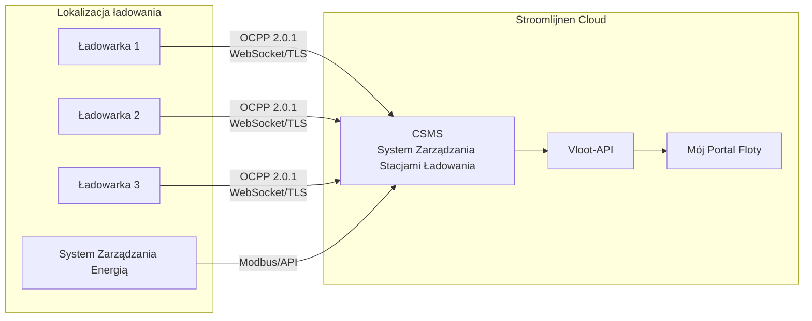

# Przegląd OCPP

**OCPP (Open Charge Point Protocol)** to standardowy protokół komunikacyjny pomiędzy stacjami ładowania a centralnym systemem zarządzania. Stroomlijnen wykorzystuje OCPP do zdalnego zarządzania, monitorowania i sterowania wszystkimi naszymi ładowarkami.

## Czym jest OCPP?

OCPP definiuje sposób, w jaki stacja ładowania (Charge Point) komunikuje się z systemem zarządzania stacjami ładowania (CSMS — czyli my). Obejmuje to:

- **Autoryzacja** — sprawdzenie, czy użytkownik/pojazd może być ładowany
- **Zarządzanie sesją** — uruchamianie, monitorowanie i zatrzymywanie sesji ładowania
- **Pomiar** — raportowanie zużycia energii w czasie rzeczywistym
- **Sterowanie zdalne** — uruchamianie/zatrzymywanie sesji na odległość, dostosowywanie mocy, restartowanie ładowarek
- **Diagnostyka** — aktualizacje oprogramowania, pobieranie logów, monitorowanie stanu
- **Ładowanie inteligentne** — dynamiczne zarządzanie mocą na wielu ładowarkach

## Wersje OCPP

| Wersja | Status w Stroomlijnen | Kluczowe funkcje |
|---------|----------------------|--------------|
| OCPP 1.6-J | ✅ Obsługiwany | JSON/WebSocket, profile ładowania inteligentnego, szerokie zastosowanie |
| OCPP 2.0.1 | ✅ Preferowany | Integracja ISO 15118, model urządzenia, poprawiona bezpieczeństwo, przetwarzanie transakcji |

### Dlaczego OCPP 2.0.1 jest ważny

OCPP 2.0.1 to znacząca aktualizacja wersji 1.6, szczególnie dla ładowania flot:

- **Integracja ISO 15118** — wbudowane wsparcie dla zarządzania certyfikatami Plug & Charge za pośrednictwem OCPP
- **Poprawiona bezpieczeństwo** — bezpieczne aktualizacje oprogramowania, podpisywane wartości liczników, wymagany TLS
- **Model urządzenia** — standaryzowany sposób na zapytanie o możliwości i konfigurację ładowarki
- **Przetwarzanie transakcji** — lepsze przetwarzanie złożonych transakcji (wstępna autoryzacja, parkowanie, energia)
- **Ładowanie inteligentne** — bardziej szczegółowa kontrola nad profilami ładowania i rozdziałem mocy
- **Wiadomości wyświetlane** — wysyłanie niestandardowych wiadomości na ekran ładowarki

Wszystkie nowe ładowarki Stroomlijnen są wdrożone z OCPP 2.0.1. Istniejące ładowarki 1.6-J nadal działają i są aktualizowane, gdy tylko sprzęt to umożliwia.

## Architektura

### Przepływ komunikacji

1. **Ładowarka → CSMS:** Ładowarka łączy się z naszym CSMS przez bezpieczne połączenie WebSocket (wss://)
2. **Sygnały serca:** Ładowarki wysyłają okresowe sygnały serca, aby potwierdzić, że są online
3. **Autoryzacja:** Gdy użytkownik przedstawia kartę RFID lub certyfikat PnC, ładowarka wysyła wniosek o autoryzację do naszego CSMS
4. **Pomiar:** Podczas ładowania wartości liczników (energia, moc, SoC) są wysyłane w regularnych odstępach czasu
5. **Polecenia zewnętrzne:** Nasze CSMS może wysyłać polecenia do ładowarek (uruchamianie, zatrzymywanie, resetowanie, aktualizacja oprogramowania)

## Ładowanie inteligentne

Funkcje ładowania inteligentnego OCPP są niezbędne dla lokalizacji o ograniczonej pojemności sieci:

### Profile ładowania
Ustawiamy profile ładowania, które informują każdą ładowarkę, jaka moc może być użyta w danym momencie:

- **TxDefaultProfile** — standardowy limit mocy dla każdej transakcji
- **TxProfile** — dostosowanie mocy na transakcję
- **ChargingStationMaxProfile** — ogólny limit mocy dla lokalizacji

### Rozdział zadań
Gdy wiele pojazdów ładowanych jest jednocześnie, a lokalizacja ma ograniczoną pojemność sieci:

1. Nasz system EMS monitoruje całkowite obciążenie lokalizacji (za pomocą Modbus/API)
2. CSMS oblicza dostępną pojemność dla każdej ładowarki
3. Profile ładowania są dynamicznie aktualizowane za pomocą OCPP
4. Moc jest rozdzielana sprawiedliwie lub na podstawie priorytetu (w oparciu o ustawienia floty)

Przykład: Lokalizacja z pojemnością sieci 600 kW i 3 ładowarkami po 350 kW:
- 1 pojazd ładowany → otrzymuje do 350 kW
- 2 pojazdy ładowane → każdy 300 kW
- 3 pojazdy ładowane → każdy 200 kW
- Podczas godzin szczytu w sieci → obniżone, aby pozostać w ramach umówionej pojemności

### Planowane ładowanie
Menedżerowie floty mogą ustawić czasy wyjazdu i docelowy stan naładowania. Nasz system optymalizuje, kiedy ładować:
- Opóźnia start, aż energia będzie najtańsza
- Gwarantuje osiągnięcie docelowego stanu naładowania przed czasem wyjazdu
- Bilansuje pomiędzy wszystkimi pojazdami na lokalizacji

## Bezpieczeństwo

Funkcje bezpieczeństwa OCPP 2.0.1, które wdrażamy:

- **TLS 1.3** — Wszystkie połączenia OCPP są szyfrowane
- **Certyfikaty klienta** — Ładowarki uwierzytelniają się w naszym CSMS za pomocą certyfikatów
- **Podpisane wartości liczników** — Zapobiegające manipulacji pomiarami energii
- **Bezpieczne aktualizacje oprogramowania** — Kryptograficznie podpisywane obrazy oprogramowania
- **Kontrola dostępu** — Ograniczenia fizycznego i sieciowego dostępu do każdej lokalizacji

## Dla partnerów sprzętowych

Jeśli jesteś producentem ładowarek lub instalatorem współpracującym ze Stroomlijnen:

- Wymagamy **zgodności z OCPP 2.0.1** (1.6-J akceptowane dla istniejących zapasów)
- Ładowarki muszą obsługiwać **ISO 15118-2** PnC
- TLS 1.2+ jest wymagany
- Zapewniamy punkty końcowe CSMS i dane podczas procesu wdrożenia
- Testy interoperacyjności są wymagane do wdrożenia

Skontaktuj się z nami przez [technical@stroomlijnen.nl](mailto:technical@stroomlijnen.nl) w celu uzyskania dokumentacji integracyjnej.