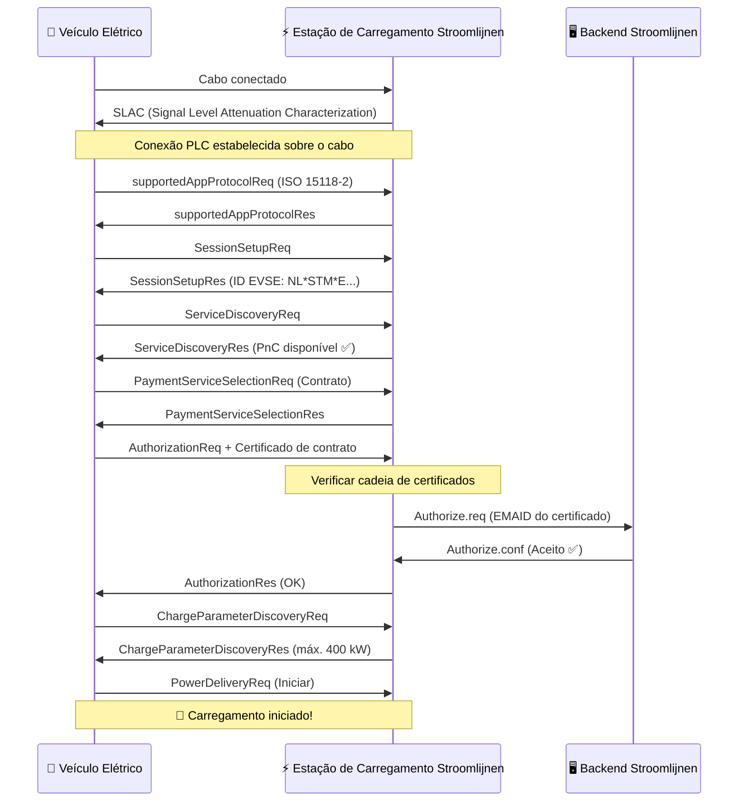

# Como Funciona o Plug & Charge

O Plug & Charge (PnC) substitui tokens físicos (cartões RFID, aplicativos) por **certificados criptográficos** integrados ao veículo. Quando um caminhão compatível com PnC se conecta a uma estação de carregamento compatível com PnC, eles realizam uma "aperto de mão" digital — verificando identidade, autorizando a sessão e iniciando o fluxo de energia — tudo em questão de segundos.

## O Protocolo: ISO 15118

A ISO 15118 é o padrão internacional que define como veículos elétricos se comunicam com estações de carregamento via cabo de carregamento. Ele vai muito além da simples entrega de energia:

- **ISO 15118-2** — A versão amplamente utilizada para carregamento AC e DC com suporte a PnC
- **ISO 15118-20** — A próxima geração, com transferência de energia bidirecional (V2G) e processamento de certificados aprimorado
- **ISO 15118-3** — Camada física e camada de link de dados (comunicação PLC sobre o cabo)

As estações de carregamento Stroomlijnen agora suportam a ISO 15118-2, com prontidão para a ISO 15118-20 integrada em nosso hardware.

## A Cadeia de Certificados

A segurança do PnC depende de uma **Infraestrutura de Chaves Públicas (PKI)** — a mesma tecnologia que protege o banking online e sites HTTPS. Esta é a hierarquia:

```
V2G Root CA (por exemplo, Hubject)
├── CPO Sub-CA (Stroomlijnen)
│   └── Certificado de folha EVSE (estação de carregamento individual)
└── eMSP Sub-CA (Stroomlijnen / parceiro de roaming)
    └── Certificado de contrato (instalado em seu caminhão)
```

Cada certificado é assinado pelo certificado pai, criando uma **cadeia de confiança** que tanto o veículo quanto a estação de carregamento podem verificar independentemente.

## O Aperto de Mão — Passo a Passo



### O que Acontece em Linguagem Comum

1. **Conexão física** — O motorista conecta o cabo CCS
2. **Conexão de comunicação** — O caminhão e a estação de carregamento estabelecem uma conexão de dados via PLC sobre o cabo
3. **Negociação de protocolo** — Eles concordam em usar ISO 15118-2
4. **Troca de identidade** — O caminhão apresenta seu **certificado de contrato**, que contém a EMAID (Identificador de Conta de Mobilidade Elétrica) que o vincula a uma conta de faturamento
5. **Verificação de certificado** — A estação de carregamento valida a cadeia de certificados até a CA raiz confiável
6. **Autorização de backend** — A estação de carregamento verifica com o backend Stroomlijnen se essa EMAID é válida e tem um contrato ativo
7. **Parâmetros de carregamento** — Eles negociam níveis de energia (tensão, corrente, potência máxima)
8. **Energia flui** — O carregamento começa automaticamente

Todo o processo dura **3–8 segundos** desde a conexão até a entrega de energia.

## Conceitos Chave

### Certificado de Contrato

Um certificado digital instalado no computador de bordo do veículo. Ele contém:

- **EMAID** — Seu Identificador de Conta de Mobilidade Elétrica único (por exemplo, `NL-STM-C00001234-5`)
- **Chave pública** — Usada para autenticação TLS
- **Período de validade** — Normalmente 1–2 anos
- **Emissor** — O eMSP (Stroomlijnen ou parceiro de roaming)

O caminhão armazena esse certificado com segurança e o apresenta automaticamente em cada estação de carregamento compatível com PnC.

### Certificado EVSE

O certificado próprio da estação de carregamento, que prova ser um ponto de carregamento Stroomlijnen legítimo. Isso impede que estações de carregamento mal-intencionadas interceptem credenciais de login.

### Serviço de Provisionamento de Certificados (CPS)

O sistema que instala e atualiza certificados de contrato em veículos. Quando você registra um caminhão no portal Stroomlijnen, o CPS:

1. Gera um certificado de contrato para esse veículo
2. O envia via backend do OEM para o veículo (Volvo Connect, DAF Connect, etc.)
3. O veículo armazena em seu elemento seguro

### Hubject

O **âncora de confiança** para PnC na Europa. A Hubject gerencia a V2G Root CA e o pool de certificados que permite compatibilidade entre operadores. Quando uma estação de carregamento Stroomlijnen encontra um caminhão com um certificado de outra eMSP, a infraestrutura da Hubject valida a cadeia.

## Segurança

O PnC é **mais seguro** do que os cartões RFID:

| Aspecto | RFID | Plug & Charge |
|--------|------|---------------|
| Autenticação | Token estático (pode ser clonado) | Autenticação TLS mútua |
| Criptografia | Nenhuma | AES-256 via PLC |
| Vinculação de identidade | Passaporte ↔ conta (solto) | Certificado ↔ VIN do veículo (forte) |
| Revogação | Deve tomar o passaporte fisicamente | Certificado revogado remotamente |
| Risco de fraude | Roubo/clonagem de passaportes | Extremamente difícil (módulo de segurança de hardware) |

## Requisitos

Para o Plug & Charge, três coisas são necessárias:

1. **Suporte do veículo** — O caminhão deve ter a capacidade ISO 15118-PnC e um certificado de contrato válido instalado
2. **Suporte da estação de carregamento** — A EVSE deve suportar a ISO 15118-2 com PnC (todas as estações de carregamento DC Stroomlijnen o fazem)
3. **Integração de backend** — O eMSP e o CPO devem estar conectados via o ecossistema de certificados (Hubject)

## O que Vem a Seguir: Vehicle-to-Grid (V2G)

A ISO 15118-20 expande o PnC com transferência de energia bidirecional. Uma frota de caminhões elétricos que estaciona perto de um teatro à noite poderia:

- Carregar quando a eletricidade é mais barata (horas de baixo consumo / alto fornecimento solar)
- Fornecer energia de volta à rede durante picos de demanda
- Gerar receita para o gestor da frota

O hardware Stroomlijnen está pronto para V2G. Assim que os fabricantes de caminhões ativarem a ISO 15118-20, ativaremos o carregamento bidirecional em nossas estações.

---

**Próximo:** [Veículos Compatíveis →](./compatible-vehicles)