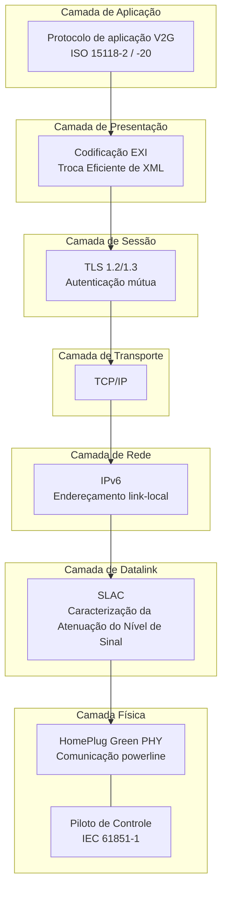
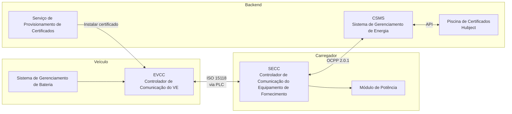
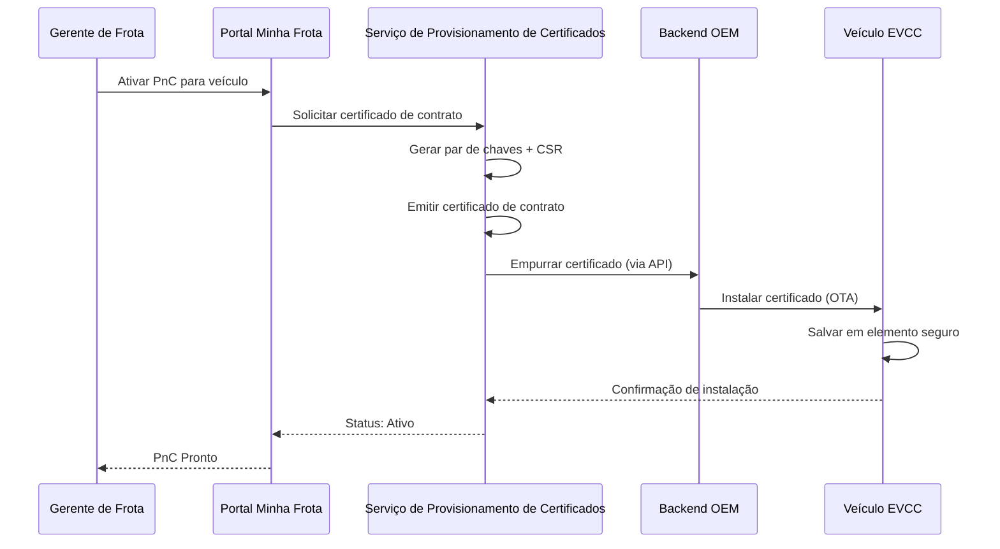

# Aprofundamento da ISO 15118

A ISO 15118 é o padrão internacional para "Interface de Comunicação Veículo-Rede". Define como veículos elétricos e estações de carregamento se comunicam via cabo de carregamento, possibilitando Plug & Charge, carregamento inteligente e, eventualmente, transferência bidirecional de energia.

## Estrutura do Padrão

| Parte | Título | Relevância |
|------|-------|-----------|
| ISO 15118-1 | Informações gerais e definição de cenários de uso | Quadro e conceitos |
| ISO 15118-2 | Protocolo de rede e aplicação (AC/DC) | **Atualmente implantado** — PnC, carregamento inteligente |
| ISO 15118-3 | Camada física e datalink (PLC) | Comunicação powerline via cabo |
| ISO 15118-4 | Teste de conformidade do protocolo de rede e aplicação | Procedimentos de teste |
| ISO 15118-5 | Teste de conformidade da camada física e datalink | Procedimentos de teste |
| ISO 15118-20 | 2ª geração do protocolo de rede e aplicação | **Próxima geração** — V2G, PnC aprimorado, ACDP |
| ISO 15118-8 | Camada física e datalink (sem fio) | Comunicação de carregamento sem fio |

## Pilha de Comunicação

### Organização em Camadas

**Camada Física — Comunicação Powerline (PLC)**
A comunicação ocorre diretamente via o cabo de carregamento por meio do HomePlug Green PHY (HPGP), um padrão de comunicação powerline que opera em frequências entre 2–30 MHz. Não é necessário um cabo de dados separado.

O sinal Control Pilot (CP) da IEC 61851-1 fornece sinalização básica (cabo conectado, capacidade de corrente) e dispara a comunicação ISO 15118 de nível superior.

**Camada de Datalink — SLAC**
A Caracterização da Atenuação do Nível de Sinal determina qual veículo está conectado a qual carregador. Em um estacionamento com vários carregadores, o SLAC garante que sua caminhonete se comunique com o carregador correto, não com o carregador na configuração adjacente.

**Camada de Rede — IPv6**
Uma vez estabelecida a conexão PLC, uma rede link-local IPv6 é criada entre o veículo e o carregador. O carregador executa um leve DHCP/SDP (Protocolo de Descoberta de Serviço) para que o veículo possa encontrar o ponto de extremidade do serviço de carregamento.

**Camada de Transporte/Sessão — TLS**
Toda a comunicação PnC ISO 15118-2 é criptografada com TLS. Tanto o veículo quanto o carregador apresentam certificados para autenticação mútua. Esta é a camada de segurança fundamental.

**Camada de Presentação — EXI**
As mensagens são codificadas em EXI (Troca Eficiente de XML) — um formato binário compacto que é muito menor do que o texto XML. Isso é importante porque a largura de banda PLC é limitada (~10 Mbps teóricos, mais baixa na prática).

**Camada de Aplicação — Protocolo V2G**
As mensagens de carregamento reais: configuração da sessão, autenticação, descoberta de parâmetros de carregamento, fornecimento de energia, medição e fechamento da sessão.

## Entidades Principais

- **EVCC (Controlador de Comunicação do VE)** — O cérebro ISO 15118 do veículo. Processa TLS, apresenta certificados, solicita energia.
- **SECC (Controlador de Comunicação do Equipamento de Fornecimento)** — O cérebro ISO 15118 do carregador. Valida certificados, se comunica com o backend, gerencia fornecimento de energia.
- **Serviço de Provisionamento de Certificados** — Instala certificados de contrato em veículos (via backends OEM).
- **Piscina de Certificados (Hubject)** — Confiança transoperadora. Quando um veículo de outra eMSP carrega na Stroomlijnen, o Hubject pontua a confiança.

## Gerenciamento de Certificados

### Tipos de Certificados

| Certificado | Propósito | Instalado em | Emitido por |
|-------------|-----|-------------|-----------|
| V2G Root CA | Âncora de confiança | Carregador + Veículo | Hubject / Administrador PKI V2G |
| CPO Sub-CA | Identidade CPO | CSMS | V2G Root CA |
| Certificado EVSE | Identidade do carregador | Carregador (SECC) | CPO Sub-CA |
| MO Root CA | Âncora de confiança eMSP | Carregador | Hubject |
| Certificado de Contrato | Identidade veículo/conta | Veículo (EVCC) | eMSP Sub-CA |

### Ciclo de Vida do Certificado

### Rotação de Certificados
Os certificados têm uma validade limitada (geralmente 2 anos). Nosso sistema:
1. Monitora datas de vencimento de todos os certificados da frota
2. Envia notificações 60, 30 e 7 dias antes do vencimento
3. Gera automaticamente certificados de renovação
4. Empurra-os via o mesmo canal OEM
5. O certificado antigo permanece válido até que o novo seja instalado

## ISO 15118-20: O Que é Novo

A ISO 15118-20 é a próxima geração, com acréscimos:

### Transferência Bidirecional de Energia (V2G/V2H)
- Veículos podem fornecer energia de volta à rede ou ao prédio
- Requer mensagens de segurança e controle adicionais
- Potencial de receita para gerentes de frota

### Protocolo de Dispositivo de Conexão Automatizada (ACDP)
- Suporta carregamento automatizado/robótico (sem intervenção humana necessária)
- Relevante para caminhões autônomos e carregamento em depósitos

### Gerenciamento de Certificados Aprimorado
- Procedimentos de instalação e atualização de certificados mais eficientes
- Suporte a vários certificados de contrato (roaming multi-fornecedor simplificado)

### DC Bidirecional (DC BPT)
- Protocolo de carregamento bidirecional DC
- V2G de alta potência em comparação com AC bidirecional

### Comunicação Multiplexada
- Múltiplos veículos podem compartilhar um único canal de comunicação (relevante para sistemas de carregamento pantográfico/ferroviário)

## Stroomlijnen & ISO 15118

Nossa implementação:

- **Atual:** ISO 15118-2 em todos os carregadores DC — suporte completo a Plug & Charge
- **Hardware-pronto:** Nossos carregadores têm módulos de comunicação compatíveis com a ISO 15118-20
- **Preparado para V2G:** A eletrônica de potência suporta fluxo bidirecional de energia (ativação de firmware aguardando prontidão OEM)
- **Conectado ao Hubject:** Integração completa com a infraestrutura V2G PKI europeia

## Para Desenvolvedores

Se você está integrando com a infraestrutura da Stroomlijnen no nível ISO 15118 (fabricantes de carregadores, desenvolvedores CSMS), entre em contato via [technical@stroomlijnen.nl](mailto:technical@stroomlijnen.nl) para:

- Especificações de integração SECC
- Documentação de mapeamento OCPP 2.0.1 ↔ ISO 15118
- Documentação da API de provisionamento de certificados
- Acesso ao ambiente de teste de interoperabilidade