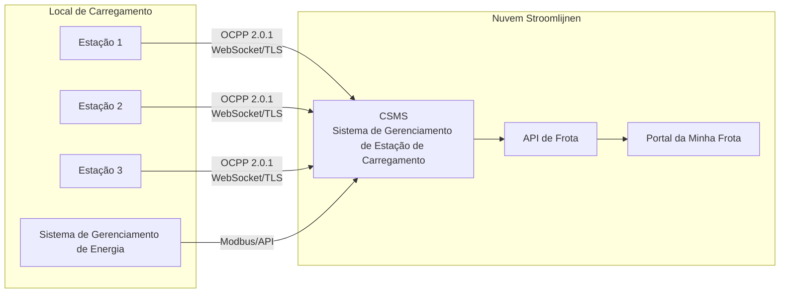

# Visão Geral do OCPP

**OCPP (Open Charge Point Protocol)** é o protocolo de comunicação padrão da indústria entre estações de carregamento e um sistema de gerenciamento central. A Stroomlijnen utiliza o OCPP para gerenciar, monitorar e controlar todas as nossas estações de carregamento de forma remota.

## O que é OCPP?

OCPP define como uma estação de carregamento (Charge Point) se comunica com um Sistema de Gerenciamento de Estação de Carregamento (CSMS — que somos nós). Isso inclui:

- **Autorização** — Verificar se um usuário/veículo pode carregar
- **Gerenciamento de Sessão** — Iniciar, monitorar e parar sessões de carregamento
- **Medição** — Relatar o consumo de energia em tempo real
- **Controle Remoto** — Iniciar/parar sessões de forma remota, ajustar a potência, reiniciar as estações de carregamento
- **Diagnóstico** — Atualizações de firmware, registro de logs, monitoramento de saúde
- **Carregamento Inteligente** — Gerenciamento dinâmico de potência em múltiplas estações de carregamento

## Versões do OCPP

| Versão | Status na Stroomlijnen | Recursos Principais |
|---------|----------------------|--------------|
| OCPP 1.6-J | ✅ Suportado | JSON/WebSocket, perfis de carregamento inteligentes, amplamente utilizado |
| OCPP 2.0.1 | ✅ Preferido | Integração com ISO 15118, modelo de dispositivo, segurança aprimorada, processamento de transações |

### Por que o OCPP 2.0.1 é Importante

OCPP 2.0.1 é uma atualização significativa em relação ao 1.6, especialmente para carregamento de frotas:

- **Integração com ISO 15118** — Suporte integrado para gerenciamento de certificados Plug & Charge via OCPP
- **Segurança Aprimorada** — Atualizações de firmware seguras, valores de medição assinados, TLS obrigatório
- **Modelo de Dispositivo** — Método padronizado para consultar as capacidades e configuração das estações de carregamento
- **Processamento de Transações** — Processamento melhorado de transações complexas (pré-autorização, estacionamento, energia)
- **Carregamento Inteligente** — Controle mais detalhado sobre perfis de carregamento e distribuição de potência
- **Mensagens de Exibição** — Envie mensagens personalizadas para a tela da estação de carregamento

Todas as novas estações de carregamento da Stroomlijnen são implantadas com OCPP 2.0.1. As estações existentes de 1.6-J continuam funcionando e serão atualizadas quando o hardware permitir.

## Arquitetura

### Fluxo de Comunicação

1. **Estação → CSMS:** A estação se conecta ao nosso CSMS via uma conexão WebSocket segura (wss://)
2. **Pulsos:** As estações enviam pulsos periódicos para confirmar que estão online
3. **Autorização:** Quando um usuário apresenta um passe RFID ou certificado PnC, a estação envia uma solicitação de autorização para o nosso CSMS
4. **Medição:** Durante o carregamento, os valores de medição (energia, potência, SoC) são enviados em intervalos regulares
5. **Comandos Externos:** O nosso CSMS pode enviar comandos para as estações (iniciar, parar, reiniciar, atualizar firmware)

## Carregamento Inteligente

As capacidades de carregamento inteligente do OCPP são essenciais para locais com capacidade de rede limitada:

### Perfis de Carregamento
Configuramos perfis de carregamento que informam cada estação sobre quanto de potência ela pode usar a qualquer momento:

- **TxDefaultProfile** — Limite de potência padrão para cada transação
- **TxProfile** — Ajuste de potência por transação
- **ChargingStationMaxProfile** — Limite de potência geral do local

### Distribuição de Tarefas
Quando várias estações carregam simultaneamente e o local tem capacidade de rede limitada:

1. O nosso EMS monitora a carga total do local (via Modbus/API)
2. O CSMS calcula a capacidade disponível por estação
3. Os perfis de carregamento são atualizados dinamicamente via OCPP
4. A potência é distribuída de forma justa ou com base na prioridade (com base nas configurações da frota)

Exemplo: Um local com 600 kW de capacidade de rede e 3 estações de 350 kW cada:
- 1 veículo carregando → recebe até 350 kW
- 2 veículos carregando → cada um recebe 300 kW
- 3 veículos carregando → cada um recebe 200 kW
- Durante os picos de demanda na rede → reduzido ainda mais para permanecer dentro da capacidade contratada

### Carregamento Agendado
Os gerentes de frota podem definir horários de partida e SoC desejados. O nosso sistema otimiza quando carregar:
- Atrasa o início até que a eletricidade seja mais barata
- Garante que o SoC desejado seja alcançado antes do horário de partida
- Equilibra sobre todos os veículos no local

## Segurança

Recursos de segurança do OCPP 2.0.1 que implementamos:

- **TLS 1.3** — Todas as conexões OCPP são criptografadas
- **Certificados de Cliente** — As estações se autenticam em nosso CSMS com certificados
- **Valores de Medição Assinados** — Medidas de energia resistentes a manipulação
- **Atualizações de Firmware Seguras** — Imagens de firmware criptograficamente assinadas
- **Controle de Acesso** — Restrições de acesso físico e de rede em cada local

## Para Parceiros de Hardware

Se você é um fabricante ou instalador de estações de carregamento que trabalha com a Stroomlijnen:

- Nós exigimos **conformidade com o OCPP 2.0.1** (1.6-J aceito para estoque existente)
- As estações devem suportar **ISO 15118-2** PnC
- TLS 1.2+ é obrigatório
- Fornecemos pontos de extremidade e dados do CSMS durante o processo de integração
- Testes de interoperabilidade são necessários para implantação

Entre em contato conosco via [technical@stroomlijnen.nl](mailto:technical@stroomlijnen.nl) para obter documentação de integração.