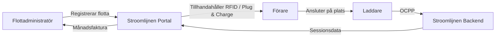

# Vad är Stroomlijnen?

Stroomlijnen B.V. är en nederländsk **Charge Point Operator (CPO)** och **e-Mobility Service Provider (eMSP)** som bygger och driver laddinfrastruktur för elfordon vid **teatrar** och **logistiska lokaler** i hela Nederländerna.

## Vad vi gör

Vi installerar, driver och underhåller högeffektladdstationer som är specifikt utformade för **el-lastbilar och företagsfordon**. Våra laddare står på lokaler med stora befintliga nätanslutningar — främst teatrar, evenemangslokaler och logistiska nav.

### Varför teatrar?

Teatrar har något som de flesta lokaler inte har: **enorma el-anslutningar** (ofta 400–2000 kVA) som inte används på dagen. Föreställningarna är på kvällen. Lastbilar laddas på dagen. Infrastrukturen finns redan — vi sätter den i arbete.

### Vår eMSP-identitet

Vi opererar under **NL\*STM** eMSP-identiteten i det nederländska och europeiska laddnätverket. Det betyder:

- Era förare kan använda våra RFID-kort eller Plug & Charge på **varje** offentlig laddare i Nederländerna och Europa (via roaming)
- Kunder från andra eMSP kan ladda på våra lokaler
- Fullständig interoperabilitet via OCPI-protokollet

## Hur flottladdning fungerar

1. **Registrera** er flotta på Stroomlijnen-portalen
2. **Konfigurera** era fordon — RFID-kort, Plug & Charge eller båda
3. **Förare laddar** på valfri Stroomlijnen-lokal (eller hos roamingpartner)
4. **Ni får** detaljerade sessionsdata, energirapporter och en månadsfaktura

## Viktigaste funktionerna

| Funktion | Beskrivning |
|---------|-------------|
| **Plug & Charge** | ISO 15118 automatisk autentisering — ingen kort behövs |
| **RFID-kort** | Traditionell kortbaserad laddning med NL*STM-identitet |
| **Flottportal** | Realtids sessionsdata, fordonshantering, fakturering |
| **Smart laddning** | Uppdelning för optimala energikostnader och nätverkan |
| **OCPP 2.0.1** | Senaste protokollstandarden för laddarhantering |
| **Roaming** | Laddning på 300.000+ punkter i hela Europa via OCPI |

## Vad finns i denna kunskapsbank?

Denna webbplats innehåller allt du behöver veta:

- **[Kom igång](/docs/getting-started/first-session)** — Er första laddningssession
- **[Plug & Charge](/docs/plug-and-charge/what-is-pnc)** — Framtiden för smidig laddning
- **[Flottadministration](/docs/fleet-management/overview)** — Hantera er laddflotta
- **[Teknisk](/docs/technical/ocpp-overview)** — Djupgående insikt i teknologin
- **[FAQ](/docs/faq)** — Vanliga frågor besvarade

:::tip Föreställningen måste gå vidare
Vår slogan är inte bara en marknadsföringsstrategi. Den speglar vår tillägnelse: om er flotta måste laddas, **måste** infrastrukturen vara redo. Tillförlitlighet på teaterns nivå betyder att vara förberedd på alla scenarier.
:::