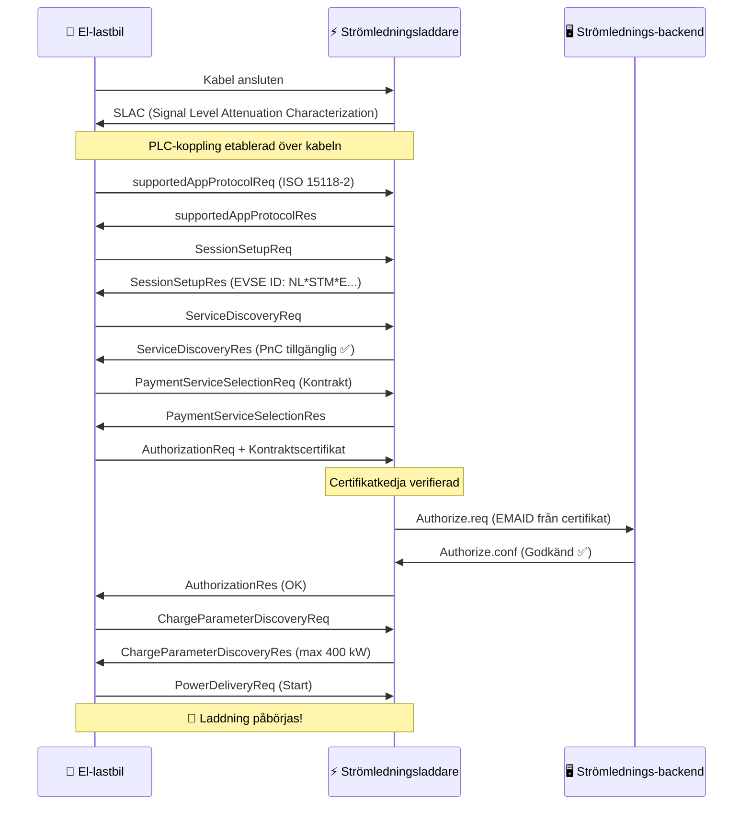

# Hur Plug & Charge Fungerar

Plug & Charge (PnC) ersätter fysiska token (RFID-kort, appar) med **kryptografiska certifikat** som är inbyggda i fordonet. När en PnC-kompatibel lastbil ansluter till en PnC-kompatibel laddare, utför de en digital handskakning — där de verifierar identitet, auktoriserar sessionen och startar energitillförsel — allt in några sekunder.

## Protokollet: ISO 15118

ISO 15118 är den internationella standard som definierar hur elfordon kommunicerar med laddstationer via laddkabeln. Det går långt utöver enkel energitillförsel:

- **ISO 15118-2** — Den breda versionen för AC- och DC-laddning med PnC-stöd
- **ISO 15118-20** — Nästa generation, med bidirektionell energiöverföring (V2G) och förbättrad certifikathantering
- **ISO 15118-3** — Fysisk lager och datalänklager (PLC-kommunikation över kabeln)

Strömledningsladdare stöder nu ISO 15118-2, med ISO 15118-20-beredskap inbyggd i vår hårdvara.

## Certifikatkedjan

PnC-säkerhet bygger på en **Public Key Infrastructure (PKI)** — samma teknik som säkrar internetbanker och HTTPS-webbplatser. Detta är hierarkin:

```
V2G Root CA (t.ex. Hubject)
├── CPO Sub-CA (Strömledning)
│   └── EVSE-bladcertifikat (enskild laddare)
└── eMSP Sub-CA (Strömledning / roamingpartner)
    └── Kontraktscertifikat (installerat i din lastbil)
```

Varje certifikat är undertecknat av det överordnade, vilket skapar en **förtroendekedja** som både fordonet och laddaren kan verifiera oberoende.

## Handshake — Steg för Steg



### Vad som Händer i Vanlig Ordning

1. **Fysisk anslutning** — Föraren ansluter CCS-kabeln
2. **Kommunikationskoppling** — Lastbilen och laddaren etablerar en datakoppling via kabeln via Power Line Communication (PLC)
3. **Protokollförhandling** — De kommer överens om att använda ISO 15118-2
4. **Identitetsutbyte** — Lastbilen presenterar sitt **kontraktscertifikat**, som innehåller EMAID (e-Mobility Account Identifier) som kopplar den till ett faktureringskonto
5. **Certifikatverifiering** — Laddaren verifierar certifikatkedjan till en betrodd rot-CA
6. **Backend-auktorisering** — Laddaren kontrollerar med Strömlednings-backend om denna EMAID är giltig och har ett aktivt kontrakt
7. **Laddparametrar** — De förhandlar om effektnivåer (spänning, ström, maximal effekt)
8. **Energi flödar** — Laddning startar automatiskt

Hela processen tar **3–8 sekunder** från anslutning till energitillförsel.

## Kärnkoncept

### Kontraktscertifikat

Ett digitalt certifikat installerat i fordonets dator. Det innehåller:

- **EMAID** — Din unika e-Mobility Account Identifier (t.ex. `NL-STM-C00001234-5`)
- **Publik nyckel** — Används för TLS-autentisering
- **Giltighetsperiod** — Vanligtvis 1–2 år
- **Utgivare** — eMSP (Strömledning eller roamingpartner)

Lastbilen lagrar detta certifikat säkert och presenterar det automatiskt vid varje PnC-kompatibel laddare.

### EVSE-certifikat

Laddarens eget certifikat, som bevisar att det är ett legitimt Strömlednings-laddpunkt. Detta förhindrar att illvilliga laddare kapar inloggningsuppgifter.

### Certificate Provisioning Service (CPS)

Systemet som installerar kontraktscertifikat i fordon och uppdaterar dem. När du registrerar en lastbil i Strömlednings-portalen, kommer CPS att:

1. Generera ett kontraktscertifikat för fordonet
2. Skicka det via OEM:s backend till fordonet (Volvo Connect, DAF Connect, etc.)
3. Fordonet lagrar det i sitt säkra element

### Hubject

**Förtroendeankaret** för PnC i Europa. Hubject hanterar V2G Root CA och certifikatpoolen som möjliggör cross-operator-kompatibilitet. När en Strömlednings-laddare möter en lastbil med ett certifikat från en annan eMSP, verifierar Hubjects infrastruktur kedjan.

## Säkerhet

PnC är **säkrare** än RFID-kort:

| Aspekt | RFID | Plug & Charge |
|--------|------|---------------|
| Autentisering | Statisk token (kan klonas) | TLS ömsesidig autentisering |
| Kryptering | Inget | AES-256 via PLC |
| Identitetskoppling | Kort ↔ konto (löst) | Certifikat ↔ fordon-VIN (starkt) |
| Återkallande | Måste ta tillbaka kortet fysiskt | Certifikat kan återkallas på distans |
| Bedrägeririsk | Kortstöld/-kloning | Mycket svårt (hårdvarusekuritetsmodul) |

## Krav

För Plug & Charge krävs tre saker:

1. **Fordonstöd** — Lastbilen måste ha ISO 15118-PnC-funktion och ett giltigt kontraktscertifikat installerat
2. **Laddarstöd** — EVSE måste stödja ISO 15118-2 med PnC (alla Strömlednings DC-laddare gör det)
3. **Backend-integration** — eMSP och CPO måste vara anslutna via certifikatekosystemet (Hubject)

## Vad som Kommer: Vehicle-to-Grid (V2G)

ISO 15118-20 utökar PnC med bidirektionell energiöverföring. En flotta el-lastbilar som parkerar vid en teater på natten kunde:

- Ladda när elektricitet är billigast (dal-/topptimmar)
- Leverera energi tillbaka till nätet under toppbelastning
- Generera inkomster för flottans ägare

Strömlednings hårdvara är V2G-klar. Så snart lastbils-OEM:er aktiverar ISO 15118-20, kommer vi att aktivera bidirektionellt laddning på våra platser.

---

**Nästa:** [Kompatibla fordon →](./compatible-vehicles)